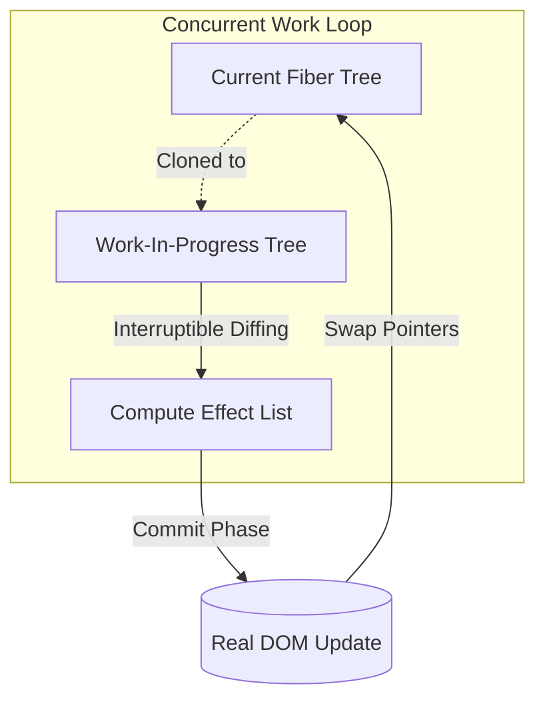

# React Core Architecture, Hooks, Redux & Fiber Performance Master Interview Bank (1 - 407)

> The definitive React interview questions covering Core React, JSX, Virtual DOM, Fiber architecture, Hooks, Context API, Redux Toolkit, React Router v6, Concurrent Features, and Action hooks.

---

### 1. What is React?
React (aka React.js or ReactJS) is an **open-source front-end JavaScript library** for building user interfaces based on components. It's used for handling the view layer in web and mobile applications, and allows developers to create reusable UI components and manage the state of those components efficiently.

React was created by [Jordan Walke](https://github.com/jordwalke), a software engineer at Facebook (now Meta). It was first deployed on Facebook's News Feed in 2011 and on Instagram in 2012. The library was open-sourced in May 2013 and has since become one of the most popular JavaScript libraries for building modern user interfaces.

#### Practical Code Example

```jsx
import React from 'react';
import { createRoot } from 'react-dom/client';

function App() {
  return <h1>Hello, Modern React!</h1>;
}

const root = createRoot(document.getElementById('root'));
root.render(<App />);
```

---

### 2. What is the history behind React evolution?
The history of ReactJS started in 2010 with the creation of **XHP**. XHP is a PHP extension which improved the syntax of the language such that XML document fragments become valid PHP expressions and the primary purpose was used to create custom and reusable HTML elements.

The main principle of this extension was to make front-end code easier to understand and to help avoid cross-site scripting attacks. The project was successful to prevent the malicious content submitted by the scrubbing user.

But there was a different problem with XHP in which dynamic web applications require many roundtrips to the server, and XHP did not solve this problem. Also, the whole UI was re-rendered for small change in the application. Later, the initial prototype of React is created with the name **FaxJ** by Jordan inspired from XHP. Finally after sometime React has been introduced as a new library into JavaScript world.

<details>
    <summary><b>See deep-dive answer</b></summary>
    The evolution of React has a fascinating history that spans over a decade:

**2010-2011: The Origins**
- The journey began with **XHP**, a PHP extension created at Facebook that allowed HTML components to be used in PHP code
- XHP improved front-end code readability and helped prevent cross-site scripting (XSS) attacks
- However, XHP had limitations with dynamic web applications, requiring frequent server roundtrips and complete UI re-renders for small changes

**2011-2012: Early Development**
- Jordan Walke created the first prototype called **FaxJS** (later renamed to React), inspired by XHP's component model
- The key innovation was bringing XHP's component model to JavaScript with performance improvements
- React introduced the Virtual DOM concept to solve the performance issues of full page re-renders
- First deployed internally on Facebook's News Feed in 2011 and Instagram in 2012

**2013: Public Release**
- React was officially open-sourced at JSConf US in May 2013
- Initial public reception was mixed, with some developers skeptical about the JSX syntax and the approach of mixing markup with JavaScript

**2014-2015: Growing Adoption**
- React Native was announced in 2015, extending React's paradigm to mobile app development
- The ecosystem began to grow with tools like Redux for state management
- Companies beyond Facebook began adopting React for production applications

**2016-2018: Maturation**
- React 16 ("Fiber") was released in 2017 with a complete rewrite of the core architecture
- Introduction of new features like Error Boundaries, Portals, and improved server-side rendering
- React 16.3 introduced the Context API for easier state management

**2019-Present: Modern React**
- React Hooks were introduced in React 16.8 (February 2019), revolutioni

### 3. What are the major features of React?
React offers a powerful set of features that have made it one of the most popular JavaScript libraries for building user interfaces:

**Core Features:**

- **Component-Based Architecture**: React applications are built using components - independent, reusable pieces of code that return HTML via a render function. This modular approach enables better code organi

### 4. What is JSX?
_JSX_ stands for _JavaScript XML_ and it is an XML-like syntax extension to ECMAScript. Basically it just provides the syntactic sugar for the `React.createElement(type, props, ...children)` function, giving us expressiveness of JavaScript along with HTML like template syntax.

In the example below, the text inside `<h1>` tag is returned as JavaScript function to the render function.

```jsx
export default function App() {
return <h1 className="greeting">{"Hello, this is a JSX Code!"}</h1>;
}
```

If you don't use JSX syntax then the respective JavaScript code should be written as below,

```javascript
import { createElement } from "react";

export default function App() {
return createElement(
 "h1",
 { className: "greeting" },
 "Hello, this is a JSX Code!"
);
}
```

<details><summary><b>See Class</b></summary>
<p>

```jsx
class App extends React.Component {
render() {
 return <h1 className="greeting">{"Hello, this is a JSX Code!"}</h1>;
}
}
```

</p>
</details>

**Note:** JSX is stricter than HTML

---

### 5. What is the difference between an Element and a Component?
**Element:**
- A React **Element** is a plain JavaScript object that describes what you want to see on the UI. It represents a DOM node or a component at a specific point in time. 
- Elements are immutable: once created, you cannot change their properties. Instead, you create new elements to reflect updates.
- Elements can be nested within other elements through their `props`.
- Creating an element is a fast, lightweight operation—it does **not** create any actual DOM nodes or render anything to the screen directly.

 **Example (without JSX):**
```js
 const element = React.createElement("button", { id: "login-btn" }, "Login");
```

 **Equivalent JSX syntax:**
```jsx
 <button id="login-btn">Login</button>
```

 **The object returned by `React.createElement`:**
```js
 {
   type: 'button',
   props: {
     id: 'login-btn',
     children: 'Login'
   }
 }
```
 Elements are then passed to the React DOM renderer (e.g., `ReactDOM.render()`), which translates them to actual DOM nodes.

 ---

**Component:**
- A **Component** is a function or class that returns an element (or a tree of elements) to describe part of the UI. Components can accept inputs (called **props**) and manage their own state (in case of class or function components with hooks).
- Components allow you to split the UI into independent, reusable pieces, each isolated and composable.
- You can define a component using a function or a class:

 **Example (Function Component with JSX):**
```jsx
 const Button = ({ handleLogin }) => (
   <button id="login-btn" onClick={handleLogin}>
     Login
   </button>
 );
```

 When JSX is compiled, it's transformed into a tree of `React.createElement` calls:

```js
 const Button = ({ handleLogin }) =>
   React.createElement(
     "button",
     { id: "login-btn", onClick: handleLogin },
     "Login"
   );
```

 ---

**In summary:**
- **Elements** are the smallest building blocks in React—objects that describe what you want to see.
- **Components** are functions or classes that return elements and encapsulate logic, structure, and behavior for parts of your UI.

> Think of **elements** as the instructions for creating UI, and **components** as reusable blueprints that combine logic and structure to generate those instructions.

---

### 6. How to create components in React?
Components are the building blocks of creating User Interfaces(UI) in React. There are two possible ways to create a component.

1. **Function Components:** This is the simplest way to create a component. Those are pure JavaScript functions that accept props object as the one and only one parameter and return React elements to render the output:

```jsx
function Greeting({ message }) {
  return <h1>{`Hello, ${message}`}</h1>;
}
```

2. **Class Components:** You can also use ES6 class to define a component. The above function component can be written as a class component:

```jsx
class Greeting extends React.Component {
  render() {
    return <h1>{`Hello, ${this.props.message}`}</h1>;
  }
}
```

---

### 7. When to use a Class Component over a Function Component?
After the addition of Hooks(i.e. React 16.8 onwards) it is always recommended to use Function components over Class components in React. Because you could use state, lifecycle methods and other features that were only available in class component present in function component too.

But even there are two reasons to use Class components over Function components.

1. If you need a React functionality whose Function component equivalent is not present yet, like Error Boundaries.
2. In older versions, If the component needs _state or lifecycle methods_ then you need to use class component.

So the summary to this question is as follows:

**Use Function Components:**

- If you don't need state or lifecycle methods, and your component is purely presentational.
- For simplicity, readability, and modern code practices, especially with the use of React Hooks for state and side effects.

**Use Class Components:**

- If you need to manage state or use lifecycle methods.
- In scenarios where backward compatibility or integration with older code is necessary.

**Note:** You can also use reusable [react error boundary](https://github.com/bvaughn/react-error-boundary) third-party component without writing any class. i.e, No need to use class components for Error boundaries.

The usage of Error boundaries from the above library is quite straight forward.

> **_Note when using react-error-boundary:_** ErrorBoundary is a client component. You can only pass props to it that are seriali

### 8. What are Pure Components?
Pure components are the components which render the same output for the same state and props. In function components, you can achieve these pure components through memoi

### 9. What is state in React?
_State_ of a component is an object that holds some information that may change over the lifetime of the component. The important point is whenever the state object changes, the component re-renders. It is always recommended to make our state as simple as possible and minimi

### 10. What are props in React?
_Props_ are inputs to components. They are single values or objects containing a set of values that are passed to components on creation similar to HTML-tag attributes. Here, the data is passed down from a parent component to a child component.

The primary purpose of props in React is to provide following component functionality:

1. Pass custom data to your component.
2. Trigger state changes.
3. Use via `this.props.reactProp` inside component's `render()` method.

For example, let us create an element with `reactProp` property:

```jsx
<Element reactProp={"1"} />
```

This `reactProp` (or whatever you came up with) attribute name then becomes a property attached to React's native props object which originally already exists on all components created using React library.

```jsx
props.reactProp;
```

For example, the usage of props in function component looks like below:

```jsx
import React from "react";
import ReactDOM from "react-dom";

const ChildComponent = (props) => {
return (
 <div>
   <p>{props.name}</p>
   <p>{props.age}</p>
   <p>{props.gender}</p>
 </div>
);
};

const ParentComponent = () => {
return (
 <div>
   <ChildComponent name="John" age="30" gender="male" />
   <ChildComponent name="Mary" age="25" geneder="female" />
 </div>
);
};
```

The properties from props object can be accessed directly using destructing feature from ES6 (ECMAScript 2015). It is also possible to fallback to default value when the prop value is not specified. The above child component can be simplified like below.

```jsx
const ChildComponent = ({ name, age, gender = "male" }) => {
return (
<div>
<p>{name}</p>
<p>{age}</p>
<p>{gender}</p>
</div>
);
};
```

**Note:** The default value won't be used if you pass `null` or `0` value. i.e, default value is only used if the prop value is missed or `undefined` value has been passed.

<details><summary><b>See Class</b></summary>
The Props accessed in Class Based Component as below

```jsx
import React from "react";
import ReactDOM from "react-dom";

class ChildComponent extends React.Component {
render() {
return (
<div>
 <p>{this.props.name}</p>
 <p>{this.props.age}</p>
 <p>{this.props.gender}</p>
</div>
);
}
}

class ParentComponent extends React.Component {
render() {
return (
<div>
 <ChildComponent name="John" age="30" gender="male" />
 <ChildComponent name="Mary" age="25" gender="female" />
</div>
);
}
}
```

</details>

---

### 11. What is the difference between state and props?
In React, both **state** and **props** are plain JavaScript objects, but they serve different purposes and have distinct behaviors:

#### State
- **Definition:**  
State is a data structure that is managed within a component. It represents information that can change over the lifetime of the component.
- **Mutability:**  
State is mutable, meaning it can be changed using the setter function (`setState` in class components or the updater function from `useState` in functional components).
- **Scope:**  
State is local to the component where it is defined. Only that component can modify its own state.
- **Usage:**  
State is typically used for data that needs to change in response to user actions, network responses, or other dynamic events.
- **Re-rendering:**  
Updating the state triggers a re-render of the component and its descendants.

#### Props
- **Definition:**  
Props (short for “properties”) are inputs to a component, provided by its parent component.
- **Mutability:**  
Props are read-only. A component cannot modify its own props; they are immutable from the component’s perspective.
- **Scope:**  
Props are used to pass data and event handlers down the component tree, enabling parent components to configure or communicate with their children.
- **Usage:**  
Props are commonly used to make components reusable and configurable. They allow the same component to be rendered with different data or behavior.
- **Analogy:**  
Think of props as arguments to a function, whereas state is like variables declared inside the function.

#### Summary Table

| Feature   | State                               | Props                             |
|-----------|-------------------------------------|-----------------------------------|
| Managed by| The component itself                | Parent component                  |
| Mutable   | Yes                                 | No (read-only)                    |
| Scope     | Local to the component              | Passed from parent to child       |
| Usage     | Manage dynamic data and UI changes  | Configure and customi

### 12. What is the difference between HTML and React event handling?
Below are some of the main differences between HTML and React event handling,

1. In HTML, the event name usually represents in _lowercase_ as a convention:

```html
<button onclick="activateLasers()"></button>
```

Whereas in React it follows _camelCase_ convention:

```jsx
<button onClick={activateLasers}>
```

2. In HTML, you can return `false` to prevent default behavior:

```html
<a
  href="#"
  onclick='console.log("The link was clicked."); return false;'
/>
```

Whereas in React you must call `preventDefault()` explicitly:

```javascript
function handleClick(event) {
  event.preventDefault();
  console.log("The link was clicked.");
}
```

3. In HTML, you need to invoke the function by appending `()`
Whereas in react you should not append `()` with the function name. (refer "activateLasers" function in the first point for example)

---

### 13. What are synthetic events in React?
`SyntheticEvent` is a cross-browser wrapper around the browser's native event. Its API is same as the browser's native event, including `stopPropagation()` and `preventDefault()`, except the events work identically across all browsers. The native events can be accessed directly from synthetic events using `nativeEvent` attribute.

Let's take an example of `BookStore` title search component with the ability to get all native event properties

```js
function BookStore() {
function handleTitleChange(e) {
 console.log("The new title is:", e.target.value);
 console.log('Synthetic event:', e); // React SyntheticEvent
 console.log('Native event:', e.nativeEvent); // Browser native event
 e.stopPropagation();
 e.preventDefault();
}

return <input name="title" onChange={handleTitleChange} />;
}
```

List of common synthetic events are:

*   `onClick`
*   `onChange`
*   `onSubmit`
*   `onKeyDown`, `onKeyUp`
*   `onFocus`, `onBlur`
*   `onMouseEnter`, `onMouseLeave`
*   `onTouchStart`, `onTouchEnd`

---

### 14. What are inline conditional expressions?
You can use either _if statements_ or _ternary expressions_ which are available in JS(and JSX in React) to conditionally execute or render expressions. Apart from these approaches, you can also embed any expressions in JSX by wrapping them in curly braces and then followed by JS logical operator `&&`. It is helpful to render elements conditionally within a single line and commonly used for concise logic, especially in JSX rendering.

```jsx
<h1>Hello!</h1>;
{
messages.length > 0 && !isLogin ? (
 <h2>You have {messages.length} unread messages.</h2>
) : (
 <h2>You don't have unread messages.</h2>
);
}
```

---

### 15. What is "key" prop and what is the benefit of using it in arrays of elements?
A `key` is a special attribute you **should** include when mapping over arrays to render data. _Key_ prop helps React identify which items have changed, are added, or are removed.

Keys should be unique among its siblings. Most often we use ID from our data as _key_:

```jsx
const todoItems = todos.map((todo) => <li key={todo.id}>{todo.text}</li>);
```

When you don't have stable IDs for rendered items, you may use the item _index_ as a _key_ as a last resort:

```jsx
const todoItems = todos.map((todo, index) => (
<li key={index}>{todo.text}</li>
));
```
**Benefits of key:**
*   Enables React to **efficiently update and re-render** components.
*   Prevents unnecessary re-renders by **reusing** components when possible.
*   Helps **maintain internal state** of list items correctly.

**Note:**

1. Using _indexes_ for _keys_ is **not recommended** if the order of items may change. This can negatively impact performance and may cause issues with component state.
2. If you extract list item as separate component then apply _keys_ on list component instead of `li` tag.
3. There will be a warning message in the console if the `key` prop is not present on list items.
4. The key attribute accepts either string or number and internally convert it as string type.
5. Don't generate the key on the fly something like `key={Math.random()}`. Because the keys will never match up between re-renders and DOM created everytime.

---

### 16. What is Virtual DOM?
The _Virtual DOM_ (VDOM) is a lightweight, in-memory representation of _Real DOM_ used by libraries like React to optimi

### 17. How Virtual DOM works?
The _Virtual DOM_ works in five simple steps.

**1. Initial Render**  
 When a UI component renders for the first time, it returns JSX. React uses this structure to create a Virtual DOM tree, which is a lightweight copy of the actual DOM. This Virtual DOM is then used to build and render the Real DOM in the browser.

**2. State or Props Change**  
 When the component's state or props change, React creates a new Virtual DOM reflecting the updated UI. However, it doesn't immediately update the Real DOM; instead, it works in memory to prepare for an efficient update.
        


**3. Diffing Algorithm**  
 React then compares the new Virtual DOM with the previous one using a process called diffing. It determines what has changed between the two versions and identifies the minimal set of updates needed.

  

**4. Reconciliation**  
 Based on the diffing results, React decides which parts of the Real DOM should be updated. It avoids re-rendering the entire DOM and instead updates only the elements that actually changed.
 


**5. Efficient DOM Updates**  
 This entire process—working with the Virtual DOM, diffing, and selective updating—makes the UI rendering much faster and more efficient than manipulating the Real DOM directly.

#### Practical Code Example

```jsx
// Step 1: Render returns Virtual DOM tree
// Step 2: React computes diff against previous Virtual DOM snapshot (Reconciliation)
// Step 3: Only the changed node is patched into real DOM:
function NotificationBadge({ unreadCount }) {
  // Only the text node inside <span> is patched when unreadCount changes!
  return <span className="badge">{unreadCount}</span>;
}
```

---

### 18. What is the difference between Shadow DOM and Virtual DOM?
The _Shadow DOM_ is a browser technology designed primarily for scoping variables and CSS in _web components_. The _Virtual DOM_ is a concept implemented by libraries in JavaScript on top of browser APIs.

The key differences in a table format shown below:

| Feature | Shadow DOM | Virtual DOM |
| --- | --- | --- |
| Purpose | Encapsulation for Web Components | Efficient UI rendering |
| Managed by | Browser | JS frameworks (e.g., React) |
| DOM Type | Part of real DOM (scoped) | In-memory representation |
| Encapsulation | Yes | No |
| Use Case | Web Components, scoped styling | UI diffing and minimal DOM updates |

#### Practical Code Example

```javascript
// 1. Shadow DOM: Browser standard for scoping encapsulated CSS & DOM subtrees (Web Components)
const host = document.querySelector('#host');
const shadowRoot = host.attachShadow({ mode: 'open' });
shadowRoot.innerHTML = '<style>p { color: red; }</style><p>Shadow DOM</p>';

// 2. Virtual DOM: In-memory JavaScript object graph used by React for fast diffing.
```

---

### 19. What is React Fiber?
**React Fiber** is the **new reconciliation engine** in React, introduced in React 16. It’s a complete rewrite of React’s core algorithm(old stack-based algorithm) for rendering and updating the UI. Fiber enhances React’s ability to handle **asynchronous rendering**, **prioriti

### 20. What is the main goal of React Fiber?
The goal of _React Fiber_ is to increase its suitability for areas like animation, layout, and gestures. Its headline feature is **incremental rendering**: the ability to split rendering work into chunks and spread it out over multiple frames.

Its main goals are:

*   **Incremental Rendering** – Breaks work into chunks for smoother updates.
*   **Interruptible Rendering** – Pauses and resumes rendering to keep the UI responsive.
*   **Prioriti

### 21. What are controlled components?
A **controlled component** is a React component that **fully manages the form element's state**(e.g, elements like `<input>`, `<textarea>`, or `<select>`))  using React's internal state mechanism. i.e, The component does not manage its own internal state — instead, React acts as the single source of truth for form data.

The controlled components will be implemented using the below steps,

1. Initiali

### 22. What are uncontrolled components?
The **Uncontrolled components** are form elements (like `<input>`, `<textarea>`, or `<select>`) that **manage their own state internally** via the **DOM**, rather than through React state.
You can query the DOM using a `ref` to find its current value when you need it. This is a bit more like traditional HTML.

The uncontrolled components will be implemented using the below steps,

1. Create a ref using `useRef` react hook in function component or `React.createRef()` in class based component.
2. Attach this `ref` to the form element.
3. The form element value can be accessed directly through `ref` in event handlers or `componentDidMount` for class components

In the below UserProfile component, the `username` input is accessed using ref.

```jsx
import React, { useRef } from "react";

function UserProfile() {
const usernameRef = useRef(null);

const handleSubmit = (event) => {
 event.preventDefault();
 console.log("The submitted username is: " + usernameRef.current.value);
};

return (
 <form onSubmit={handleSubmit}>
   <label>
     Username:
     <input type="text" ref={usernameRef} />
   </label>
   <button type="submit">Submit</button>
 </form>
);
}
```
**Note:** Here, DOM is in charge of the value. React only accesses the value when needed (via `ref`).

**Benefits:**
*   **Less boilerplate** — no need for `useState` and `onChange`.
*   Useful for **quick form setups** or when integrating with **non-React code**.
*   Slightly better **performance** in very large forms (fewer re-renders).

In most cases, it's recommend to use controlled components to implement forms. In a controlled component, form data is handled by a React component. The alternative is uncontrolled components, where form data is handled by the DOM itself.

<details><summary><b>See Class</b></summary>
<p>

```jsx
class UserProfile extends React.Component {
constructor(props) {
 super(props);
 this.handleSubmit = this.handleSubmit.bind(this);
 this.input = React.createRef();
}

handleSubmit(event) {
 alert("A name was submitted: " + this.input.current.value);
 event.preventDefault();
}

render() {
 return (
   <form onSubmit={this.handleSubmit}>
     <label>
       {"Name:"}
       <input type="text" ref={this.input} />
     </label>
     <input type="submit" value="Submit" />
   </form>
 );
}
}
```

</p>
</details>

---

### 23. What is the difference between createElement and cloneElement?
Both `React.createElement` and `React.cloneElement` are used to work with React elements, but they serve different purposes.

#### **createElement:** 
Creates a new React element from scratch. JSX elements will be transpiled to `React.createElement()` functions to create React elements which are going to be used for the object representation of UI.
**Syntax:**
```jsx
React.createElement(type, props, ...children)
```
**Example:**
```jsx
React.createElement('button', { className: 'btn' }, 'Click Me')
```
#### **cloneElement:**
The `cloneElement` method is used to clone an existing React element and optionally adds or overrides props.

**Syntax:**
```jsx
React.cloneElement(element, newProps, ...children)
```
**Example:**
```jsx
const button = <button className="btn">Click Me</button>;
const cloned = React.cloneElement(button, { className: 'btn-primary' });
// Result: <button className="btn-primary">Click Me</button>
```

---

### 24. What is Lifting State Up in React?
When several components need to share the same changing data then it is recommended to _lift the shared state up_ to their closest common ancestor. That means if two child components share the same data from its parent, then move the state to parent instead of maintaining local state in both of the child components.

#### Practical Code Example

```jsx
// Lifting State Up: Moving shared state to closest common ancestor
function Parent() {
  const [temperature, setTemperature] = useState(25);

  return (
    <div>
      <TemperatureInput temp={temperature} onTempChange={setTemperature} />
      <BoilingVerdict celsius={temperature} />
    </div>
  );
}
```

---

### 25. What are Higher-Order Components?
A _higher-order component_ (_HOC_) is a function that takes a component and returns a new enhanced component with additional props, behavior, or data. It’s a design pattern based on React’s compositional nature, allowing you to reuse logic across multiple components without modifying their internals.

We consider HOCs **pure components** because they don’t mutate or copy behavior from the original component—they simply **wrap it**, enhance it, and pass through the necessary props. The wrapped component remains decoupled and reusable.

```javascript
const EnhancedComponent = higherOrderComponent(WrappedComponent);
```
Let's take an example of a `withAuth` higher-order component (HOC) in React. This HOC will check if a user is authenticated and either render the wrapped component if authenticated or redirect (or show a message) if not.

**withAuth HOC Example:**
```jsx
import React from 'react';
import { Navigate } from 'react-router-dom'; // For redirection (assuming React Router v6)

const isAuthenticated = () => {
// e.g., check for a valid token in localStorage or context
return !!localStorage.getItem('authToken');
};

function withAuth(WrappedComponent) {
return function AuthenticatedComponent(props) {
 if (!isAuthenticated()) {
   // User is NOT authenticated, redirect to login page
   return <Navigate to="/login" replace />;
 }

 // User is authenticated, render the wrapped component
 return <WrappedComponent {...props} />;
};
}

export default withAuth;
```
**Usage**
```jsx
import React from 'react';
import withAuth from './withAuth';

function Dashboard() {
return <h1>Welcome to the Dashboard!</h1>;
}

// Wrap Dashboard with withAuth HOC
export default withAuth(Dashboard);
```

HOC can be used for many use cases:

1. Code reuse, logic and bootstrap abstraction (e.g., fetching data, permissions, theming).
2. Render hijacking (e.g., conditional rendering or layout changes).
3. State abstraction and manipulation(e.g., handling form logic).
4. Props manipulation(e.g., injecting additional props or filtering them).

Some of the real-world examples of HOCs in react eco-system:
1. connect() from react-redux
2. withRouter() from React Router v5
3. withTranslation() from react-i18next
4. withApollo() from Apollo client
5. withFormik from Formik library
6. withTheme from styled components

---

### 26. What is children prop?
The `children` prop is a special prop in React used to pass elements between the opening and closing tags of a component. It is commonly used in layout and wrapper componnents. 

A simple usage of children prop looks as below,

```jsx
function MyDiv({ children }){
 return (
   <div>
     {children}
   </div>;
 );
}

export default function Greeting() {
return (
 <MyDiv>
   <span>{"Hello"}</span>
   <span>{"World"}</span>
 </MyDiv>
);
}
```
Here, everything inside `<MyDiv>...</MyDiv>` is passed as children to the custom div component.

The children can be text, JSX elements, fragments, arrays and functions(for advance use case like render props).

<details><summary><b>See Class</b></summary>
<p>

```jsx
const MyDiv = React.createClass({
render: function () {
 return <div>{this.props.children}</div>;
},
});

ReactDOM.render(
<MyDiv>
 <span>{"Hello"}</span>
 <span>{"World"}</span>
</MyDiv>,
node
);
```

</p>
</details>

**Note:** There are several methods available in the legacy React API to work with this prop. These include `React.Children.map`, `React.Children.forEach`, `React.Children.count`, `React.Children.only`, `React.Children.toArray`.

---

### 27. How to write comments in React?
The comments in React/JSX are similar to JavaScript Multiline comments but are wrapped in curly braces.

**Single-line comments:**

```jsx
<div>
{/* Single-line comments(In vanilla JavaScript, the single-line comments are represented by double slash(//)) */}
{`Welcome ${user}, let's play React`}
</div>
```

**Multi-line comments:**

```jsx
<div>
{/* Multi-line comments for more than
one line */}
{`Welcome ${user}, let's play React`}
</div>
```

You can use `//` and `/* */` in JS logic, hooks, and functions.

---

### 28. What is reconciliation?
`Reconciliation` is the process through which React updates the Browser DOM and makes React work faster. React use a `diffing algorithm` so that component updates are predictable and faster. React would first calculate the difference between the `real DOM` and the copy of DOM `(Virtual DOM)` when there's an update of components.
React stores a copy of Browser DOM which is called `Virtual DOM`. When we make changes or add data, React creates a new Virtual DOM and compares it with the previous one. This comparison is done by `Diffing Algorithm`.
Now React compares the Virtual DOM with Real DOM. It finds out the changed nodes and updates only the changed nodes in Real DOM leaving the rest nodes as it is. This process is called _Reconciliation_.

#### Practical Code Example

```jsx
// Reconciliation: The heuristic O(N) diffing algorithm comparing element types & keys
// 1. Same Type: React updates changed props only
<div className="before" title="stuff" />
<div className="after" title="stuff" />

// 2. Different Type: Destroys old tree and builds new one from scratch
<div><Counter /></div>
<span><Counter /></span> // Counter unmounts and remounts!
```

---

### 29. Does the lazy function support named exports?
No, `React.lazy` currently supports default exports only. If the component you want to import is exported using named exports, you can create an intermediate module that re-exports it as the default, or resolve it using `.then()` on the dynamic import promise:

```jsx
// Resolving a named export with React.lazy
const MyComponent = React.lazy(() =>
  import('./MyComponents').then(module => ({ default: module.MyComponent }))
);
```

### 30. Why React uses className over class attribute?
React uses **className** instead of **class** because of a JavaScript naming conflict with the class keyword.

1. `class` is a reserved keyword in JavaScript
 In JavaScript, class is used to define ES6 classes:

```js
 class Person {
   constructor(name) {
     this.name = name;
   }
 }
```
 If you try to use class as a variable or property name, it will throw a syntax error. Since JSX is just JavaScript with XML-like syntax, using class directly in JSX would break the parser.

2. JSX Is JavaScript

 When you write JSX like this:
```jsx
 <div class="btn">Click</div>
```
 It will be compiled to:
```jsx
 React.createElement('div', { class: 'btn' }, 'Click');
```
 But `class` is invalid in this object literal context (since it clashes with the JS keyword), hence React instead uses className.
```jsx
 <div className="btn">Click</div>
```
 which compiles to:
```jsx
 React.createElement('div', { className: 'btn' }, 'Click');
```
 React then translates `className` to` class` in the final HTML DOM.

3. Aligns with DOM APIs
 In vanilla JavaScript, you interact with element classes using:
```js
 element.className = 'my-class';
```
 React follows this convention, staying consistent with the DOM API's property name rather than HTML’s attribute.

---

### 31. What are fragments?
It's a common pattern or practice in React for a component to return multiple elements. _Fragments_ let you group a list of children without adding extra nodes to the DOM.
You need to use either `<Fragment>` or a shorter syntax having empty tag (`<></>`).

Below is the example of how to use fragment inside _Story_ component.

```jsx
function Story({ title, description, date }) {
return (
 <Fragment>
   <h2>{title}</h2>
   <p>{description}</p>
   <p>{date}</p>
 </Fragment>
);
}
```

It is also possible to render list of fragments inside a loop with the mandatory **key** attribute supplied.

```jsx
function StoryBook() {
return stories.map((story) => (
 <Fragment key={story.id}>
   <h2>{story.title}</h2>
   <p>{story.description}</p>
   <p>{story.date}</p>
 </Fragment>
));
}
```

Usually, you don't need to use `<Fragment>` until there is a need of _key_ attribute. The usage of shorter syntax looks like below.

```jsx
function Story({ title, description, date }) {
return (
 <>
   <h2>{title}</h2>
   <p>{description}</p>
   <p>{date}</p>
 </>
);
}
```

---

### 32. Why fragments are better than container divs?
Below are the list of reasons to prefer fragments over container DOM elements,

1. Fragments are a bit faster and use less memory by not creating an extra DOM node. This only has a real benefit on very large and deep trees.
2. Some CSS mechanisms like _Flexbox_ and _CSS Grid_ have a special parent-child relationships, and adding divs in the middle makes it hard to keep the desired layout.
3. The DOM Inspector is less cluttered.

#### Practical Code Example

```jsx
// Fragment vs Div: Avoids invalid HTML tables and unnecessary CSS Flex/Grid wrapper bugs
function TableColumns() {
  return (
    <>
      <td>First Column</td>
      <td>Second Column</td>
    </>
  );
}
```

---

### 33. What are portals in React?
A Portal is a React feature that enables rendering children into a DOM node that exists outside the parent component's DOM hierarchy, while still preserving the React component hierarchy. Portals help avoid CSS stacking issues—for example, elements with position: fixed may not behave as expected inside a parent with transform. Portals solve this by rendering content (like modals or tooltips) outside such constrained DOM contexts.

```javascript
ReactDOM.createPortal(child, container);
```
*   `child`: Any valid React node (e.g., JSX, string, fragment).
*   `container`: A real DOM node (e.g., `document.getElementById('modal-root')`).

Even though the content renders elsewhere in the DOM, it still behaves like a normal child in React. It has access to context, state, and event handling.

**Example:- Modal:**
```jsx
function Modal({ children }) {
return ReactDOM.createPortal(
 <div className="modal">{children}</div>,
 document.body)
);
}
```
The above code will render the modal content into the body element in the HTML, not inside the component's usual location.

---

### 34. What are stateless components?
If the behaviour of a component is independent of its state then it can be a stateless component. You can use either a function or a class for creating stateless components. But unless you need to use a lifecycle hook in your components, you should go for function components. There are a lot of benefits if you decide to use function components here; they are easy to write, understand, and test, a little faster, and you can avoid the `this` keyword altogether.

#### Practical Code Example

```jsx
// Stateless (Presentational) Component: Pure function of props without local state
export function Header({ title, subtitle }) {
  return (
    <header>
      <h1>{title}</h1>
      <p>{subtitle}</p>
    </header>
  );
}
```

---

### 35. What are stateful components?
If the behaviour of a component is dependent on the _state_ of the component then it can be termed as stateful component. These _stateful components_ are either function components with hooks or _class components_.

Let's take an example of function stateful component which update the state based on click event,

```javascript
import React, {useState} from 'react';

const App = (props) => {
const [count, setCount] = useState(0);
handleIncrement() {
setCount(count+1);
}

return (
<>
 <button onClick={handleIncrement}>Increment</button>
 <span>Counter: {count}</span>
</>
)
}
```

<details><summary><b>See Class</b></summary>
<p>
The equivalent class stateful component with a state that gets initiali

### 36. How to apply validation on props in React?
When the application is running in _development mode_, React will automatically check all props that we set on components to make sure they have _correct type_. If the type is incorrect, React will generate warning messages in the console. It's disabled in _production mode_ due to performance impact. The mandatory props are defined with `isRequired`.

The set of predefined prop types:

1. `PropTypes.number`
2. `PropTypes.string`
3. `PropTypes.array`
4. `PropTypes.object`
5. `PropTypes.func`
6. `PropTypes.node`
7. `PropTypes.element`
8. `PropTypes.bool`
9. `PropTypes.symbol`
10. `PropTypes.any`

We can define `propTypes` for `User` component as below:

```jsx
import React from "react";
import PropTypes from "prop-types";

class User extends React.Component {
static propTypes = {
 name: PropTypes.string.isRequired,
 age: PropTypes.number.isRequired,
};

render() {
 return (
   <>
     <h1>{`Welcome, ${this.props.name}`}</h1>
     <h2>{`Age, ${this.props.age}`}</h2>
   </>
 );
}
}
```

**Note:** In React v15.5 _PropTypes_ were moved from `React.PropTypes` to `prop-types` library.

**Modern Recommendation:** While PropTypes are still supported, **TypeScript** is now the industry standard for type checking in React applications. Consider using TypeScript for better type safety, IDE support, and compile-time error detection.

_The Equivalent Functional Component_

```jsx
import React from "react";
import PropTypes from "prop-types";

function User({ name, age }) {
return (
 <>
   <h1>{`Welcome, ${name}`}</h1>
   <h2>{`Age, ${age}`}</h2>
 </>
);
}

User.propTypes = {
name: PropTypes.string.isRequired,
age: PropTypes.number.isRequired,
};
```

_Modern TypeScript Version_

```tsx
import React from "react";

interface UserProps {
name: string;
age: number;
}

function User({ name, age }: UserProps) {
return (
 <>
   <h1>{`Welcome, ${name}`}</h1>
   <h2>{`Age, ${age}`}</h2>
 </>
);
}
```

---

### 37. What are the advantages of React?
Below are the list of main advantages of React,

1. Increases the application's performance with _Virtual DOM_.
2. JSX makes code easy to read and write.
3. It renders both on client and server side (_SSR_).
4. Easy to integrate with frameworks (Angular, Backbone) since it is only a view library.
5. Easy to write unit and integration tests with tools such as Jest.

#### Practical Code Example

```jsx
// Core Advantages: High performance via Virtual DOM, rich component ecosystem, unidirectional data flow
function ReusableButton({ variant, children, onClick }) {
  return (
    <button className={`btn btn-${variant}`} onClick={onClick}>
      {children}
    </button>
  );
}
```

---

### 38. What are the limitations of React?
Apart from the advantages, there are few limitations of React too,

1. React is just a view library, not a full framework.
2. There is a learning curve for beginners who are new to web development.
3. Integrating React into a traditional MVC framework requires some additional configuration.
4. The code complexity increases with inline templating and JSX.
5. Too many smaller components leading to over engineering or boilerplate.

#### Practical Code Example

```jsx
// Limitation: React is a UI library, NOT a full-battery framework (requires external routing & state libs)
// npm install react-router-dom
import { BrowserRouter, Routes, Route } from 'react-router-dom';

export default function App() {
  return (
    <BrowserRouter>
      <Routes>
        <Route path="/" element={<h1>Home</h1>} />
      </Routes>
    </BrowserRouter>
  );
}
```

### 39. What are the recommended ways for static type checking?
**Modern Recommendation (2026):** **TypeScript** is the industry standard for type checking in React applications.

While PropTypes (`React.PropTypes` moved to `prop-types` package since React v15.5) are still available for runtime type checking, they have significant limitations:
- Only check types at runtime
- No compile-time errors
- Limited IDE autocomplete support
- No inference for complex types

**TypeScript is now the recommended approach** because it provides:
- Compile-time type checking
- Excellent IDE support with IntelliSense
- Type inference and generic types
- Better refactoring capabilities
- Growing ecosystem and community support

**Note:** Flow (Facebook's type checker) has seen declining adoption and is rarely used in new projects.

**Example with TypeScript:**
```tsx
interface UserProps {
name: string;
age: number;
isActive?: boolean;
}

function User({ name, age, isActive = true }: UserProps) {
return <div>{name} - {age}</div>;
}
```

---

### 40. What is the use of react-dom package?
The `react-dom` package provides _DOM-specific methods_ that can be used at the top level of your app. Most of the components are not required to use this module. Some of the methods of this package are:

1. `render()`
2. `hydrate()`
3. `unmountComponentAtNode()`
4. `findDOMNode()`
5. `createPortal()`

#### Practical Code Example

```jsx
// react-dom: The glue between React core logic and browser DOM
import { createRoot } from 'react-dom/client';
import App from './App';

const container = document.getElementById('root');
const root = createRoot(container);
root.render(<App />);
```

---

### 41. What is ReactDOMServer?
The `ReactDOMServer` object enables you to render components to static markup (typically used on node server). This object is mainly used for _server-side rendering_ (SSR). The following methods can be used in both the server and browser environments:

1. `renderToString()`
2. `renderToStaticMarkup()`

For example, you generally run a Node-based web server like Express, Hapi, or Koa, and you call `renderToString` to render your root component to a string, which you then send as response.

```javascript
// using Express
import { renderToString } from "react-dom/server";
import MyPage from "./MyPage";

app.get("/", (req, res) => {
res.write(
 "<!DOCTYPE html><html><head><title>My Page</title></head><body>"
);
res.write('<div id="content">');
res.write(renderToString(<MyPage />));
res.write("</div></body></html>");
res.end();
});
```

---

### 42. How to use innerHTML in React?
The `dangerouslySetInnerHTML` attribute is React's replacement for using `innerHTML` in the browser DOM. Just like `innerHTML`, it is risky to use this attribute considering cross-site scripting (XSS) attacks. You just need to pass a `__html` object as key and HTML text as value.

In this example MyComponent uses `dangerouslySetInnerHTML` attribute for setting HTML markup:

```jsx
function createMarkup() {
return { __html: "First &middot; Second" };
}

function MyComponent() {
return <div dangerouslySetInnerHTML={createMarkup()} />;
}
```

---

### 43. How to use styles in React?
The `style` attribute accepts a JavaScript object with camelCased properties rather than a CSS string. This is consistent with the DOM style JavaScript property, is more efficient, and prevents XSS security holes.

```jsx
const divStyle = {
color: "blue",
backgroundImage: "url(" + imgUrl + ")",
};

function HelloWorldComponent() {
return <div style={divStyle}>Hello World!</div>;
}
```

Style keys are camelCased in order to be consistent with accessing the properties on DOM nodes in JavaScript (e.g. `node.style.backgroundImage`).

---

### 44. How events are different in React?
Handling events in React elements has some syntactic differences:

1. React event handlers are named using camelCase, rather than lowercase.
2. With JSX you pass a function as the event handler, rather than a string.

#### Practical Code Example

```jsx
// React events use camelCase and synthetic wrapper for cross-browser consistency:
function Button() {
  function handleClick(e) {
    e.preventDefault(); // Explicit prevention required (cannot return false)
    console.log('Synthetic Event target:', e.target);
  }
  return <a href="#" onClick={handleClick}>Click Me</a>;
}
```

---

### 45. What is the impact of indexes as keys?
Keys should be stable, predictable, and unique so that React can keep track of elements.

In the below code snippet each element's key will be based on ordering, rather than tied to the data that is being represented. This limits the optimi

### 46. How do you conditionally render components?
In some cases you want to render different components depending on some state. JSX does not render `false` or `undefined`, so you can use conditional _short-circuiting_ to render a given part of your component only if a certain condition is true.

```jsx
const MyComponent = ({ name, address }) => (
<div>
 <h2>{name}</h2>
 {address && <p>{address}</p>}
</div>
);
```

If you need an `if-else` condition then use _ternary operator_.

```jsx
const MyComponent = ({ name, address }) => (
<div>
 <h2>{name}</h2>
 {address ? <p>{address}</p> : <p>{"Address is not available"}</p>}
</div>
);
```

---

### 47. Why we need to be careful when spreading props on DOM elements?
When we _spread props_ we run into the risk of adding unknown HTML attributes, which is a bad practice. Instead we can use prop destructuring with `...rest` operator, so it will add only required props.

For example,

```jsx
const ComponentA = () => (
<ComponentB isDisplay={true} className={"componentStyle"} />
);

const ComponentB = ({ isDisplay, ...domProps }) => (
<div {...domProps}>{"ComponentB"}</div>
);
```

---

### 48. How do you memoize a component?
In React, you can memoize a functional component using `React.memo()`. It wraps your component to prevent unnecessary re-renders if its props have not changed (via shallow comparison):

```jsx
import React from 'react';

const UserProfile = React.memo(function UserProfile({ name, role }) {
  return <div>{name} ({role})</div>;
});

export default UserProfile;
```

For class components, you can extend `React.PureComponent` which automatically implements `shouldComponentUpdate()` with a shallow prop and state comparison.

### 49. How you implement Server Side Rendering or SSR?
React is already equipped to handle rendering on Node servers. A special version of the DOM renderer is available, which follows the same pattern as on the client side.

```jsx
import ReactDOMServer from "react-dom/server";
import App from "./App";

ReactDOMServer.renderToString(<App />);
```

This method will output the regular HTML as a string, which can be then placed inside a page body as part of the server response. On the client side, React detects the pre-rendered content and seamlessly picks up where it left off.

---

### 50. How to enable production mode in React?
You should use Webpack's `DefinePlugin` method to set `NODE_ENV` to `production`, by which it strip out things like propType validation and extra warnings. Apart from this, if you minify the code, for example, Uglify's dead-code elimination to strip out development only code and comments, it will drastically reduce the si

### 51. Do Hooks replace render props and higher order components?
Both render props and higher-order components render only a single child but in most of the cases Hooks are a simpler way to serve this by reducing nesting in your tree.

#### Practical Code Example

```jsx
// Custom Hooks replace verbose Render Props and HOCs:
// Modern Custom Hook approach:
import { useState, useEffect } from 'react';

export function useWindowSize() {
  const [size, setSize] = useState({ width: window.innerWidth, height: window.innerHeight });

  useEffect(() => {
    const handleResize = () => setSize({ width: window.innerWidth, height: window.innerHeight });
    window.addEventListener('resize', handleResize);
    return () => window.removeEventListener('resize', handleResize);
  }, []);

  return size;
}
```

### 52. What is a switching component?
A _switching component_ is a component that renders one of many components. We need to use object to map prop values to components.

For example, a switching component to display different pages based on `page` prop:

```jsx
import HomePage from "./HomePage";
import AboutPage from "./AboutPage";
import ServicesPage from "./ServicesPage";
import ContactPage from "./ContactPage";

const PAGES = {
home: HomePage,
about: AboutPage,
services: ServicesPage,
contact: ContactPage,
};

const Page = (props) => {
const Handler = PAGES[props.page] || ContactPage;

return <Handler {...props} />;
};

// The keys of the PAGES object can be used in the prop types to catch dev-time errors.
Page.propTypes = {
page: PropTypes.oneOf(Object.keys(PAGES)).isRequired,
};
```

---

### 53. What are the Pointer Events supported in React?
_Pointer Events_ provide a unified way of handling all input events. In the old days we had a mouse and respective event listeners to handle them but nowadays we have many devices which don't correlate to having a mouse, like phones with touch surface or pens. We need to remember that these events will only work in browsers that support the _Pointer Events_ specification.

The following event types are now available in _React DOM_:

1. `onPointerDown`
2. `onPointerMove`
3. `onPointerUp`
4. `onPointerCancel`
5. `onGotPointerCapture`
6. `onLostPointerCapture`
7. `onPointerEnter`
8. `onPointerLeave`
9. `onPointerOver`
10. `onPointerOut`

#### Practical Code Example

```jsx
// Pointer Events normalize mouse, touch, and pen inputs:
export function DrawingSurface() {
  const handlePointerDown = (e) => {
    e.target.setPointerCapture(e.pointerId);
    console.log(`Captured ${e.pointerType} at coords: (${e.clientX}, ${e.clientY})`);
  };

  return <div onPointerDown={handlePointerDown} className="canvas-surface" />;
}
```

### 54. Why should component names start with capital letter?
If you are rendering your component using JSX, the name of that component has to begin with a capital letter otherwise React will throw an error as an unrecogni

### 55. Are custom DOM attributes supported in React v16?
**Note:** This question references React v16, which is outdated. The information below applies to React 16+, including current versions (React 18/19).

Yes. Starting with React 16, React no longer ignores unknown DOM attributes. If you write JSX with an attribute that React doesn't recogni

### 56. How to loop inside JSX?
You can simply use `Array.prototype.map` with ES6 _arrow function_ syntax.

For example, the `items` array of objects is mapped into an array of components:

```jsx
<tbody>
{items.map((item) => (
 <SomeComponent key={item.id} name={item.name} />
))}
</tbody>
```

But you can't iterate using `for` loop:

```jsx
<tbody>
for (let i = 0; i < items.length; i++) {
 <SomeComponent key={items[i].id} name={items[i].name} />
}
</tbody>
```

This is because JSX tags are transpiled into _function calls_, and you can't use statements inside expressions. This may change thanks to `do` expressions which are _stage 1 proposal_.

---

### 57. How do you access props in attribute quotes?
React (or JSX) doesn't support variable interpolation inside an attribute value. The below representation won't work:

```jsx

```

But you can put any JS expression inside curly braces as the entire attribute value. So the below expression works:

```jsx

```

Using _template strings_ will also work:

```jsx

```

---

### 58. What is React proptype array with shape?
If you want to pass an array of objects to a component with a particular shape then use `React.PropTypes.shape()` as an argument to `React.PropTypes.arrayOf()`.

```javascript
import PropTypes from 'prop-types';

ReactComponent.propTypes = {
  arrayWithShape: PropTypes.arrayOf(
    PropTypes.shape({
      color: PropTypes.string.isRequired,
      fontSize: PropTypes.number.isRequired,
    })
  ).isRequired,
};
```

### 59. How to conditionally apply class attributes?
You shouldn't use curly braces inside quotes because it is going to be evaluated as a string.

```jsx
<div className="btn-panel {this.props.visible ? 'show' : 'hidden'}">
```

Instead you need to move curly braces outside (don't forget to include spaces between class names):

```jsx
<div className={'btn-panel ' + (this.props.visible ? 'show' : 'hidden')}>
```

_Template strings_ will also work:

```jsx
<div className={`btn-panel ${this.props.visible ? 'show' : 'hidden'}`}>
```

---

### 60. What is the difference between React and ReactDOM?
The `react` package contains `React.createElement()`, `React.Component`, `React.Children`, and other helpers related to elements and component classes. You can think of these as the isomorphic or universal helpers that you need to build components. The `react-dom` package contains `ReactDOM.render()`, and in `react-dom/server` we have _server-side rendering_ support with `ReactDOMServer.renderToString()` and `ReactDOMServer.renderToStaticMarkup()`.

#### Practical Code Example

```javascript
// 'react': Defines components, hooks (useState, useEffect), and JSX elements (isomorphic)
// 'react-dom': Renders elements to browser DOM (createRoot, hydrateRoot)
// 'react-native': Renders elements to iOS / Android native widgets
```

---

### 61. Why ReactDOM is separated from React?
The React team worked on extracting all DOM-related features into a separate library called _ReactDOM_. React v0.14 is the first release in which the libraries are split. By looking at some of the packages, `react-native`, `react-art`, `react-canvas`, and `react-three`, it has become clear that the beauty and essence of React has nothing to do with browsers or the DOM.

To build more environments that React can render to, React team planned to split the main React package into two: `react` and `react-dom`. This paves the way to writing components that can be shared between the web version of React and React Native.

#### Practical Code Example

```javascript
// Separation allows React core to target multiple platforms (Web, Mobile, VR, Terminal):
// react + react-dom = Web Apps
// react + react-native = Mobile Apps
// react + ink = CLI Terminal Apps
```

---

### 62. How to use React label element?
If you try to render a `<label>` element bound to a text input using the standard `for` attribute, then it produces HTML missing that attribute and prints a warning to the console.

```jsx
<label for={'user'}>{'User'}</label>
<input type={'text'} id={'user'} />
```

Since `for` is a reserved keyword in JavaScript, use `htmlFor` instead.

```jsx
<label htmlFor={'user'}>{'User'}</label>
<input type={'text'} id={'user'} />
```

---

### 63. How to combine multiple inline style objects?
You can use _spread operator_ in regular React:

```jsx
<button style={{ ...styles.panel.button, ...styles.panel.submitButton }}>
{"Submit"}
</button>
```

If you're using React Native then you can use the array notation:

```jsx
<button style={[styles.panel.button, styles.panel.submitButton]}>
{"Submit"}
</button>
```

---

### 64. How to re-render the view when the browser is resized?
You can use the `useState` hook to manage the width and height state variables, and the `useEffect` hook to add and remove the `resi

### 65. How to pretty print JSON with React?
We can use `<pre>` tag so that the formatting of the `JSON.stringify()` is retained:

```jsx
const data = { name: "John", age: 42 };

function User {
 return <pre>{JSON.stringify(data, null, 2)}</pre>;
}

const container = createRoot(document.getElementById("container"));

container.render(<User />);
```

<details><summary><b>See Class</b></summary>
<p>

```jsx
const data = { name: "John", age: 42 };

class User extends React.Component {
render() {
 return <pre>{JSON.stringify(data, null, 2)}</pre>;
}
}

React.render(<User />, document.getElementById("container"));
```

</p>
</details>

---

### 66. Why can't you update props in React?
The React philosophy is that props should be _immutable_(read only) and _top-down_. This means that a parent can send any prop values to a child, but the child can't modify received props.

#### Practical Code Example

```jsx
// Props are strictly READ-ONLY to ensure predictable unidirectional data flow:
function Profile(props) {
  // props.name = 'Bob'; // TypeError: Cannot assign to read only property

  // Correct: Notify parent component via callback to update its state!
  return <h1>{props.name}</h1>;
}
```

---

### 67. How to focus an input element on page load?
You need to use `useEffect` hook to set focus on input field during page load time for functional component.

```jsx
import React, { useEffect, useRef } from "react";

const App = () => {
const inputElRef = useRef(null);

useEffect(() => {
 inputElRef.current.focus();
}, []);

return (
 <div>
   <input defaultValue={"Won't focus"} />
   <input ref={inputElRef} defaultValue={"Will focus"} />
 </div>
);
};

ReactDOM.render(<App />, document.getElementById("app"));
```

<details><summary><b>See Class</b></summary>
<p>
You can do it by creating _ref_ for `input` element and using it in `componentDidMount()`:

```jsx
class App extends React.Component {
componentDidMount() {
 this.nameInput.focus();
}

render() {
 return (
   <div>
     <input defaultValue={"Won't focus"} />
     <input
       ref={(input) => (this.nameInput = input)}
       defaultValue={"Will focus"}
     />
   </div>
 );
}
}

ReactDOM.render(<App />, document.getElementById("app"));
```

</p>
</details>

---

### 68. How can we find the version of React at runtime in the browser?
You can use `React.version` to get the version.

```jsx
const REACT_VERSION = React.version;

ReactDOM.render(
<div>{`React version: ${REACT_VERSION}`}</div>,
document.getElementById("app")
);
```

---

### 69. How to add Google Analytics for React Router?
Add a listener on the `history` object to record each page view:

```javascript
history.listen(function (location) {
window.ga("set", "page", location.pathname + location.search);
window.ga("send", "pageview", location.pathname + location.search);
});
```

---

### 70. How do you apply vendor prefixes to inline styles in React?
React _does not_ apply _vendor prefixes_ automatically. You need to add vendor prefixes manually.

```jsx
<div
style={{
 transform: "rotate(90deg)",
 WebkitTransform: "rotate(90deg)", // note the capital 'W' here
 msTransform: "rotate(90deg)", // 'ms' is the only lowercase vendor prefix
}}
/>
```

---

### 71. How to import and export components using React and ES6?
You should use default for exporting the components

```jsx
import User from "user";

export default function MyProfile {
 return <User type="customer">//...</User>;
}
```

<details>
<summary><b>See Class</b></summary>

```jsx
import React from "react";
import User from "user";

export default class MyProfile extends React.Component {
  render() {
    return <User type="customer">//...</User>;
  }
}
```

</details>

With the export specifier, the MyProfile is going to be the member and exported to this module and the same can be imported without mentioning the name in other components.

---

### 72. What are the exceptions on React component naming?
The component names should start with an uppercase letter but there are few exceptions to this convention. The lowercase tag names with a dot (property accessors) are still considered as valid component names.
For example, the below tag can be compiled to a valid component,

```jsx
  render() {
       return (
         <obj.component/> // `React.createElement(obj.component)`
       )
 }
```

---

### 73. Is it possible to use async/await in plain React?
Yes, you can use `async/await` in plain React, as long as your JavaScript environment supports ES2017+. Nowadays most modern browsers and build tools support ES2017+ version. If you're using **Create React App**, **Next.js**, **Remix**, or any modern React setup, `async/await` is supported out of the box through **Babel**.

#### Example Usage

```jsx
import { useEffect, useState } from 'react';

function UserProfile() {
const [user, setUser] = useState(null);

useEffect(() => {
 const fetchUser = async () => {
   const response = await fetch('/api/user');
   const data = await response.json();
   setUser(data);
 };

 fetchUser();
}, []);

return user ? <div>Hello, {user.name}</div> : <div>Loading...</div>;
}
```
But If you're not using a bundler like **Webpack or Babel**, you will need _Babel_ and [transform-async-to-generator](https://babeljs.io/docs/en/babel-plugin-transform-async-to-generator) plugin. However, React Native ships with Babel and a set of transforms.

---

### 74. What are the common folder structures for React?
There are two common practices for React project file structure.

1.  **Grouping by features or routes:**

 One common way to structure projects is locate CSS, JS, and tests together, grouped by feature or route.

```
 common/
 ├─ Avatar.js
 ├─ Avatar.css
 ├─ APIUtils.js
 └─ APIUtils.test.js
 feed/
 ├─ index.js
 ├─ Feed.js
 ├─ Feed.css
 ├─ FeedStory.js
 ├─ FeedStory.test.js
 └─ FeedAPI.js
 profile/
 ├─ index.js
 ├─ Profile.js
 ├─ ProfileHeader.js
 ├─ ProfileHeader.css
 └─ ProfileAPI.js
```

2.  **Grouping by file type:**

 Another popular way to structure projects is to group similar files together.

```
 api/
 ├─ APIUtils.js
 ├─ APIUtils.test.js
 ├─ ProfileAPI.js
 └─ UserAPI.js
 components/
 ├─ Avatar.js
 ├─ Avatar.css
 ├─ Feed.js
 ├─ Feed.css
 ├─ FeedStory.js
 ├─ FeedStory.test.js
 ├─ Profile.js
 ├─ ProfileHeader.js
 └─ ProfileHeader.css
```

---

### 75. What are the popular packages for animation?
_React Transition Group_ and _React Motion_ are popular animation packages in React ecosystem.

#### Practical Code Example

```jsx
// Modern React Animation Libraries: Framer Motion
import { motion } from 'framer-motion';

export function FadeInCard({ children }) {
  return (
    <motion.div
      initial={{ opacity: 0, y: 20 }}
      animate={{ opacity: 1, y: 0 }}
      transition={{ duration: 0.4 }}
    >
      {children}
    </motion.div>
  );
}
```

---

### 76. What is the benefit of styles modules?
It is recommended to avoid hard coding style values in components. Any values that are likely to be used across different UI components should be extracted into their own modules.

For example, these styles could be extracted into a separate component:

```javascript
export const colors = {
white,
black,
blue,
};

export const space = [0, 8, 16, 32, 64];
```

And then imported individually in other components:

```javascript
import { space, colors } from "./styles";
```

---

### 77. What are the popular React-specific linters?
ESLint is a popular JavaScript linter. There are plugins available that analyse specific code styles. One of the most common for React is an npm package called `eslint-plugin-react`. By default, it will check a number of best practices, with rules checking things from keys in iterators to a complete set of prop types.

Another popular plugin is `eslint-plugin-jsx-a11y`, which will help fix common issues with accessibility. As JSX offers slightly different syntax to regular HTML, issues with `alt` text and `tabindex`, for example, will not be picked up by regular plugins.


#### React Router

#### Practical Code Example

```json
// .eslintrc.json:
{
  "extends": [
    "eslint:recommended",
    "plugin:react/recommended",
    "plugin:react-hooks/recommended"
  ]
}
```

---

## Part 2: React Router & Navigation (78 - 88)

### 78. What is React Router?
React Router is a powerful routing library built on top of React that helps you add new screens and flows to your application incredibly quickly, all while keeping the URL in sync with what's being displayed on the page.

#### Practical Code Example

```jsx
// React Router: Client-side routing library for Single Page Applications
import { BrowserRouter, Routes, Route, Link } from 'react-router-dom';

function App() {
  return (
    <BrowserRouter>
      <nav><Link to="/">Home</Link> | <Link to="/about">About</Link></nav>
      <Routes>
        <Route path="/" element={<Home />} />
        <Route path="/about" element={<About />} />
      </Routes>
    </BrowserRouter>
  );
}
```

---

### 79. How React Router is different from history library?
React Router is a wrapper around the `history` library which handles interaction with the browser's `window.history` with its browser and hash histories. It also provides memory history which is useful for environments that don't have global history, such as mobile app development (React Native) and unit testing with Node.

#### Practical Code Example

```jsx
// 'history' is a low-level library managing browser history stack.
// 'React Router' wraps history and provides declarative components (<Routes>, <Route>, <Link>):
import { useNavigate } from 'react-router-dom';

function LogoutButton() {
  const navigate = useNavigate();
  return <button onClick={() => navigate('/login')}>Logout</button>;
}
```

---

### 80. What are the <Router> components of React Router v6?
React Router v6 provides below 4 `<Router>` components:

1.  `<BrowserRouter>`:Uses the HTML5 history API for standard web apps.
2.  `<HashRouter>`:Uses hash-based routing for static servers.
3.  `<MemoryRouter>`:Uses in-memory routing for testing and non-browser environments.
4.  `<StaticRouter>`:Provides static routing for server-side rendering (SSR).

The above components will create _browser_, _hash_, _memory_ and _static_ history instances. React Router v6 makes the properties and methods of the `history` instance associated with your router available through the context in the `router` object.

#### Practical Code Example

```jsx
// React Router v6 core router components:
// 1. <BrowserRouter> (HTML5 History API)
// 2. <HashRouter> (URL Hash /#/)
// 3. <MemoryRouter> (In-memory navigation for tests / React Native)
import { BrowserRouter, Routes, Route } from 'react-router-dom';
```

---

### 81. What is the purpose of push() and replace() methods of history?
A history instance has two methods for navigation purpose.

1.  `push()`
2.  `replace()`

If you think of the history as an array of visited locations, `push()` will add a new location to the array and `replace()` will replace the current location in the array with the new one.

#### Practical Code Example

```jsx
import { useNavigate } from 'react-router-dom';

function NavigationActions() {
  const navigate = useNavigate();
  return (
    <>
      {/* push: Adds new entry to history stack (User can click Back) */}
      <button onClick={() => navigate('/dashboard')}>Go to Dashboard</button>

      {/* replace: Replaces current entry (Back button skips replaced page) */}
      <button onClick={() => navigate('/login', { replace: true })}>Force Relogin</button>
    </>
  );
}
```

---

### 82. How do you programmatically navigate using React Router v4?
There are three different ways to achieve programmatic routing/navigation within components.

1.  **Using the `withRouter()` higher-order function:**

 The `withRouter()` higher-order function will inject the history object as a prop of the component. This object provides `push()` and `replace()` methods to avoid the usage of context.

```jsx
 import { withRouter } from "react-router-dom"; // this also works with 'react-router-native'

 const Button = withRouter(({ history }) => (
   <button
     type="button"
     onClick={() => {
       history.push("/new-location");
     }}
   >
     {"Click Me!"}
   </button>
 ));
```

2.  **Using `<Route>` component and render props pattern:**

 The `<Route>` component passes the same props as `withRouter()`, so you will be able to access the history methods through the history prop.

```jsx
 import { Route } from "react-router-dom";

 const Button = () => (
   <Route
     render={({ history }) => (
       <button
         type="button"
         onClick={() => {
           history.push("/new-location");
         }}
       >
         {"Click Me!"}
       </button>
     )}
   />
 );
```

3.  **Using context:**

 This option is not recommended and treated as unstable API.

```jsx
 const Button = (props, context) => (
   <button
     type="button"
     onClick={() => {
       context.history.push("/new-location");
     }}
   >
     {"Click Me!"}
   </button>
 );

 Button.contextTypes = {
   history: React.PropTypes.shape({
     push: React.PropTypes.func.isRequired,
   }),
 };
```

---

### 83. How to get query parameters in React Router v4?
The ability to parse query strings was taken out of React Router v4 because there have been user requests over the years to support different implementation. So the decision has been given to users to choose the implementation they like. The recommended approach is to use query strings library.

```javascript
const queryString = require("query-string");
const parsed = queryString.parse(props.location.search);
```

You can also use `URLSearchParams` if you want something native:

```javascript
const params = new URLSearchParams(props.location.search);
const foo = params.get("name");
```

You should use a _polyfill_ for IE11.

---

### 84. Why you get "Router may have only one child element" warning?
You have to wrap your Route's in a `<Switch>` block because `<Switch>` is unique in that it renders a route exclusively.

At first you need to add `Switch` to your imports:

```javascript
import { Switch, Router, Route } from "react-router";
```

Then define the routes within `<Switch>` block:

```jsx
<Router>
<Switch>
 <Route {/* ... */} />
 <Route {/* ... */} />
</Switch>
</Router>
```

---

### 85. How to pass params to history.push method in React Router v4?
While navigating you can pass props to the `history` object:

```javascript
this.props.history.push({
pathname: "/template",
search: "?name=alex",
state: { detail: response.data },
});
```

The `search` property is used to pass query params in `push()` method.

---

### 86. How to implement _default_ or _NotFound_ page?
A `<Switch>` renders the first child `<Route>` that matches. A `<Route>` with no path always matches. So you just need to simply drop path attribute as below

```jsx
<Switch>
<Route exact path="/" component={Home} />
<Route path="/user" component={User} />
<Route component={NotFound} />
</Switch>
```

---

### 87. How to get history on React Router v4?
Below are the list of steps to get history object on React Router v4,

1.  Create a module that exports a `history` object and import this module across the project.

 For example, create `history.js` file:

```javascript
 import { createBrowserHistory } from "history";

 export default createBrowserHistory({
   /* pass a configuration object here if needed */
 });
```

2.  You should use the `<Router>` component instead of built-in routers. Import the above `history.js` inside `index.js` file:

```jsx
 import { Router } from "react-router-dom";
 import history from "./history";
 import App from "./App";

 ReactDOM.render(
   <Router history={history}>
     <App />
   </Router>,
   holder
 );
```

3.  You can also use push method of `history` object similar to built-in history object:

```javascript
 // some-other-file.js
 import history from "./history";

 history.push("/go-here");
```

---

### 88. How to perform automatic redirect after login?
The `react-router` package provides `<Redirect>` component in React Router. Rendering a `<Redirect>` will navigate to a new location. Like server-side redirects, the new location will override the current location in the history stack.

```javascript
import { Redirect } from "react-router";

export default function Login {
 if (this.state.isLoggedIn === true) {
   return <Redirect to="/your/redirect/page" />;
 } else {
   return <div>{"Login Please"}</div>;
 }
}
```

<details><summary><b>See Class</b></summary>
<p>

```jsx
import React, { Component } from "react";
import { Redirect } from "react-router";

export default class LoginComponent extends Component {
render() {
 if (this.state.isLoggedIn === true) {
   return <Redirect to="/your/redirect/page" />;
 } else {
   return <div>{"Login Please"}</div>;
 }
}
}
```

</p>
</details>


#### React Internationalization

### 89. What is React Intl?
**React Intl** is an open-source internationalization (i18n) library created by FormatJS for React applications. It provides React components and an API to format dates, numbers, strings, and handle pluralization across different languages and locales.

```jsx
import { FormattedMessage, IntlProvider } from 'react-intl';

function App() {
  return (
    <IntlProvider locale="en" defaultLocale="en">
      <h1>
        <FormattedMessage id="greeting" defaultMessage="Welcome back, {name}!" values={{ name: 'Alex' }} />
      </h1>
    </IntlProvider>
  );
}
```

### 90. What are the main features of React Intl?
Below are the main features of React Intl,

1.  Display numbers with separators.
2.  Display dates and times correctly.
3.  Display dates relative to "now".
4.  Plurali

### 91. What are the two ways of formatting in React Intl?
The library provides two ways to format strings, numbers, and dates:

1.  **Using react components:**

```jsx
 <FormattedMessage
   id={"account"}
   defaultMessage={"The amount is less than minimum balance."}
 />
```

2.  **Using an API:**

```javascript
 const messages = defineMessages({
   accountMessage: {
     id: "account",
     defaultMessage: "The amount is less than minimum balance.",
   },
 });

 formatMessage(messages.accountMessage);
```

---

### 92. How to use <FormattedMessage> as placeholder using React Intl?
The `<Formatted... />` components from `react-intl` return elements, not plain text, so they can't be used for placeholders, alt text, etc. In that case, you should use lower level API `formatMessage()`. You can inject the `intl` object into your component using `injectIntl()` higher-order component and then format the message using `formatMessage()` available on that object.

```jsx
import React from "react";
import { injectIntl, intlShape } from "react-intl";

const MyComponent = ({ intl }) => {
const placeholder = intl.formatMessage({ id: "messageId" });
return <input placeholder={placeholder} />;
};

MyComponent.propTypes = {
intl: intlShape.isRequired,
};

export default injectIntl(MyComponent);
```

---

### 93. How to access current locale with React Intl?
You can get the current locale in any component of your application using `injectIntl()`:

```jsx
import { injectIntl, intlShape } from "react-intl";

const MyComponent = ({ intl }) => (
<div>{`The current locale is ${intl.locale}`}</div>
);

MyComponent.propTypes = {
intl: intlShape.isRequired,
};

export default injectIntl(MyComponent);
```

---

### 94. How to format date using React Intl?
The `injectIntl()` higher-order component will give you access to the `formatDate()` method via the props in your component. The method is used internally by instances of `FormattedDate` and it returns the string representation of the formatted date.

```jsx
import { injectIntl, intlShape } from "react-intl";

const stringDate = this.props.intl.formatDate(date, {
year: "numeric",
month: "numeric",
day: "numeric",
});

const MyComponent = ({ intl }) => (
<div>{`The formatted date is ${stringDate}`}</div>
);

MyComponent.propTypes = {
intl: intlShape.isRequired,
};

export default injectIntl(MyComponent);
```


#### React Testing

---

## Part 4: React Testing & Jest (95 - 100)

### 95. What is Shallow Renderer in React testing?
_Shallow rendering_ is useful for writing unit test cases in React. It lets you render a component _one level deep_ and assert facts about what its render method returns, without worrying about the behavior of child components, which are not instantiated or rendered.

For example, if you have the following component:

```javascript
function MyComponent() {
return (
 <div>
   <span className={"heading"}>{"Title"}</span>
   <span className={"description"}>{"Description"}</span>
 </div>
);
}
```

Then you can assert as follows:

```jsx
import ShallowRenderer from "react-test-renderer/shallow";

// in your test
const renderer = new ShallowRenderer();
renderer.render(<MyComponent />);

const result = renderer.getRenderOutput();

expect(result.type).toBe("div");
expect(result.props.children).toEqual([
<span className={"heading"}>{"Title"}</span>,
<span className={"description"}>{"Description"}</span>,
]);
```

---

### 96. What is TestRenderer package in React?
This package provides a renderer that can be used to render components to pure JavaScript objects, without depending on the DOM or a native mobile environment. This package makes it easy to grab a snapshot of the platform view hierarchy (similar to a DOM tree) rendered by a ReactDOM or React Native without using a browser or `jsdom`.

```jsx
import TestRenderer from "react-test-renderer";

const Link = ({ page, children }) => <a href={page}>{children}</a>;

const testRenderer = TestRenderer.create(
<Link page={"https://www.facebook.com/"}>{"Facebook"}</Link>
);

console.log(testRenderer.toJSON());
// {
//   type: 'a',
//   props: { href: 'https://www.facebook.com/' },
//   children: [ 'Facebook' ]
// }
```

---

### 97. What is the purpose of ReactTestUtils package?
_ReactTestUtils_ are provided in the `with-addons` package and allow you to perform actions against a simulated DOM for the purpose of unit testing.

#### Practical Code Example

```jsx
// ReactTestUtils: Low-level testing primitives (largely superseded by React Testing Library):
import ReactTestUtils from 'react-dom/test-utils';
import Button from './Button';

const component = ReactTestUtils.renderIntoDocument(<Button label="Submit" />);
const domNode = ReactTestUtils.findRenderedDOMComponentWithTag(component, 'button');
```

---

### 98. What is Jest?
_Jest_ is a JavaScript unit testing framework created by Facebook based on Jasmine and provides automated mock creation and a `jsdom` environment. It's often used for testing components.

#### Practical Code Example

```javascript
// Jest: Delightful JavaScript Testing Framework with built-in test runner, assertion library, and mock engine
describe('Math helpers', () => {
  test('adds 1 + 2 to equal 3', () => {
    expect(1 + 2).toBe(3);
  });
});
```

---

### 99. What are the advantages of Jest over Jasmine?
There are couple of advantages compared to Jasmine:

- Automatically finds tests to execute in your source code.
- Automatically mocks dependencies when running your tests.
- Allows you to test asynchronous code synchronously.
- Runs your tests with a fake DOM implementation (via `jsdom`) so that your tests can be run on the command line.
- Runs tests in parallel processes so that they finish sooner.

#### Practical Code Example

```javascript
// Advantages of Jest: Zero config, parallelized workers, built-in mocking & assertions
describe('UserService', () => {
  it('mocks asynchronous network requests natively', async () => {
    const mockFetch = jest.fn().mockResolvedValue({ id: 101, name: 'Alice' });
    const user = await mockFetch();
    expect(user.name).toBe('Alice');
    expect(mockFetch).toHaveBeenCalledTimes(1);
  });
});
```

### 100. Give a simple example of Jest test case
Let's write a test for a function that adds two numbers in `sum.js` file:

```javascript
const sum = (a, b) => a + b;

export default sum;
```

Create a file named `sum.test.js` which contains actual test:

```javascript
import sum from "./sum";

test("adds 1 + 2 to equal 3", () => {
expect(sum(1, 2)).toBe(3);
});
```

And then add the following section to your `package.json`:

```json
{
"scripts": {
  "test": "jest"
}
}
```

Finally, run `yarn test` or `npm test` and Jest will print a result:

```console
$ yarn test
PASS ./sum.test.js
✓ adds 1 + 2 to equal 3 (2ms)
```

#### React Redux

---

## Part 5: React Redux State Management (101 - 134)

### 101. What is flux?
**Flux** is an **application architecture** (not a framework or library) designed by Facebook to manage **data flow** in React applications. It was created as an alternative to the traditional **MVC (Model-View-Controller)** pattern, and it emphasi

### 102. What is Redux?
Redux is a predictable state container for JavaScript applications, most commonly used with React. It helps you manage and centrali

### 103. What are the core principles of Redux?
Redux follows three fundamental principles:

1. **Single source of truth:** The state of your whole application is stored in an object tree within a single store. The single state tree makes it easier to keep track of changes over time and debug or inspect the application.

```jsx
const store = createStore(reducer);
```
2. **State is read-only:** The only way to change the state is to emit an action, an object describing what happened. This ensures that neither the views nor the network callbacks will ever write directly to the state.
```js
const action = { type: 'INCREMENT' };
store.dispatch(action);
```
3. **Changes are made with pure functions(Reducers):** To specify how the state tree is transformed by actions, you write reducers. Reducers are just pure functions that take the previous state and an action as parameters, and return the next state.

```jsx
function counter(state = 0, action) {
 switch (action.type) {
   case 'INCREMENT':
     return state + 1;
   case 'DECREMENT':
     return state - 1;
   default:
     return state;
 }
}
```

---

### 104. What are the downsides of Redux compared to Flux?
While Redux offers a powerful and predictable state management solution, it comes with a few trade-offs when compared to Flux. These include:

1.  **Immutability is essential**  
 Redux enforces a strict immutability model for state updates, which differs from Flux’s more relaxed approach. This means you must avoid mutating state directly. Many Redux-related libraries assume immutability, so your team must be disciplined in writing pure update logic. You can use tools like `redux-immutable-state-invariant`, `Immer`, or `Immutable.js` to help enforce this practice, especially during development.
2.  **Careful selection of complementary packages**  
 Redux is more minimal by design and provides extension points such as middleware and store enhancers. This has led to a large ecosystem, but it also means you must thoughtfully choose and configure additional packages for features like undo/redo, persistence, or form handling—something Flux explicitly leaves out but may be simpler to manage in smaller setups.
3.  **Limited static type integration**  
 While Flux has mature support for static type checking with tools like Flow, Redux’s type integration is less seamless. Although TypeScript is commonly used with Redux now, early Flow support was limited, and more boilerplate was required for static type safety. This may affect teams that rely heavily on type systems for large codebases.

#### Practical Code Example

```javascript
// Downsides of Redux vs Flux:
// 1. Boilerplate (Actions, Types, Reducers, Dispatchers)
// 2. Steep learning curve (Normalized relational state, strict immutability)
// Note: Modern Redux Toolkit (createSlice, configureStore) eliminates 70% of this boilerplate.
```

### 105. What is the difference between mapStateToProps() and mapDispatchToProps()?
`mapStateToProps()` is a utility which helps your component get updated state (which is updated by some other components):

```javascript
const mapStateToProps = (state) => {
return {
  todos: getVisibleTodos(state.todos, state.visibilityFilter),
};
};
```

`mapDispatchToProps()` is a utility which will help your component to fire an action event (dispatching action which may cause change of application state):

```javascript
const mapDispatchToProps = (dispatch) => {
return {
  onTodoClick: (id) => {
    dispatch(toggleTodo(id));
  },
};
};
```

It is recommended to always use the “object shorthand” form for the `mapDispatchToProps`.

Redux wraps it in another function that looks like (…args) => dispatch(onTodoClick(…args)), and pass that wrapper function as a prop to your component.

```javascript
const mapDispatchToProps = {
onTodoClick,
};
```

---

### 106. Can I dispatch an action in reducer?
Dispatching an action within a reducer is an **anti-pattern**. Your reducer should be _without side effects_, simply digesting the action payload and returning a new state object. Adding listeners and dispatching actions within the reducer can lead to chained actions and other side effects.

#### Practical Code Example

```javascript
// Can you dispatch an action in a reducer?
// NO! Reducers MUST be pure functions without side-effects.
// Dispatching inside a reducer causes infinite loops and throws an error in Redux.
```

---

### 107. How to access Redux store outside a component?
You just need to export the store from the module where it created with `createStore()`. Also, it shouldn't pollute the global window object.

```javascript
store = createStore(myReducer);

export default store;
```

---

### 108. What are the drawbacks of MVW pattern?
1. DOM manipulation is very expensive which causes applications to behave slow and inefficient.
2. Due to circular dependencies, a complicated model was created around models and views.
3. Lot of data changes happens for collaborative applications(like Google Docs).
4. No way to do undo (travel back in time) easily without adding so much extra code.

#### Practical Code Example

```javascript
// Drawbacks of traditional Model-View-Whatever (MVW / two-way data binding):
// 1. Cascading updates where Model A mutates Model B, causing infinite loops
// 2. Difficult to trace origin of state mutations
```

---

### 109. Are there any similarities between Redux and RxJS?
These libraries are very different for very different purposes, but there are some vague similarities.

Redux is a tool for managing state throughout the application. It is usually used as an architecture for UIs. Think of it as an alternative to (half of) Angular. RxJS is a reactive programming library. It is usually used as a tool to accomplish asynchronous tasks in JavaScript. Think of it as an alternative to Promises. Redux uses the Reactive paradigm because the Store is reactive. The Store observes actions from a distance, and changes itself. RxJS also uses the Reactive paradigm, but instead of being an architecture, it gives you basic building blocks, Observables, to accomplish this pattern.

#### Practical Code Example

```javascript
// Redux vs RxJS similarities:
// Redux Store is conceptually similar to an RxJS BehaviorSubject:
// Both hold current state, allow subscriptions, and push state updates to observers.
```

---

### 110. How to reset state in Redux?
You need to write a _root reducer_ in your application which delegate handling the action to the reducer generated by `combineReducers()`.

For example, let us take `rootReducer()` to return the initial state after `USER_LOGOUT` action. As we know, reducers are supposed to return the initial state when they are called with `undefined` as the first argument, no matter the action.

```javascript
const appReducer = combineReducers({
/* your app's top-level reducers */
});

const rootReducer = (state, action) => {
if (action.type === "USER_LOGOUT") {
  state = undefined;
}

return appReducer(state, action);
};
```

In case of using `redux-persist`, you may also need to clean your storage. `redux-persist` keeps a copy of your state in a storage engine. First, you need to import the appropriate storage engine and then, to parse the state before setting it to undefined and clean each storage state key.

```javascript
const appReducer = combineReducers({
/* your app's top-level reducers */
});

const rootReducer = (state, action) => {
if (action.type === "USER_LOGOUT") {
  Object.keys(state).forEach((key) => {
    storage.removeItem(`persist:${key}`);
  });

  state = undefined;
}

return appReducer(state, action);
};
```

---

### 111. What is the difference between React context and React Redux?
You can use **Context** in your application directly and is going to be great for passing down data to deeply nested components which what it was designed for.

Whereas **Redux** is much more powerful and provides a large number of features that the Context API doesn't provide. Also, React Redux uses context internally but it doesn't expose this fact in the public API.

| Aspect | Context API | Redux |
| --- | --- | --- |
| Purpose | Dependency injection — passes data through the tree without prop drilling | Full state-management library with a predictable, centrali

### 112. Why are Redux state functions called reducers?
Reducers always return the accumulation of the state (based on all previous and current actions). Therefore, they act as a reducer of state. Each time a Redux reducer is called, the state and action are passed as parameters. This state is then reduced (or accumulated) based on the action, and then the next state is returned. You could _reduce_ a collection of actions and an initial state (of the store) on which to perform these actions to get the resulting final state.

#### Practical Code Example

```javascript
// Reducers are named after Array.prototype.reduce:
// Both take (accumulator, currentValue) => newAccumulator:
const actions = [{ type: 'ADD', val: 5 }, { type: 'ADD', val: 10 }];
const finalState = actions.reduce((state, action) => state + action.val, 0);
console.log(finalState); // 15
```

---

### 113. How to make AJAX request in Redux?
You can use `redux-thunk` middleware which allows you to define async actions.

Let's take an example of fetching specific account as an AJAX call using _fetch API_:

```javascript
export function fetchAccount(id) {
return (dispatch) => {
  dispatch(setLoadingAccountState()); // Show a loading spinner
  fetch(`/account/${id}`, (response) => {
    dispatch(doneFetchingAccount()); // Hide loading spinner
    if (response.status === 200) {
      dispatch(setAccount(response.json)); // Use a normal function to set the received state
    } else {
      dispatch(someError);
    }
  });
};
}

function setAccount(data) {
return { type: "SET_Account", data: data };
}
```

---

### 114. Should I keep all component's state in Redux store?
Keep your data in the Redux store, and the UI related state internally in the component.

#### Practical Code Example

```jsx
// Rule of Thumb: Only store truly global, shared state in Redux:
// Local UI State (Keep in component):
const [isDropdownOpen, setIsDropdownOpen] = useState(false);

// Global Shared State (Store in Redux):
const currentUser = useSelector((state) => state.auth.user);
```

---

### 115. What is the proper way to access Redux store?
The best way to access your store in a component is to use the `connect()` function, that creates a new component that wraps around your existing one. This pattern is called _Higher-Order Components_, and is generally the preferred way of extending a component's functionality in React. This allows you to map state and action creators to your component, and have them passed in automatically as your store updates.

Let's take an example of `<FilterLink>` component using connect:

```javascript
import { connect } from "react-redux";
import { setVisibilityFilter } from "../actions";
import Link from "../components/Link";

const mapStateToProps = (state, ownProps) => ({
active: ownProps.filter === state.visibilityFilter,
});

const mapDispatchToProps = (dispatch, ownProps) => ({
onClick: () => dispatch(setVisibilityFilter(ownProps.filter)),
});

const FilterLink = connect(mapStateToProps, mapDispatchToProps)(Link);

export default FilterLink;
```

Due to it having quite a few performance optimi

### 116. What is the difference between component and container in React Redux?
**Component** is a class or function component that describes the presentational part of your application.

**Container** is an informal term for a component that is connected to a Redux store. Containers _subscribe_ to Redux state updates and _dispatch_ actions, and they usually don't render DOM elements; they delegate rendering to presentational child components.

#### Practical Code Example

```jsx
// Component (Presentational): Receives props, renders JSX
function UserList({ users }) {
  return <ul>{users.map(u => <li key={u.id}>{u.name}</li>)}</ul>;
}

// Container: Connected to Redux store, passes state and dispatch to Component
function UserListContainer() {
  const users = useSelector(state => state.users.list);
  return <UserList users={users} />;
}
```

---

### 117. What is the purpose of the constants in Redux?
Constants allows you to easily find all usages of that specific functionality across the project when you use an IDE. It also prevents you from introducing silly bugs caused by typos – in which case, you will get a `ReferenceError` immediately.

Normally we will save them in a single file (`constants.js` or `actionTypes.js`).

```javascript
export const ADD_TODO = "ADD_TODO";
export const DELETE_TODO = "DELETE_TODO";
export const EDIT_TODO = "EDIT_TODO";
export const COMPLETE_TODO = "COMPLETE_TODO";
export const COMPLETE_ALL = "COMPLETE_ALL";
export const CLEAR_COMPLETED = "CLEAR_COMPLETED";
```

In Redux, you use them in two places:

1. **During action creation:**

 Let's take `actions.js`:

```javascript
 import { ADD_TODO } from "./actionTypes";

 export function addTodo(text) {
   return { type: ADD_TODO, text };
 }
```

2. **In reducers:**

 Let's create `reducer.js`:

```javascript
 import { ADD_TODO } from "./actionTypes";

 export default (state = [], action) => {
   switch (action.type) {
     case ADD_TODO:
       return [
         ...state,
         {
           text: action.text,
           completed: false,
         },
       ];
     default:
       return state;
   }
 };
```

---

### 118. What are the different ways to write mapDispatchToProps()?
There are a few ways of binding _action creators_ to `dispatch()` in `mapDispatchToProps()`.

Below are the possible options:

```javascript
const mapDispatchToProps = (dispatch) => ({
action: () => dispatch(action()),
});
```

```javascript
const mapDispatchToProps = (dispatch) => ({
action: bindActionCreators(action, dispatch),
});
```

```javascript
const mapDispatchToProps = { action };
```

The third option is just a shorthand for the first one.

---

### 119. What is the use of the ownProps parameter in mapStateToProps() and mapDispatchToProps()?
If the `ownProps` parameter is specified, React Redux will pass the props that were passed to the component into your _connect_ functions. So, if you use a connected component:

```jsx
import ConnectedComponent from "./containers/ConnectedComponent";

<ConnectedComponent user={"john"} />;
```

The `ownProps` inside your `mapStateToProps()` and `mapDispatchToProps()` functions will be an object:

```javascript
{
user: "john";
}
```

You can use this object to decide what to return from those functions.

---

### 120. How to structure Redux top level directories?
Most of the applications has several top-level directories as below:

1. **Components**: Used for _dumb_ components unaware of Redux.
2. **Containers**: Used for _smart_ components connected to Redux.
3. **Actions**: Used for all action creators, where file names correspond to part of the app.
4. **Reducers**: Used for all reducers, where files name correspond to state key.
5. **Store**: Used for store initiali

### 121. What is redux-saga?
`redux-saga` is a library that aims to make side effects (asynchronous things like data fetching and impure things like accessing the browser cache) in React/Redux applications easier and better.

It is available in NPM:

```console
$ npm install --save redux-saga
```

---

### 122. What is the mental model of redux-saga?
_Saga_ is like a separate thread in your application, that's solely responsible for side effects. `redux-saga` is a redux _middleware_, which means this thread can be started, paused and cancelled from the main application with normal Redux actions, it has access to the full Redux application state and it can dispatch Redux actions as well.

#### Practical Code Example

```javascript
// Redux Saga Mental Model: A separate background thread solely responsible for side-effects:
import { takeEvery, call, put } from 'redux-saga/effects';

function* fetchUserSaga(action) {
  try {
    const user = yield call(api.fetchUser, action.payload);
    yield put({ type: 'USER_SUCCESS', payload: user });
  } catch (e) {
    yield put({ type: 'USER_FAILED', message: e.message });
  }
}
```

---

### 123. What are the differences between call() and put() in redux-saga?
Both `call()` and `put()` are effect creator functions. `call()` function is used to create effect description, which instructs middleware to call the promise. `put()` function creates an effect, which instructs middleware to dispatch an action to the store.

Let's take example of how these effects work for fetching particular user data.

```javascript
function* fetchUserSaga(action) {
// `call` function accepts rest arguments, which will be passed to `api.fetchUser` function.
// Instructing middleware to call promise, it resolved value will be assigned to `userData` variable
const userData = yield call(api.fetchUser, action.userId);

// Instructing middleware to dispatch corresponding action.
yield put({
  type: "FETCH_USER_SUCCESS",
  userData,
});
}
```

---

### 124. What is Redux Thunk?
_Redux Thunk_ middleware allows you to write action creators that return a function instead of an action. The thunk can be used to delay the dispatch of an action, or to dispatch only if a certain condition is met. The inner function receives the store methods `dispatch()` and `getState()` as parameters.

#### Practical Code Example

```javascript
// Redux Thunk: Middleware allowing action creators to return a function instead of an action object:
export const fetchUser = (id) => async (dispatch, getState) => {
  dispatch({ type: 'FETCH_START' });
  try {
    const res = await api.get(`/users/${id}`);
    dispatch({ type: 'FETCH_SUCCESS', payload: res.data });
  } catch (err) {
    dispatch({ type: 'FETCH_ERROR', payload: err.message });
  }
};
```

---

### 125. What are the differences between redux-saga and redux-thunk?
Both _Redux Thunk_ and _Redux Saga_ take care of dealing with side effects. In most of the scenarios, Thunk uses _Promises_ to deal with them, whereas Saga uses _Generators_. Thunk is simple to use and Promises are familiar to many developers, Sagas/Generators are more powerful but you will need to learn them. But both middleware can coexist, so you can start with Thunks and introduce Sagas when/if you need them.

#### Practical Code Example

```javascript
// Redux Thunk: Simple async/await functions dispatched as actions
export const fetchUserThunk = (id) => async (dispatch) => {
  dispatch({ type: 'USER_PENDING' });
  try {
    const res = await api.getUser(id);
    dispatch({ type: 'USER_SUCCESS', payload: res });
  } catch (err) {
    dispatch({ type: 'USER_ERROR', error: err.message });
  }
};
```

### 126. What is Redux DevTools?
_Redux DevTools_ is a live-editing time travel environment for Redux with hot reloading, action replay, and customi

### 127. What are the features of Redux DevTools?
Some of the main features of Redux DevTools are below,

1. Lets you inspect every state and action payload.
2. Lets you go back in time by _cancelling_ actions.
3. If you change the reducer code, each _staged_ action will be re-evaluated.
4. If the reducers throw, you will see during which action this happened, and what the error was.
5. With `persistState()` store enhancer, you can persist debug sessions across page reloads.

#### Practical Code Example

```javascript
// Key Redux DevTools Features:
// 1. Action Replay: Rewind and fast-forward state changes
// 2. State Diffs: Highlights exact keys mutated between actions
// 3. Action Dispatcher: Manually dispatch mock actions from browser DevTools
```

---

### 128. What are Redux selectors and why use them?
_Selectors_ are functions that take Redux state as an argument and return some data to pass to the component.

For example, to get user details from the state:

```javascript
const getUserData = (state) => state.user.data;
```

These selectors have two main benefits,

1. The selector can compute derived data, allowing Redux to store the minimal possible state
2. The selector is not recomputed unless one of its arguments changes

---

### 129. What is Redux Form?
_Redux Form_ works with React and Redux to enable a form in React to use Redux to store all of its state. Redux Form can be used with raw HTML5 inputs, but it also works very well with common UI frameworks like Material UI, React Widgets and React Bootstrap.

#### Practical Code Example

```jsx
// Redux Form: Stores form input state in Redux store (legacy pattern, superseded by React Hook Form)
import { reduxForm, Field } from 'redux-form';
```

---

### 130. What are the main features of Redux Form?
Some of the main features of Redux Form are:

1. Field values persistence via Redux store.
2. Validation (sync/async) and submission.
3. Formatting, parsing and normali

### 131. How to add multiple middlewares to Redux?
You can use `applyMiddleware()`.

For example, you can add `redux-thunk` and `logger` passing them as arguments to `applyMiddleware()`:

```javascript
import { createStore, applyMiddleware } from "redux";
const createStoreWithMiddleware = applyMiddleware(
ReduxThunk,
logger
)(createStore);
```

---

### 132. How to set initial state in Redux?
You need to pass initial state as second argument to createStore:

```javascript
const rootReducer = combineReducers({
todos: todos,
visibilityFilter: visibilityFilter,
});

const initialState = {
todos: [{ id: 123, name: "example", completed: false }],
};

const store = createStore(rootReducer, initialState);
```

---

### 133. How Relay is different from Redux?
Relay is similar to Redux in that they both use a single store. The main difference is that relay only manages state originated from the server, and all access to the state is used via _GraphQL_ queries (for reading data) and mutations (for changing data). Relay caches the data for you and optimi

### 134. What is an action in Redux?
_Actions_ are plain JavaScript objects or payloads of information that send data from your application to your store. They are the only source of information for the store. Actions must have a type property that indicates the type of action being performed.

For example, let's take an action which represents adding a new todo item:

```
{
type: ADD_TODO,
text: 'Add todo item'
}
```


#### React Native

---

## Part 6: React Native Architecture (135 - 138)

### 135. What is the difference between React Native and React?
**React** is a JavaScript library, supporting both front end web and being run on the server, for building user interfaces and web applications.

**React Native** is a mobile framework that compiles to native app components, allowing you to build native mobile applications (iOS, Android, and Windows) in JavaScript that allows you to use React to build your components, and implements React under the hood.

#### Practical Code Example

```jsx
// React Native renders to native iOS/Android views (NOT HTML DOM elements):
import React from 'react';
import { View, Text, StyleSheet } from 'react-native';

export default function NativeApp() {
  return (
    <View style={styles.container}>
      <Text>Hello iOS & Android!</Text>
    </View>
  );
}
const styles = StyleSheet.create({ container: { flex: 1, padding: 20 } });
```

---

### 136. How to test React Native apps?
React Native can be tested only in mobile simulators like iOS and Android. You can run the app in your mobile using expo app (https://expo.io) Where it syncs using QR code, your mobile and computer should be in same wireless network.

#### Practical Code Example

```javascript
// Testing React Native: Jest + React Native Testing Library
import { render, screen } from '@testing-library/react-native';
import NativeApp from './NativeApp';

test('renders native greeting', () => {
  render(<NativeApp />);
  expect(screen.getByText('Hello iOS & Android!')).toBeTruthy();
});
```

---

### 137. How to do logging in React Native?
You can use `console.log`, `console.warn`, etc. As of React Native v0.29 you can simply run the following to see logs in the console:

```
$ react-native log-ios
$ react-native log-android
```

---

### 138. How to debug your React Native?
Follow the below steps to debug React Native app:

1. Run your application in the iOS simulator.
2. Press `Command + D` and a webpage should open up at `http://localhost:8081/debugger-ui`.
3. Enable _Pause On Caught Exceptions_ for a better debugging experience.
4. Press `Command + Option + I` to open the Chrome Developer tools, or open it via `View` -> `Developer` -> `Developer Tools`.
5. You should now be able to debug as you normally would.

#### React supported libraries & Integration

#### Practical Code Example

```text
// Debugging React Native:
// 1. React Native Flipper / React DevTools
// 2. Chrome Inspect (Hermes debugger)
// 3. React Native LogBox in simulator
```

---

## Part 7: Supported Libraries, Styling & Integrations (139 - 151)

### 139. What is reselect and how it works?
_Reselect_ is a **memoized selector library** for Redux (built into Redux Toolkit) that prevents expensive recalculations and unnecessary component re-renders.

#### Core Benefits
1. **Memoization**: Selectors compute derived state and cache results based on input selectors.
2. **Referential Stability**: Returns the cached object reference if inputs haven't changed, preventing re-renders.
3. **Composability**: Selectors can be chained together into modular data retrieval pipelines.

#### Code Example
```javascript
import { createSelector } from '@reduxjs/toolkit';

const selectCartItems = (state) => state.cart.items;
const selectTaxRate = (state) => state.cart.taxRate;

// Memoized selector: only runs when selectCartItems or selectTaxRate changes
export const selectCartTotal = createSelector(
  [selectCartItems, selectTaxRate],
  (items, taxRate) => {
    const subtotal = items.reduce((sum, item) => sum + item.price * item.quantity, 0);
    return subtotal * (1 + taxRate);
  }
);
```

### 140. What is Flow?
_Flow_ is a _static type checker_ designed to find type errors in JavaScript. Flow types can express much more fine-grained distinctions than traditional type systems. For example, Flow helps you catch errors involving `null`, unlike most type systems.

#### Practical Code Example

```javascript
// Flow: Static type checker for JavaScript developed by Facebook
// @flow
function square(n: number): number {
  return n * n;
}
```

---

### 141. What is the difference between Flow and PropTypes?
Flow is a _static analysis tool_ (static checker) which uses a superset of the language, allowing you to add type annotations to all of your code and catch an entire class of bugs at compile time.

PropTypes is a _basic type checker_ (runtime checker) which has been patched onto React. It can't check anything other than the types of the props being passed to a given component. If you want more flexible typechecking for your entire project Flow/TypeScript are appropriate choices.

#### Practical Code Example

```javascript
// Flow: Static compile-time checking before code runs (zero runtime bundle overhead)
// @flow
function calculateDiscount(price: number, discountRate: number): number {
  return price * (1 - discountRate);
}

// PropTypes: Runtime prop validation in development mode
import PropTypes from 'prop-types';
function PriceTag({ price }) {
  return <span>${price}</span>;
}
PriceTag.propTypes = {
  price: PropTypes.number.isRequired,
};
```

### 142. How to use Font Awesome icons in React?
The below steps followed to include Font Awesome in React:

1. Install `font-awesome`:

```console
 $ npm install --save font-awesome
```

2. Import `font-awesome` in your `index.js` file:

```javascript
 import "font-awesome/css/font-awesome.min.css";
```

3. Add Font Awesome classes in `className`:

```javascript
 function MyComponent {
   return <div><i className={'fa fa-spinner'} /></div>
 }
```

---

### 143. What is React Dev Tools?
_React Developer Tools_ let you inspect the component hierarchy, including component props and state. It exists both as a browser extension (for Chrome and Firefox), and as a standalone app (works with other environments including Safari, IE, and React Native).

The official extensions available for different browsers or environments.

1. **Chrome extension**
2. **Firefox extension**
3. **Standalone app** (Safari, React Native, etc)

#### Practical Code Example

```text
// React DevTools: Official browser extension enabling:
// 1. Components Tab: Inspect React component tree, props, and hooks state
// 2. Profiler Tab: Measure component render durations and identify wasteful re-renders
```

---

### 144. Why is DevTools not loading in Chrome for local files?
If you opened a local HTML file in your browser (`file://...`) then you must first open _Chrome Extensions_ and check `Allow access to file URLs`.

#### Practical Code Example

```text
// DevTools not loading for local files:
// Chrome requires enabling "Allow access to file URLs" in chrome://extensions for the React DevTools extension.
```

---

### 145. How to use Polymer in React?
You need to follow below steps to use Polymer in React,

1. Create a Polymer element:

```jsx
 <link
   rel="import"
   href="../../bower_components/polymer/polymer.html"
 />;
 Polymer({
   is: "calendar-element",
   ready: function () {
     this.textContent = "I am a calendar";
   },
 });
```

2. Create the Polymer component HTML tag by importing it in a HTML document, e.g. import it in the `index.html` of your React application:

```html
 <link
   rel="import"
   href="./src/polymer-components/calendar-element.html"
 />
```

3. Use that element in the JSX file:

```javascript
 export default function MyComponent {
   return <calendar-element />;
 }
```

---

### 146. What are the advantages of React over Vue.js?
React has the following advantages over Vue.js:

1. Gives more flexibility in large apps developing.
2. Easier to test.
3. Suitable for mobile apps creating.
4. More information and solutions available.

**Note:** The above list of advantages are purely opinionated and it vary based on the professional experience. But they are helpful as base parameters.

#### Practical Code Example

```jsx
// React vs Vue:
// React advantages: Pure JavaScript flexibility (JSX), larger ecosystem, React Native for mobile.
```

---

### 147. What is the difference between React and Angular?
Let's see the difference between React and Angular in a table format.

| React                                                                                       | Angular                                                                                                                            |
| ------------------------------------------------------------------------------------------- | ---------------------------------------------------------------------------------------------------------------------------------- |
| React is a library and has only the View layer                                              | Angular is a framework and has complete MVC functionality                                                                          |
| React handles rendering on the server side                                                  | AngularJS renders only on the client side but Angular 2 and above renders on the server side                                       |
| React uses JSX that looks like HTML in JS which can be confusing                            | Angular follows the template approach for HTML, which makes code shorter and easy to understand                                    |
| React Native, which is a React type to build mobile applications are faster and more stable | Ionic, Angular's mobile native app is relatively less stable and slower                                                            |
| In React, data flows only in one way and hence debugging is easy                            | In Angular, data flows both way i.e it has two-way data binding between children and parent and hence debugging is often difficult |

**Note:** The above list of differences are purely opinionated and it vary based on the professional experience. But they are helpful as base parameters.

#### Practical Code Example

```jsx
// React vs Angular:
// React: Minimalist UI library, highly flexible, Virtual DOM, JSX
// Angular: Full-battery enterprise framework, opinionated TypeScript, DI, RxJS by default
```

---

### 148. Why React tab is not showing up in DevTools?
When the page loads, _React DevTools_ sets a global named `__REACT_DEVTOOLS_GLOBAL_HOOK__`, then React communicates with that hook during initiali

### 149. What are Styled Components?
`styled-components` is a JavaScript library for styling React applications. It removes the mapping between styles and components, and lets you write actual CSS augmented with JavaScript.

#### Practical Code Example

```jsx
// Styled Components: CSS-in-JS library utilizing ES6 Tagged Template Literals
import styled from 'styled-components';

export const StyledCard = styled.div`
  padding: 1.5rem;
  background: #ffffff;
  border-radius: 12px;
  box-shadow: 0 4px 6px -1px rgba(0, 0, 0, 0.1);
  border: 1px solid #e2e8f0;
`;
```

### 150. Give an example of Styled Components?
Lets create `<Title>` and `<Wrapper>` components with specific styles for each.

```javascript
import React from "react";
import styled from "styled-components";

// Create a <Title> component that renders an <h1> which is centered, purple, and responsive
const Title = styled.h1`
  font-size: 1.5rem;
  text-align: center;
  color: #7c3aed;
`;

// Create a <Wrapper> component that renders a section with background and padding
const Wrapper = styled.section`
  padding: 2rem;
  background: #f8fafc;
  border-radius: 12px;
`;

export default function StyledApp() {
  return (
    <Wrapper>
      <Title>Hello Styled Components!</Title>
    </Wrapper>
  );
}
```

### 151. What is Relay?
Relay is a JavaScript framework for providing a data layer and client-server communication to web applications using the React view layer.


#### Miscellaneous

#### Practical Code Example

```javascript
// Relay: Production-grade GraphQL client library for React created by Meta
```

---

## Part 8: Advanced React Patterns, Portals & Performance (152 - 261)

### 152. What are the main features of Reselect library?
Let's see the main features of Reselect library,

1. Selectors can compute derived data, allowing Redux to store the minimal possible state.
2. Selectors are efficient. A selector is not recomputed unless one of its arguments changes.
3. Selectors are composable. They can be used as input to other selectors.

154. #### Give an example of Reselect usage?

Let's take calculations and different amounts of a shipment order with the simplified usage of Reselect:

```javascript
import { createSelector } from "reselect";

const shopItemsSelector = (state) => state.shop.items;
const taxPercentSelector = (state) => state.shop.taxPercent;

const subtotalSelector = createSelector(shopItemsSelector, (items) =>
items.reduce((acc, item) => acc + item.value, 0)
);

const taxSelector = createSelector(
subtotalSelector,
taxPercentSelector,
(subtotal, taxPercent) => subtotal * (taxPercent / 100)
);

export const totalSelector = createSelector(
subtotalSelector,
taxSelector,
(subtotal, tax) => ({ total: subtotal + tax })
);

let exampleState = {
shop: {
  taxPercent: 8,
  items: [
    { name: "apple", value: 1.2 },
    { name: "orange", value: 0.95 },
  ],
},
};

console.log(subtotalSelector(exampleState)); // 2.15
console.log(taxSelector(exampleState)); // 0.172
console.log(totalSelector(exampleState)); // { total: 2.322 }
```

---

### 153. Can Redux only be used with React?
Redux can be used as a data store for any UI layer. The most common usage is with React and React Native, but there are bindings available for Angular, Angular 2, Vue, Mithril, and more. Redux simply provides a subscription mechanism which can be used by any other code.

#### Practical Code Example

```javascript
// Redux can be used with ANY UI framework or vanilla JavaScript:
import { createStore } from 'redux';

function counter(state = 0, action) {
  return action.type === 'INC' ? state + 1 : state;
}
const store = createStore(counter);
store.subscribe(() => console.log('State:', store.getState()));
store.dispatch({ type: 'INC' }); // Logs: State: 1
```

---

### 154. Do you need to have a particular build tool to use Redux?
Redux is originally written in ES6 and transpiled for production into ES5 with Webpack and Babel. You should be able to use it regardless of your JavaScript build process. Redux also offers a UMD build that can be used directly without any build process at all.

#### Practical Code Example

```text
// Do you need a specific build tool for Redux?
// NO. Redux can be included via a simple <script> tag from unpkg or bundled with Vite/Webpack/esbuild.
```

---

### 155. How Redux Form initialValues get updated from state?
In Redux Form, to re-initialize form fields when the Redux store state changes (for example, after fetching data asynchronously), you set the `enableReinitialize: true` configuration flag when wrapping your component with `reduxForm()`:

```jsx
import { reduxForm } from 'redux-form';

let EditUserForm = (props) => {
  const { handleSubmit } = props;
  return <form onSubmit={handleSubmit}>...</form>;
};

EditUserForm = reduxForm({
  form: 'editUser',
  enableReinitialize: true, // Automatically reinitializes when initialValues prop changes
})(EditUserForm);

export default EditUserForm;
```

---

### 156. How React PropTypes allow different types for one prop?
You can use the `oneOfType()` method of `PropTypes`.

For example, the height property can be defined with either `string` or `number` type as below:

```javascript
Component.propTypes = {
  size: PropTypes.oneOfType([PropTypes.string, PropTypes.number]),
};
```

### 157. Can I import an SVG file as react component?
You can import SVG directly as component instead of loading it as a file. This feature is available with `react-scripts@2.0.0` and higher.

```jsx
import { ReactComponent as Logo } from "./logo.svg";

const App = () => (
<div>
  {/* Logo is an actual react component */}
  <Logo />
</div>
);
```

**Note**: Don't forget about the curly braces in the import.

---

### 158. What is render hijacking in react?
The concept of render hijacking is the ability to control what a component will output from another component. It means that you decorate your component by wrapping it into a Higher-Order component. By wrapping, you can inject additional props or make other changes, which can cause changing logic of rendering. It does not actually enable hijacking, but by using HOC you make your component behave differently.

#### Practical Code Example

```jsx
// Render Hijacking: A Higher-Order Component intercepts and modifies rendered output
function withLoader(WrappedComponent) {
  return function ({ isLoading, ...props }) {
    if (isLoading) return <div>Loading...</div>; // Hijacks render!
    return <WrappedComponent {...props} />;
  };
}
```

---

### 159. How to pass numbers to React component?
We can pass `numbers` as `props` to React component using curly braces `{}` where as `strings` in double quotes `""` or single quotes `''`

```jsx
import React from "react";

const ChildComponent = ({ name, age }) => {
return (
  <>
    My Name is {name} and Age is {age}
  </>
);
};

const ParentComponent = () => {
return (
  <>
    <ChildComponent name="Chetan" age={30} />
  </>
);
};

export default ParentComponent;
```

---

### 160. Do I need to keep all my state into Redux? Should I ever use react internal state?
It is up to the developer's decision, i.e., it is developer's job to determine what kinds of state make up your application, and where each piece of state should live. Some users prefer to keep every single piece of data in Redux, to maintain a fully seriali

### 161. What is the purpose of registerServiceWorker in React?
React creates a service worker for you without any configuration by default. The service worker is a web API that helps you cache your assets and other files so that when the user is offline or on a slow network, he/she can still see results on the screen, as such, it helps you build a better user experience, that's what you should know about service worker for now. It's all about adding offline capabilities to your site.

```jsx
import React from "react";
import ReactDOM from "react-dom";
import App from "./App";
import registerServiceWorker from "./registerServiceWorker";

ReactDOM.render(<App />, document.getElementById("root"));
registerServiceWorker();
```

---

### 162. What is React memo function?
Class components can be restricted from re-rendering when their input props are the same using **PureComponent or shouldComponentUpdate**. Now you can do the same with function components by wrapping them in **React.memo**.

```jsx
const MyComponent = React.memo(function MyComponent(props) {
/* only rerenders if props change */
});
```

---

### 163. What is React lazy function?
The `React.lazy()` function lets you render a dynamic import as a regular component. This enables code-splitting by loading the bundle containing the component only when it is actually rendered on screen. It must be wrapped inside a `React.Suspense` boundary:

```jsx
import React, { Suspense, lazy } from 'react';

const HeavyComponent = lazy(() => import('./HeavyComponent'));

function MyPage() {
  return (
    <Suspense fallback={<div>Loading component...</div>}>
      <HeavyComponent />
    </Suspense>
  );
}
```

### 164. How to prevent unnecessary updates using setState?
You can compare the current value of the state with an existing state value and decide whether to rerender the page or not. If the values are the same then you need to return **null** to stop re-rendering otherwise return the latest state value.

For example, the user profile information is conditionally rendered as follows,

```jsx
getUserProfile = (user) => {
const latestAddress = user.address;
this.setState((state) => {
  if (state.address === latestAddress) {
    return null;
  } else {
    return { title: latestAddress };
  }
});
};
```

---

### 165. How do you render Array, Strings and Numbers in React 16 Version?
**Note:** This question references React 16. These features remain valid in current React versions (18/19).

**Arrays**: Starting with React 16, you can return multiple sibling elements without a wrapping element by returning an array or using Fragments.

**Array approach:**
```jsx
const ReactJSDevs = () => {
return [
  <li key="1">John</li>,
  <li key="2">Jackie</li>,
  <li key="3">Jordan</li>,
];
};
```

**Fragment approach (preferred):**
```jsx
const ReactJSDevs = () => {
return (
  <>
    <li>John</li>
    <li>Jackie</li>
    <li>Jordan</li>
  </>
);
};
```

You can also merge this array of items in another array component.

```jsx
const JSDevs = () => {
return (
  <ul>
    <li>Brad</li>
    <li>Brodge</li>
    <ReactJSDevs />
    <li>Brandon</li>
  </ul>
);
};
```

**Strings and Numbers:** You can also return string and number type from the render method.

```jsx
render() {
return 'Welcome to ReactJS questions';
}
// Number
render() {
return 2018;
}
```

---

### 166. What are hooks?
Hooks is a special JavaScript function that allows you use state and other React features without writing a class. This pattern has been introduced as a new feature in React 16.8 and helped to isolate the stateful logic from the components.

Let's see an example of useState hook:

```jsx
import { useState } from "react";

function Example() {
// Declare a new state variable, which we'll call "count"
const [count, setCount] = useState(0);

return (
  <>
    <p>You clicked {count} times</p>
    <button onClick={() => setCount(count + 1)}>Click me</button>
  </>
);
}
```

**Note:** Hooks can be used inside an existing function component without rewriting the component.

---

### 167. What rules need to be followed for hooks?
You need to follow two rules in order to use hooks,

1. **Call Hooks only at the top level of your react functions:** You should always use hooks at the top level of react function before any early returns. i.e, You shouldn’t call Hooks inside loops, conditions, or nested functions. This will ensure that Hooks are called in the same order each time a component renders and it preserves the state of Hooks between multiple re-renders due to `useState` and `useEffect` calls.

Let's see the difference using an example,
**Correct usage:**:
```jsx
function UserProfile() {
// Correct: Hooks called at the top level
const [name, setName] = useState('John');
const [country, setCountry] = useState('US');

return (
 <div>
   <h1>Name: {name}</h1>
   <p>Country: {country}</p>
 </div>
);
}
```
**Incorrect usage:**:
```jsx
function UserProfile() {
const [name, setName] = useState('John');

if (name === 'John') {
 // Incorrect: useState is called inside a conditional
 const [country, setCountry] = useState('US'); 
}

return (
 <div>
   <h1>Name: {name}</h1>
   <p>Country: {country}</p> {/* This will throw an error if the name condition isn't met */}
 </div>
);
}
```
The `useState` hook for the country field is being called conditionally within an `if` block. This can lead to inconsistent state behavior and may cause hooks to be called in a different order on each re-render.

2. **Call Hooks from React Functions only:** You shouldn’t call Hooks from regular JavaScript functions or class components. Instead, you should call them from either function components or custom hooks.

Let's find the difference of correct and incorrect usage with below examples,

**Correct usage:**:
```jsx
//Example1:
function Counter() {
// Correct: useState is used inside a functional component
const [count, setCount] = useState(0);

return <div>Counter: {count}</div>;
}
//Example2:
function useFetchData(url) {
const [data, setData] = useState(null);

useEffect(() => {
 fetch(url)
   .then((response) => response.json())
   .then((data) => setData(data));
}, [url]);

return data;
}

function UserProfile() {
// Correct: Using a custom hook here
const user = useFetchData('https://some-api.com/user');

return (
 <div>
   <h1>{user ? user.name : 'Loading profile...'}</h1>
 </div>
);
}
```
**Incorrect usage:**:
```jsx
//Example1
function normalFunction() {
 // Incorrect: Can't call hooks in normal functions
 const [count, setCount] = useState(0); 
}

//Example2
function fetchData(url) {
 // Incorrect: Hooks can't be used in non-React functions
 const [data, setData] = useState(null);

 useEffect(() => {
   fetch(url)
     .then((response) => response.json())
     .then((data) => setData(data));
 }, [url]);

 return data;
}
```
In the above incorrect usage example, both `useState` and `useEffect` are used in non-React functions(`normalFunction` and `fetchData`), which is not allowed.

---

### 168. How to ensure hooks followed the rules in your project?
React team released an ESLint plugin called **eslint-plugin-react-hooks** that enforces Hook's two rules. It is part of Hooks API. You can add this plugin to your project using the below command,

```javascript
 npm install eslint-plugin-react-hooks --save-dev
```

 And apply the below config in your ESLint config file,

```javascript
 // Your ESLint configuration
 {
   "plugins": [
     // ...
     "react-hooks"
   ],
   "rules": {
     // ...
     "react-hooks/rules-of-hooks": "error"
   }
 }
```

 This plugin also provide another important rule through `react-hooks/exhaustive-deps`. It ensures that the dependencies of useEffect, useCallback, and useMemo hooks are correctly listed to avoid potential bugs.

```jsx
 useEffect(() => {
   // Forgetting `message` will result in incorrect behavior
   console.log(message);
 }, []); // Here `message` should be a dependency
```
 The recommended `eslint-config-react-app` preset already includes the hooks rules of this plugin.
 For example, the linter enforce proper naming convention for hooks. If you rename your custom hooks which as prefix "use" to something else then linter won't allow you to call built-in hooks such as useState, useEffect etc inside of your custom hook anymore.

 **Note:** This plugin is intended to use in Create React App by default.

---

### 169. What are the differences between Flux and Redux?
The biggest conceptual difference is the data flow itself:

```
Flux:

View
↓
Action
↓
Dispatcher
↓
Multiple Stores
↓
View
```

versus:

```
Redux:

View
↓
Action
↓
Middleware
↓
Reducer
↓
Single Store
↓
View
```

Flux routes every action through a single **Dispatcher**, which broadcasts it to **multiple stores**, each holding its own slice of state and its own change logic. Redux replaces the dispatcher with **middleware** (for side effects) and **pure reducer functions** (for state updates), all funneling into a **single store** as the one source of truth.

Below are the major differences between Flux and Redux

| Flux                                           | Redux                                      |
| ---------------------------------------------- | ------------------------------------------ |
| State is mutable                               | State is immutable                         |
| The Store contains both state and change logic | The Store and change logic are separate    |
| There are multiple stores exist                | There is only one store exist              |
| All the stores are disconnected and flat       | Single store with hierarchical reducers    |
| It has a singleton dispatcher                  | There is no concept of dispatcher          |
| React components subscribe to the store        | Container components uses connect function |

---

### 170. What are the benefits of React Router V4?
Below are the main benefits of React Router V4 module,

1. In React Router v4(version 4), the API is completely about components. A router can be visuali

### 171. Can you describe about componentDidCatch lifecycle method signature?
The **componentDidCatch** lifecycle method is invoked after an error has been thrown by a descendant component. The method receives two parameters,

1. error: - The error object which was thrown
2. info: - An object with a componentStack key contains the information about which component threw the error.

The method structure would be as follows

```javascript
componentDidCatch(error, info);
```

---

### 172. In which scenarios do error boundaries not catch errors?
Below are the cases in which error boundaries don't work,

1. Inside Event handlers
2. Asynchronous code using **setTimeout or requestAnimationFrame** callbacks
3. During Server side rendering
4. When errors thrown in the error boundary code itself

#### Practical Code Example

```jsx
// Error Boundaries do NOT catch errors in:
// 1. Event handlers (use try/catch inside onClick)
// 2. Asynchronous code (setTimeout, requestAnimationFrame)
// 3. Server-side rendering (SSR)
// 4. Errors thrown inside the Error Boundary component itself
```

---

### 173. What is the behavior of uncaught errors in react 16?
**Note:** This behavior was introduced in React 16 and continues in React 18/19.

In React 16+, errors that are not caught by any error boundary will result in unmounting of the whole React component tree. The reason behind this decision is that it is worse to leave corrupted UI in place than to completely remove it. For example, it is worse for a payments app to display a wrong amount than to render nothing.

**Best Practice:** Always wrap your application or critical sections in error boundaries to prevent complete unmounting and provide a better user experience.

```jsx
<ErrorBoundary fallback={<ErrorPage />}>
<App />
</ErrorBoundary>
```

---

### 174. What is the proper placement for error boundaries?
The granularity of error boundaries usage is up to the developer based on project needs. You can follow either of these approaches,
1. You can wrap top-level route components to display a generic error message for the entire application.
2. You can also wrap individual components in an error boundary to protect them from crashing the rest of the application.

#### Practical Code Example

```jsx
// Strategic Placement: Wrap critical widgets independently to avoid crashing entire page
function Dashboard() {
  return (
    <div>
      <Header />
      <ErrorBoundary fallback={<WidgetError />}>
        <AnalyticsChart />
      </ErrorBoundary>
      <ErrorBoundary fallback={<FeedError />}>
        <LiveFeed />
      </ErrorBoundary>
    </div>
  );
}
```

---

### 175. What is the benefit of component stack trace from error boundary?
Apart from error messages and javascript stack, React16 will display the component stack trace with file names and line numbers using error boundary concept.

For example, BuggyCounter component displays the component stack trace as below,


#### Practical Code Example

```text
// Component Stack Trace from Error Boundary identifies the exact JSX component tree hierarchy
// pointing directly to the offending file and line number:
// in BrokenComponent (at App.js:14)
// in ErrorBoundary (at App.js:12)
// in div (at App.js:10)
```

---

### 176. What are default props?
The _defaultProps_ can be defined as a property on the component to set the default values for the props. These default props are used when props not supplied(i.e., undefined props), but not for `null` or `0` as props. That means, If you provide null value then it remains null value. It's the same behavior with 0 as well.

For example, let us create color default prop for the button component,

```javascript
function MyButton {
// ...
}

MyButton.defaultProps = {
color: "red",
};
```

If `props.color` is not provided then it will set the default value to 'red'. i.e, Whenever you try to access the color prop it uses the default value

```javascript
function MyButton() {
return <MyButton />; // props.color will contain red value
}
```

---

### 177. What is the purpose of displayName class property?
The displayName string is used in debugging messages. Usually, you don’t need to set it explicitly because it’s inferred from the name of the function or class that defines the component. You might want to set it explicitly if you want to display a different name for debugging purposes or when you create a higher-order component.

For example, To ease debugging, choose a display name that communicates that it’s the result of a withSubscription HOC.

```javascript
function withSubscription(WrappedComponent) {
class WithSubscription extends React.Component {
  /* ... */
}
WithSubscription.displayName = `WithSubscription(${getDisplayName(
  WrappedComponent
)})`;
return WithSubscription;
}
function getDisplayName(WrappedComponent) {
return (
  WrappedComponent.displayName || WrappedComponent.name || "Component"
);
}
```

---

### 178. What is the browser support for react applications?
React supports all popular browsers, including Internet Explorer 9 and above, although some polyfills are required for older browsers such as IE 9 and IE 10. If you use **es5-shim and es5-sham** polyfill then it even support old browsers that doesn't support ES5 methods.

#### Practical Code Example

```text
// Browser Support: All modern Evergreen browsers (Chrome, Edge, Firefox, Safari)
// React 18 requires Promise, Set, Map, and requestAnimationFrame support.
```

---

### 179. What is code-splitting?
Code-Splitting is a feature supported by bundlers like Webpack and Browserify which can create multiple bundles that can be dynamically loaded at runtime. The react project supports code splitting via dynamic import() feature.

For example, in the below code snippets, it will make moduleA.js and all its unique dependencies as a separate chunk that only loads after the user clicks the 'Load' button.

**moduleA.js**

```javascript
const moduleA = "Hello";

export { moduleA };
```

**App.js**

```javascript
export default function App {
function handleClick() {
  import("./moduleA")
    .then(({ moduleA }) => {
      // Use moduleA
    })
    .catch((err) => {
      // Handle failure
    });
};

return (
 <div>
   <button onClick={this.handleClick}>Load</button>
 </div>
);
}
```

<details><summary><b>See Class</b></summary>
<p>

```javascript
import React, { Component } from "react";

class App extends Component {
handleClick = () => {
  import("./moduleA")
    .then(({ moduleA }) => {
      // Use moduleA
    })
    .catch((err) => {
      // Handle failure
    });
};

render() {
  return (
    <div>
      <button onClick={this.handleClick}>Load</button>
    </div>
  );
}
}

export default App;
```

</p>
</details>

---

### 180. What are Keyed Fragments?
The Fragments declared with the explicit <React.Fragment> syntax may have keys. The general use case is mapping a collection to an array of fragments as below,

```javascript
function Glossary(props) {
return (
  <dl>
    {props.items.map((item) => (
      // Without the `key`, React will fire a key warning
      <React.Fragment key={item.id}>
        <dt>{item.term}</dt>
        <dd>{item.description}</dd>
      </React.Fragment>
    ))}
  </dl>
);
}
```

**Note:** key is the only attribute that can be passed to Fragment. In the future, there might be a support for additional attributes, such as event handlers.

---

### 181. Does React support all HTML attributes?
As of React 16, both standard or custom DOM attributes are fully supported. Since React components often take both custom and DOM-related props, React uses the camelCase convention just like the DOM APIs.

Let us take few props with respect to standard HTML attributes,

```javascript
<div tabIndex="-1" />      // Just like node.tabIndex DOM API
<div className="Button" /> // Just like node.className DOM API
<input readOnly={true} />  // Just like node.readOnly DOM API
```

These props work similarly to the corresponding HTML attributes, with the exception of the special cases. It also support all SVG attributes.

---

### 182. When component props defaults to true?
If you pass no value for a prop, it defaults to true. This behavior is available so that it matches the behavior of HTML.

For example, below expressions are equivalent,

```javascript
<MyInput autocomplete />

<MyInput autocomplete={true} />
```

**Note:** It is not recommended to use this approach because it can be confused with the ES6 object shorthand (example, `{name}` which is short for `{name: name}`)

---

### 183. What is NextJS and major features of it?
Next.js is a popular and lightweight framework for static and server‑rendered applications built with React. It also provides styling and routing solutions. Below are the major features provided by NextJS,

1. Server-rendered by default
2. Automatic code splitting for faster page loads
3. Simple client-side routing (page based)
4. Webpack-based dev environment which supports (HMR)
5. Able to implement with Express or any other Node.js HTTP server
6. Customi

### 184. How do you pass an event handler to a component?
You can pass event handlers and other functions as props to child components. The functions can be passed to child component as below,

```jsx
function Button({ onClick }) {
return <button onClick={onClick}>Download</button>;
}

export default function downloadExcel() {
function handleClick() {
  alert("Downloaded");
}

return <Button onClick={handleClick}></Button>;
}
```

---

### 185. How to prevent a function from being called multiple times?
If you use an event handler such as **onClick or onScroll** and want to prevent the callback from being fired too quickly, then you can limit the rate at which callback is executed. This can be achieved in the below possible ways,

1. **Throttling:** Changes based on a time based frequency. For example, it can be used using \_.throttle lodash function
2. **Debouncing:** Publish changes after a period of inactivity. For example, it can be used using \_.debounce lodash function
3. **RequestAnimationFrame throttling:** Changes based on requestAnimationFrame. For example, it can be used using raf-schd lodash function

#### Practical Code Example

```jsx
// Prevent multiple function invocations:
function SubmitButton() {
  const [isSubmitting, setIsSubmitting] = useState(false);

  async function handleSubmit() {
    if (isSubmitting) return; // Prevent double invocation!
    setIsSubmitting(true);
    await api.submit();
    setIsSubmitting(false);
  }
  return <button disabled={isSubmitting} onClick={handleSubmit}>Submit</button>;
}
```

---

### 186. How JSX prevents Injection Attacks?
React DOM escapes any values embedded in JSX before rendering them. Thus it ensures that you can never inject anything that’s not explicitly written in your application. Everything is converted to a string before being rendered.

For example, you can embed user input as below,

```javascript
const name = response.potentiallyMaliciousInput;
const element = <h1>{name}</h1>;
```

This way you can prevent XSS(Cross-site-scripting) attacks in the application.

---

### 187. How do you update rendered elements?
You can update UI(represented by rendered element) by passing the newly created element to ReactDOM's render method.

For example, lets take a ticking clock example, where it updates the time by calling render method multiple times,

```javascript
function tick() {
const element = (
  <div>
    <h1>Hello, world!</h1>
    <h2>It is {new Date().toLocaleTimeString()}.</h2>
  </div>
);
ReactDOM.render(element, document.getElementById("root"));
}

setInterval(tick, 1000);
```

---

### 188. How do you say that props are readonly?
When you declare a component as a function or a class, it must never modify its own props.

Let us take a below capital function,

```javascript
function capital(amount, interest) {
return amount + interest;
}
```

The above function is called “pure” because it does not attempt to change their inputs, and always return the same result for the same inputs. Hence, React has a single rule saying "All React components must act like pure functions with respect to their props."

---

### 189. What are the conditions to safely use the index as a key?
There are three conditions to make sure, it is safe use the index as a key.

1. The list and items are static– they are not computed and do not change
2. The items in the list have no ids
3. The list is never reordered or filtered.

#### Practical Code Example

```jsx
// Index as key is safe ONLY when:
// 1. The list is static (items never added, removed, or reordered)
// 2. Items in the list have no unique ID
// 3. List is never filtered
const daysOfWeek = ['Mon', 'Tue', 'Wed', 'Thu', 'Fri'];
return daysOfWeek.map((day, index) => <span key={index}>{day}</span>);
```

---

### 190. Should keys be globally unique?
The keys used within arrays should be unique among their siblings but they don’t need to be globally unique. i.e, You can use the same keys with two different arrays.

For example, the below `Book` component uses two arrays with different arrays,

```javascript
function Book(props) {
const index = (
  <ul>
    {props.pages.map((page) => (
      <li key={page.id}>{page.title}</li>
    ))}
  </ul>
);
const content = props.pages.map((page) => (
  <div key={page.id}>
    <h3>{page.title}</h3>
    <p>{page.content}</p>
    <p>{page.pageNumber}</p>
  </div>
));
return (
  <div>
    {index}
    <hr />
    {content}
  </div>
);
}
```

---

### 191. What is the popular choice for form handling?
`Formik` is a form library for react which provides solutions such as validation, keeping track of the visited fields, and handling form submission.

In detail, You can categori

### 192. What are the advantages of formik over redux form library?
Below are the main reasons to recommend formik over redux form library,

1. The form state is inherently short-term and local, so tracking it in Redux (or any kind of Flux library) is unnecessary.
2. Redux-Form calls your entire top-level Redux reducer multiple times ON EVERY SINGLE KEYSTROKE. This way it increases input latency for large apps.
3. Redux-Form is 22.5 kB minified g

### 193. Why are you not required to use inheritance?
In React, it is recommended to use composition over inheritance to reuse code between components. Both Props and composition give you all the flexibility you need to customi

### 194. Can I use web components in react application?
Yes, you can use web components in a react application. Even though many developers won't use this combination, it may require especially if you are using third-party UI components that are written using Web Components.

For example, let us use `Vaadin` date picker web component as below,

```javascript
import "./App.css";
import "@vaadin/vaadin-date-picker";
export default function App() {
return (
  <div className="App">
    <vaadin-date-picker label="When were you born?"></vaadin-date-picker>
  </div>
);
}
```

---

### 195. What is dynamic import?
You can achieve code-splitting in your app using dynamic import.

Let's take an example of addition,

1. **Normal Import**

```javascript
import { add } from "./math";
console.log(add(10, 20));
```

2. **Dynamic Import**

```javascript
import("./math").then((math) => {
console.log(math.add(10, 20));
});
```

---

### 196. What are loadable components?
**Loadable Components** (`@loadable/component`) is a code-splitting library for React that supports Server-Side Rendering (SSR). While `React.lazy` was originally designed for client-side rendering, Loadable Components allows dynamic chunk imports with full SSR support, preloading capabilities, and automatic script collection for hydration.

```jsx
import loadable from '@loadable/component';

const OtherComponent = loadable(() => import('./OtherComponent'), {
  fallback: <div>Loading...</div>,
});

function MyComponent() {
  return <OtherComponent />;
}
```

---

### 197. What is suspense component?
React Suspense is a built-in feature that lets you delay rendering part of the UI until asynchronous work (such as loading a component or fetching data) is ready. While waiting, React shows a fallback UI (loading text, skeleton, spinner, etc.) defined by the nearest `<Suspense>` boundary.

Common use cases:
1. **Code splitting with `React.lazy`**: Displays a fallback while the dynamic chunk script downloads.
2. **Data fetching (with Suspense-enabled frameworks)**: Delays rendering until asynchronous server data is available.

---

### 198. What is route based code splitting?
One of the best places to do code splitting is with routes. The entire page is going to re-render at once so users are unlikely to interact with other elements in the page at the same time. Due to this, the user experience won't be disturbed.

Let us take an example of a route-based website using libraries like React Router with `React.lazy`:

```jsx
import React, { Suspense, lazy } from 'react';
import { BrowserRouter as Router, Routes, Route } from 'react-router-dom';

const Home = lazy(() => import('./routes/Home'));
const About = lazy(() => import('./routes/About'));

const App = () => (
  <Router>
    <Suspense fallback={<div>Loading route...</div>}>
      <Routes>
        <Route path="/" element={<Home />} />
        <Route path="/about" element={<About />} />
      </Routes>
    </Suspense>
  </Router>
);
```

### 199. What is the purpose of default value in context?
The defaultValue argument is only used when a component does not have a matching Provider above it in the tree. This can be helpful for testing components in isolation without wrapping them.

Below code snippet provides default theme value as Luna.

```javascript
const MyContext = React.createContext(defaultValue);
```

---

### 200. What is diffing algorithm?
React needs to use algorithms to find out how to efficiently update the UI to match the most recent tree. The diffing algorithms is generating the minimum number of operations to transform one tree into another. However, the algorithms have a complexity in the order of O(n³) where n is the number of elements in the tree.

In this case, displaying 1000 elements would require in the order of one billion comparisons. This is far too expensive. Instead, React implements a heuristic O(n) algorithm based on two assumptions:

1. Two elements of different types will produce different trees.
2. The developer can hint at which child elements may be stable across different renders with a key prop.

#### Practical Code Example

```jsx
// Diffing Algorithm Rules:
// 1. Elements of different types produce different trees
// 2. Key props allow React to preserve identity across list re-renders:
<ul>
  <li key="2020">2020</li>
  <li key="2021">2021</li>
</ul>
```

---

### 201. What are the rules covered by diffing algorithm?
When diffing two trees, React first compares the two root elements. The behavior is different depending on the types of the root elements. It covers the below rules during reconciliation algorithm,

1. **Elements Of Different Types:**
 Whenever the root elements have different types, React will tear down the old tree and build the new tree from scratch. For example, elements <a> to , or from <Article> to <Comment> of different types lead a full rebuild.
2. **DOM Elements Of The Same Type:**
 When comparing two React DOM elements of the same type, React looks at the attributes of both, keeps the same underlying DOM node, and only updates the changed attributes. Lets take an example with same DOM elements except className attribute,

```javascript
 <div className="show" title="ReactJS" />

 <div className="hide" title="ReactJS" />
```

3. **Component Elements Of The Same Type:**
 When a component updates, the instance stays the same, so that state is maintained across renders. React updates the props of the underlying component instance to match the new element, and calls componentWillReceiveProps() and componentWillUpdate() on the underlying instance. After that, the render() method is called and the diff algorithm recurses on the previous result and the new result.
4. **Recursing On Children:**
 when recursing on the children of a DOM node, React just iterates over both lists of children at the same time and generates a mutation whenever there’s a difference. For example, when adding an element at the end of the children, converting between these two trees works well.

```javascript
 <ul>
   <li>first</li>
   <li>second</li>
 </ul>

 <ul>
   <li>first</li>
   <li>second</li>
   <li>third</li>
 </ul>

```

5. **Handling keys:**
 React supports a key attribute. When children have keys, React uses the key to match children in the original tree with children in the subsequent tree. For example, adding a key can make the tree conversion efficient,

```javascript
<ul>
<li key="2015">Duke</li>
<li key="2016">Villanova</li>
</ul>

<ul>
<li key="2014">Connecticut</li>
<li key="2015">Duke</li>
<li key="2016">Villanova</li>
</ul>
```

---

### 202. When do you need to use refs?
There are few use cases to go for refs,

1. Managing focus, text selection, or media playback.
2. Triggering imperative animations.
3. Integrating with third-party DOM libraries.

#### Practical Code Example

```jsx
// When to use refs:
// 1. Managing focus, text selection, or media playback
// 2. Triggering imperative animations
// 3. Measuring element dimensions (getBoundingClientRect)
function AutoFocusInput() {
  const inputRef = useRef(null);
  useEffect(() => { inputRef.current?.focus(); }, []);
  return <input ref={inputRef} />;
}
```

---

### 203. Must prop be named as render for render props?
Even though the pattern named render props, you don’t have to use a prop named render to use this pattern. i.e, Any prop that is a function that a component uses to know what to render is technically a “render prop”. Lets take an example with the children prop for render props,

```javascript
<Mouse
children={(mouse) => (
  <p>
    The mouse position is {mouse.x}, {mouse.y}
  </p>
)}
/>
```

Actually children prop doesn’t need to be named in the list of “attributes” in JSX element. Instead, you can keep it directly inside element,

```javascript
<Mouse>
{(mouse) => (
  <p>
    The mouse position is {mouse.x}, {mouse.y}
  </p>
)}
</Mouse>
```

While using this above technique(without any name), explicitly state that children should be a function in your propTypes.

```javascript
Mouse.propTypes = {
children: PropTypes.func.isRequired,
};
```

---

### 204. What are the problems of using render props with pure components?
If you create a function inside a render method, it negates the purpose of pure component. Because the shallow prop comparison will always return false for new props, and each render in this case will generate a new value for the render prop. You can solve this issue by defining the render function as instance method.

```javascript
class Mouse extends React.PureComponent {
render() {
  // BAD: a new arrow function reference is created on every render,
  // so PureComponent's shallow comparison always sees "new" props
  return <MouseTracker render={(mouse) => <Cat mouse={mouse} />} />;
}
}
```

```javascript
class MouseWithCat extends React.PureComponent {
// GOOD: defined once as an instance method/class property, so the
// reference stays stable across renders
renderTheCat = (mouse) => <Cat mouse={mouse} />;

render() {
  return <MouseTracker render={this.renderTheCat} />;
}
}
```

---

### 205. What is windowing technique?
Windowing is a technique that only renders a small subset of your rows at any given time, and can dramatically reduce the time it takes to re-render the components as well as the number of DOM nodes created. If your application renders long lists of data then this technique is recommended. Both react-window and react-virtuali

### 206. How do you print falsy values in JSX?
The falsy values such as false, null, undefined, and true are valid children but they don't render anything. If you still want to display them then you need to convert it to string. Let's take an example on how to convert to a string,

```javascript
<div>My JavaScript variable is {String(myVariable)}.</div>
```

---

### 207. What is the typical use case of portals?
React Portals are primarily used to render UI components such as **modals, tooltips, dropdowns, hovercards, and notifications** outside of their parent component's DOM tree. This helps avoid common CSS issues caused by parent elements, such as:

*   `**overflow: hidden**` on parent elements clipping or hiding child elements like modals or tooltips,
*   **stacking context and** `**

### 208. How do you set default value for uncontrolled component?
In React, the value attribute on form elements will override the value in the DOM. With an uncontrolled component, you might want React to specify the initial value, but leave subsequent updates uncontrolled. To handle this case, you can specify a **defaultValue** attribute instead of **value**.

```javascript
render() {
return (
  <form onSubmit={this.handleSubmit}>
    <label>
      User Name:
      <input
        defaultValue="John"
        type="text"
        ref={this.input} />
    </label>
    <input type="submit" value="Submit" />
  </form>
);
}
```

The same applies for `select` and `textArea` inputs. But you need to use **defaultChecked** for `checkbox` and `radio` inputs.

---

### 209. What is your favorite React stack?
Even though the tech stack varies from developer to developer, the most popular stack is used in react boilerplate project code. It mainly uses Redux and redux-saga for state management and asynchronous side-effects, react-router for routing purpose, styled-components for styling react components, axios for invoking REST api, and other supported stack such as webpack, reselect, ESNext, Babel.
You can clone the project https://github.com/react-boilerplate/react-boilerplate and start working on any new react project.

#### Practical Code Example

```text
// Modern Production React Stack:
// - Framework: Next.js 14+ (App Router, Server Components)
// - Language: TypeScript
// - Styling: Tailwind CSS
// - State & Data Fetching: TanStack Query (React Query) + Zustand
// - Testing: Vitest + React Testing Library + Playwright
```

---

### 210. What is the difference between Real DOM and Virtual DOM?
Below are the main differences between Real DOM and Virtual DOM,

| Real DOM                             | Virtual DOM                          |
| ------------------------------------ | ------------------------------------ |
| Updates are slow                     | Updates are fast                     |
| DOM manipulation is very expensive.  | DOM manipulation is very easy        |
| You can update HTML directly.        | You Can’t directly update HTML       |
| It causes too much of memory wastage | There is no memory wastage           |
| Creates a new DOM if element updates | It updates the JSX if element update |

#### Practical Code Example

```text
// Real DOM vs Virtual DOM:
// Real DOM: Browser C++ data structure; slow layout recalculations on updates
// Virtual DOM: In-memory JavaScript object tree; ultra-fast diffing before minimal real DOM batch
```

---

### 211. How to add Bootstrap to a react application?
Bootstrap can be added to your React app in a three possible ways,

1. Using the Bootstrap CDN:
 This is the easiest way to add bootstrap. Add both bootstrap CSS and JS resources in a head tag.
2. Bootstrap as Dependency:
 If you are using a build tool or a module bundler such as Webpack, then this is the preferred option for adding Bootstrap to your React application
```javascript
 npm install bootstrap
```
3. React Bootstrap Package:
 In this case, you can add Bootstrap to our React app is by using a package that has rebuilt Bootstrap components to work particularly as React components. Below packages are popular in this category,
 1. react-bootstrap
 2. reactstrap

---

### 212. Can you list down top websites or applications using react as front end framework?
Below are the `top 10 websites` using React as their front-end framework,

1. Facebook
2. Uber
3. Instagram
4. WhatsApp
5. Khan Academy
6. Airbnb
7. Dropbox
8. Flipboard
9. Netflix
10. PayPal

#### Practical Code Example

```text
// Top production applications powered by React:
// Meta / Facebook, Instagram, Netflix, Airbnb, Uber, Pinterest, Discord, X (Twitter)
```

---

### 213. Is it recommended to use CSS In JS technique in React?
React does not have any opinion about how styles are defined but if you are a beginner then good starting point is to define your styles in a separate \*.css file as usual and refer to them using className. This functionality is not part of React but came from third-party libraries. But If you want to try a different approach(CSS-In-JS) then styled-components library is a good option.

#### Practical Code Example

```jsx
// CSS-in-JS:
// Zero-runtime solutions (Tailwind CSS, Vanilla Extract) are preferred over runtime CSS-in-JS
// because runtime libraries add JavaScript bundle weight and slow down React Server Components (RSC).
```

---

### 214. Do I need to rewrite all my class components with hooks?
No. But you can try Hooks in a few components(or new components) without rewriting any existing code. Because there are no plans to remove classes in ReactJS.

#### Practical Code Example

```text
// Do you need to rewrite class components?
// NO. Class components continue to work indefinitely. Use Hooks for all new components.
```

---

### 215. What is useEffect hook? How to fetch data with React Hooks?
The `useEffect` hook is a React Hook that lets you perform **side effects** in function components. Side effects are operations that interact with the outside world or system and aren't directly related to rendering UI — such as fetching data, setting up subscriptions, timers, manually manipulating the DOM, etc.

In function components, useEffect replaces the class component lifecycle methods(`componentDidMount`, `componentDidUpdate` and `componentWillUnmount`) with a single, unified API.     

**Syntax**
```js
useEffect(() => {
 // Side effect logic here

 return () => {
 // Cleanup logic (optional)
 };
 }, [dependencies]);
```
This effect hook can be used to fetch data from an API and to set the data in the local state of the component with the useState hook’s update function.

Here is an example of fetching a list of ReactJS articles from an API using fetch.

```javascript
import React from "react";

function App() {
const [data, setData] = React.useState({ hits: [] });

React.useEffect(() => {
  fetch("http://hn.algolia.com/api/v1/search?query=react")
    .then((response) => response.json())
    .then((data) => setData(data));
}, []);

return (
  <ul>
    {data.hits.map((item) => (
      <li key={item.objectID}>
        <a href={item.url}>{item.title}</a>
      </li>
    ))}
  </ul>
);
}

export default App;
```

A popular way to simplify this is by using the library axios.

We provided an empty array as second argument to the useEffect hook to avoid activating it on component updates. This way, it only fetches on component mount.

---

### 216. Is Hooks cover all use cases for classes?
Hooks doesn't cover all use cases of classes but there is a plan to add them soon. Currently there are no Hook equivalents to the uncommon **getSnapshotBeforeUpdate** and **componentDidCatch** lifecycles yet.

#### Practical Code Example

```jsx
// Hooks cover 99% of use cases.
// Only two rare class lifecycles currently lack direct Hook equivalents:
// 1. componentDidCatch / getDerivedStateFromError (Error Boundaries)
// 2. getSnapshotBeforeUpdate
```

---

### 217. What is the stable release for hooks support?
React includes a stable implementation of React Hooks in 16.8 release for below packages

1. React DOM
2. React DOM Server
3. React Test Renderer
4. React Shallow Renderer

#### Practical Code Example

```text
// React Hooks Stable Release: React 16.8.0 (February 6, 2019)
```

---

### 218. Why do we use array destructuring (square brackets notation) in useState?
When we declare a state variable with `useState`, it returns a pair — an array with two items. The first item is the current value, and the second is a function that updates the value. Using [0] and [1] to access them is a bit confusing because they have a specific meaning. This is why we use array destructuring instead.

For example, the array index access would look as follows:

```javascript
var userStateVariable = useState("userProfile"); // Returns an array pair
var user = userStateVariable[0]; // Access first item
var setUser = userStateVariable[1]; // Access second item
```

Whereas with array destructuring the variables can be accessed as follows:

```javascript
const [user, setUser] = useState("userProfile");
```

---

### 219. What are the sources used for introducing hooks?
Hooks got the ideas from several different sources. Below are some of them,

1. Previous experiments with functional APIs in the react-future repository
2. Community experiments with render prop APIs such as Reactions Component
3. State variables and state cells in DisplayScript.
4. Subscriptions in Rx.
5. Reducer components in ReasonReact.

#### Practical Code Example

```text
// Sources inspiring Hooks:
// Prior research in Functional Reactive Programming, algebraic effects, and ReasonML component state.
```

---

### 220. How do you access imperative API of web components?
Web Components often expose an imperative API to implement its functions. You will need to use a **ref** to interact with the DOM node directly if you want to access imperative API of a web component. But if you are using third-party Web Components, the best solution is to write a React component that behaves as a **wrapper** for your Web Component.

#### Practical Code Example

```jsx
// Accessing imperative Web Component APIs via React Refs:
function WebComponentWrapper() {
  const customElRef = useRef(null);

  useEffect(() => {
    customElRef.current?.addEventListener('customEvent', handleEvent);
    return () => customElRef.current?.removeEventListener('customEvent', handleEvent);
  }, []);

  return <my-custom-element ref={customElRef} />;
}
```

---

### 221. What is formik?
Formik is a small react form library that helps you with the three major problems,

1. Getting values in and out of form state
2. Validation and error messages
3. Handling form submission

#### Practical Code Example

```jsx
// Formik: Form state management library
import { Formik, Form, Field } from 'formik';

function LoginForm() {
  return (
    <Formik initialValues={{ email: '' }} onSubmit={values => console.log(values)}>
      <Form>
        <Field name="email" type="email" />
        <button type="submit">Login</button>
      </Form>
    </Formik>
  );
}
```

---

### 222. What are typical middleware choices for handling asynchronous calls in Redux?
Some of the popular middleware choices for handling asynchronous calls in Redux eco system are `Redux Thunk, Redux Promise, Redux Saga`.

#### Practical Code Example

```javascript
// Middleware choices for async Redux:
// 1. Redux Toolkit 'createAsyncThunk' (Standard modern choice)
// 2. Redux Thunk (Minimalist)
// 3. Redux Saga (Complex orchestrations)
```

---

### 223. Do browsers understand JSX code?
No, browsers can't understand JSX code. You need a transpiler to convert your JSX to regular Javascript that browsers can understand. The most widely used transpiler right now is Babel.

#### Practical Code Example

```text
// Do browsers understand JSX?
// NO. Browsers only understand standard ECMAScript.
// JSX is transpiled by Babel / SWC into 'React.createElement()' or '_jsx()' function calls.
```

---

### 224. Describe about data flow in react?
React implements one-way reactive data flow using props which reduce boilerplate and is easier to understand than traditional two-way data binding.

#### Practical Code Example

```text
// Unidirectional Data Flow:
// State flows DOWN from parent to child via props.
// User events flow UP from child to parent via callbacks.
```

---

### 225. What is MobX?
MobX is a simple, scalable and battle tested state management solution for applying functional reactive programming (TFRP). For ReactJS application, you need to install below packages,
```bash
npm install mobx --save
npm install mobx-react --save
```

---

### 226. What are the differences between Redux and MobX?
Below are the main differences between Redux and MobX,

| Topic         | Redux                                                         | MobX                                                                   |
| ------------- | ------------------------------------------------------------- | ---------------------------------------------------------------------- |
| Definition    | It is a javascript library for managing the application state | It is a library for reactively managing the state of your applications |
| Programming   | It is mainly written in ES6                                   | It is written in JavaScript(ES5)                                       |
| Data Store    | There is only one large store exist for data storage          | There is more than one store for storage                               |
| Usage         | Mainly used for large and complex applications                | Used for simple applications                                           |
| Performance   | Need to be improved                                           | Provides better performance                                            |
| How it stores | Uses JS Object to store                                       | Uses observable to store the data                                      |

#### Practical Code Example

```javascript
// Redux: Explicit, immutable, centralized single source of truth (Flux architecture)
// MobX: Transparent functional reactive programming (TFRP) with observables
import { makeAutoObservable } from 'mobx';

class CounterStore {
  count = 0;
  constructor() {
    makeAutoObservable(this);
  }
  increment() {
    this.count++;
  }
}
export const counterStore = new CounterStore();
```

### 227. Should I learn ES6 before learning ReactJS?
No, you don’t have to learn es2015/es6 to learn react. But you may find many resources or React ecosystem uses ES6 extensively. Let's see some of the frequently used ES6 features,

1. **Destructuring:** To get props and use them in a component

```javascript
 // in es 5
 var someData = this.props.someData;
 var dispatch = this.props.dispatch;

 // in es6
 const { someData, dispatch } = this.props;
```

2. **Spread operator:** Helps in passing props down into a component

```javascript
 // in es 5
 <SomeComponent someData={this.props.someData} dispatch={this.props.dispatch} />

 // in es6
 <SomeComponent {...this.props} />
```

3. **Arrow functions:** Makes compact syntax
```javascript
 // es 5
 var users = usersList.map(function (user) {
   return <li>{user.name}</li>;
 });
 // es 6
 const users = usersList.map((user) => <li>{user.name}</li>);
```

---

### 228. Explain concurrent rendering with an example
Concurrent rendering in React 18 lets React prepare UI updates in a non-blocking way. This means React can pause low-priority rendering work, handle urgent updates first (like typing or clicking), and then continue rendering.

#### Example: Search input stays responsive while filtering a large list

```jsx
import { useMemo, useState, useTransition } from "react";

const items = Array.from({ length: 10000 }, (_, i) => `Item ${i + 1}`);

export default function SearchList() {
const [query, setQuery] = useState("");
const [filter, setFilter] = useState("");
const [isPending, startTransition] = useTransition();

function handleChange(e) {
  const value = e.target.value;
  setQuery(value); // urgent: keep input in sync

  // non-urgent: expensive list filtering can be interrupted
  startTransition(() => {
    setFilter(value);
  });
}

const filteredItems = useMemo(
  () => items.filter((item) => item.toLowerCase().includes(filter.toLowerCase())),
  [filter]
);

return (
  <div>
    <input value={query} onChange={handleChange} placeholder="Type to filter" />
    {isPending && <p>Updating results...</p>}
    <ul>
      {filteredItems.slice(0, 200).map((item) => (
        <li key={item}>{item}</li>
      ))}
    </ul>
  </div>
);
}
```

In this example, typing remains smooth because React prioriti

### 229. What is the difference between async mode and concurrent mode?
Both refers the same thing. Previously concurrent Mode being referred to as "Async Mode" by React team. The name has been changed to highlight React’s ability to perform work on different priority levels. So it avoids the confusion from other approaches to Async Rendering.

#### Practical Code Example

```javascript
// Async Mode vs Concurrent Mode:
// React 18 Concurrent Rendering allows React to interrupt a long render to process urgent user input (typing).
```

---

### 230. What is the purpose of eslint plugin for hooks?
The ESLint plugin enforces rules of Hooks to avoid bugs. It assumes that any function starting with ”use” and a capital letter right after it is a Hook. In particular, the rule enforces that,

1. Calls to Hooks are either inside a PascalCase function (assumed to be a component) or another useSomething function (assumed to be a custom Hook).
2. Hooks are called in the same order on every render.

#### Practical Code Example

```javascript
// eslint-plugin-react-hooks ensures:
// 1. Hooks are called only at top level (never in loops, conditions, or nested functions)
// 2. All reactive dependencies are included in dependency array
```

---

### 231. What is the difference between Imperative and Declarative in React?
Imagine a simple UI component, such as a "Like" button. When you tap it, it turns blue if it was previously grey, and grey if it was previously blue.

The imperative way of doing this would be:

```javascript
if (user.likes()) {
if (hasBlue()) {
  removeBlue();
  addGrey();
} else {
  removeGrey();
  addBlue();
}
}
```

Basically, you have to check what is currently on the screen and handle all the changes necessary to redraw it with the current state, including undoing the changes from the previous state. You can imagine how complex this could be in a real-world scenario.

In contrast, the declarative approach would be:

```javascript
if (this.state.liked) {
return <blueLike />;
} else {
return <greyLike />;
}
```

Because the declarative approach separates concerns, this part of it only needs to handle how the UI should look in a specific state, and is therefore much simpler to understand.

---

### 232. What are the benefits of using TypeScript with ReactJS?
Below are some of the benefits of using TypeScript with ReactJS,

1. It is possible to use latest JavaScript features
2. Use of interfaces for complex type definitions
3. IDEs such as VS Code was made for TypeScript
4. Avoid bugs with the ease of readability and Validation

#### Practical Code Example

```tsx
// TypeScript with React provides compile-time safety and autocompletion:
interface CardProps {
  title: string;
  count?: number;
}
export function Card({ title, count = 0 }: CardProps) {
  return <div>{title}: {count}</div>;
}
```

---

### 233. How do you make sure that user remains authenticated on page refresh while using Context API State Management?
When a user logs in and reload, to persist the state generally we add the load user action in the useEffect hooks in the main App.js. While using Redux, loadUser action can be easily accessed.

**App.js**

```js
import { loadUser } from "../actions/auth";
store.dispatch(loadUser());
```

- But while using **Context API**, to access context in App.js, wrap the AuthState in index.js so that App.js can access the auth context. Now whenever the page reloads, no matter what route you are on, the user will be authenticated as **loadUser** action will be triggered on each re-render.

**index.js**

```js
import React from "react";
import ReactDOM from "react-dom";
import App from "./App";
import AuthState from "./context/auth/AuthState";

ReactDOM.render(
<React.StrictMode>
  <AuthState>
    <App />
  </AuthState>
</React.StrictMode>,
document.getElementById("root")
);
```

**App.js**

```js
const authContext = useContext(AuthContext);

const { loadUser } = authContext;

useEffect(() => {
loadUser();
}, []);
```

**loadUser**

```js
const loadUser = async () => {
const token = sessionStorage.getItem("token");

if (!token) {
  dispatch({
    type: ERROR,
  });
}
setAuthToken(token);

try {
  const res = await axios("/api/auth");

  dispatch({
    type: USER_LOADED,
    payload: res.data.data,
  });
} catch (err) {
  console.error(err);
}
};
```

---

### 234. What are the benefits of new JSX transform?
There are three major benefits of new JSX transform,

1. It is possible to use JSX without importing React packages
2. The compiled output might improve the bundle si

### 235. How is the new JSX transform different from old transform??
The new JSX transform doesn’t require React to be in scope. i.e, You don't need to import React package for simple scenarios.

Let's take an example to look at the main differences between the old and the new transform,

**Old Transform:**

```js
import React from "react";

function App() {
return <h1>Good morning!!</h1>;
}
```

Now JSX transform convert the above code into regular JavaScript as below,

```js
import React from "react";

function App() {
return React.createElement("h1", null, "Good morning!!");
}
```

**New Transform:**

The new JSX transform doesn't require any React imports

```js
function App() {
return <h1>Good morning!!</h1>;
}
```

Under the hood JSX transform compiles to below code

```js
import { jsx as _jsx } from "react/jsx-runtime";

function App() {
return _jsx("h1", { children: "Good morning!!" });
}
```

**Note:** You still need to import React to use Hooks.

---

### 236. What are React Server components?
React Server Component is a way to write React component that gets rendered in the server-side with the purpose of improving React app performance. These components allow us to load components from the backend.

**Note:** React Server Components is still under development and not recommended for production yet.

#### Practical Code Example

```jsx
// React Server Components (RSC): Execute ONLY on the server, sending zero JS bundle to the client
import db from '@/lib/db';

export default async function UserListPage() {
  const users = await db.user.findMany(); // Direct server database access
  return (
    <ul>
      {users.map((u) => (
        <li key={u.id}>{u.name} ({u.email})</li>
      ))}
    </ul>
  );
}
```

### 237. What is prop drilling?
Prop Drilling is the process by which you pass data from one component of the React Component tree to another by going through other components that do not need the data but only help in passing it around.

#### Practical Code Example

```jsx
// Prop Drilling: Passing props through multiple levels of components that don't need them
// Solved cleanly with React Context or state management (Zustand):
const ThemeContext = React.createContext('light');
function DeepChild() {
  const theme = useContext(ThemeContext); // Direct consumption without drilling!
  return <div>Theme: {theme}</div>;
}
```

---

### 238. What is the difference between useState and useRef hook?
1. useState causes components to re-render after state updates whereas useRef doesn’t cause a component to re-render when the value or state changes.
 Essentially, useRef is like a “box” that can hold a mutable value in its (`.current`) property.
2. useState allows us to update the state inside components. While useRef allows referencing DOM elements and tracking values.

#### Practical Code Example

```jsx
// useState vs useRef:
function StateVsRef() {
  const [count, setCount] = useState(0); // Changing triggers re-render!
  const renderCount = useRef(0);         // Changing does NOT trigger re-render!

  useEffect(() => { renderCount.current++; });
  return <button onClick={() => setCount(count + 1)}>Count: {count}</button>;
}
```

---

### 239. What is a wrapper component?
A wrapper in React is a component that wraps or surrounds another component or group of components. It can be used for a variety of purposes such as adding additional functionality, styling, or layout to the wrapped components.

For example, consider a simple component that displays a message:

```javascript
const Message = ({ text }) => {
return <p>{text}</p>;
};
```

We can create a wrapper component that will add a border to the message component:

```javascript
const MessageWrapper = (props) => {
return (
  <div style={{ border: "1px solid black" }}>
    <Message {...props} />
  </div>
);
};
```

Now we can use the MessageWrapper component instead of the Message component and the message will be displayed with a border:

```javascript
<MessageWrapper text="Hello World" />
```

Wrapper component can also accept its own props and pass them down to the wrapped component, for example, we can create a wrapper component that will add a title to the message component:

```javascript
const MessageWrapperWithTitle = ({ title, ...props }) => {
return (
  <div>
    <h3>{title}</h3>
    <Message {...props} />
  </div>
);
};
```

Now we can use the MessageWrapperWithTitle component and pass title props:

```javascript
<MessageWrapperWithTitle title="My Message" text="Hello World" />
```

This way, the wrapper component can add additional functionality, styling, or layout to the wrapped component while keeping the wrapped component simple and reusable.

---

### 240. What are the differences between useEffect and useLayoutEffect hooks?
Both `useEffect` and `useLayoutEffect` share identical signatures, but differ in **when they execute** relative to DOM mutation and browser painting.

| Feature | `useEffect` | `useLayoutEffect` |
| :--- | :--- | :--- |
| **Execution Timing** | Asynchronous (after browser paint) | Synchronous (after DOM mutation, before paint) |
| **Blocks Visual Render?** | No | Yes (blocks visual paint until callback finishes) |
| **Primary Use Cases** | API calls, subscriptions, timers, logging | DOM measurements (scroll position, tooltip placement) |
| **Performance Impact** | Smooth 60fps renders without jank | Can cause screen freezing if computations are heavy |

#### Code Example
```jsx
import { useState, useLayoutEffect, useRef } from 'react';

export function TooltipTarget({ targetRect }) {
  const tooltipRef = useRef(null);
  const [position, setPosition] = useState({ top: 0, left: 0 });

  // useLayoutEffect runs BEFORE the browser paints, avoiding visual flicker
  useLayoutEffect(() => {
    if (tooltipRef.current && targetRect) {
      const height = tooltipRef.current.offsetHeight;
      setPosition({ top: targetRect.top - height - 8, left: targetRect.left });
    }
  }, [targetRect]);

  return <div ref={tooltipRef} style={{ position: 'fixed', top: position.top, left: position.left }}>Tooltip</div>;
}
```

### 241. What are the differences between Functional and Class Components?
There are two different ways to create components in ReactJS. The main differences are listed down as below,

#### 1. Syntax:

The class components uses ES6 classes to create the components. It uses `render` function to display the HTML content in the webpage.

The syntax for class component looks like as below.

```js
class App extends React.Component {
render() {
  return <h1>This is a class component</h1>;
}
}
```

**Note:** The **Pascal Case** is the recommended approach to provide naming to a component.

Functional component has been improved over the years with some added features like Hooks. Here is a syntax for functional component.

```js
function App() {
return (
  <div className="App">
    <h1>Hello, I'm a function component</h1>
  </div>
);
}
```

#### 2. State:

State contains information or data about a component which may change over time.

In class component, you can update the state when a user interacts with it or server updates the data using the `setState()` method. The initial state is going to be assigned in the `Constructor()` method using the `this.state` object and it is possible to assign different data types such as string, boolean, numbers, etc.

**A simple example showing how we use the setState() and constructor():**

```js
class App extends Component {
constructor() {
  super();
  this.state = {
    message: "This is a class component",
  };
}
updateMessage() {
  this.setState({
    message: "Updating the class component",
  });
}
render() {
  return (
    <>
      <h1>{this.state.message}</h1>
      <button
        onClick={() => {
          this.updateMessage();
        }}>
        Click!!
      </button>
    </>
  );
}
}

```

You didn't use state in functional components because it was only supported in class components. But over the years hooks have been implemented in functional components which enables to use state too.

The `useState()` hook can used to implement state in functional components. It returns an array with two items: the first item is current state and the next one is a function (setState) that updates the value of the current state.

Let's see an example to demonstrate the state in functional components,

```js
function App() {
const [message, setMessage] = useState("This is a functional component");
const updateMessage = () => {
  setMessage("Updating the functional component");
};
return (
  <div className="App">
    <h1>{message} </h1>
    <button onClick={updateMessage}>Click me!!</button>
  </div>
);
}
```

#### 3. Props:

Props are referred to as "properties". The props are passed into React component just like arguments passed to a function. In other words, they are similar to HTML attributes.

The props are accessible in child class component using `this.props` as shown in below example,

```js
class Child extends React.Component {
render() {
  return (
    <h1>
      {" "}
      This is a functional component and component name is {
        this.props.name
      }{" "}
    </h1>
  );
}
}

class Parent extends React.Component {
render() {
  return (
    <div className="Parent">
      <Child name="First child component" />
      <Child name="Second child component" />
    </div>
  );
}
}
```

Props in functional components are similar to that of the class components but the difference is the absence of 'this' keyword.

```js
function Child(props) {
return (
  <h1>
    This is a child component and the component name is{props.name}
  </h1>
);
}

function Parent() {
return (
  <div className="Parent">
    <Child name="First child component" />
    <Child name="Second child component" />
  </div>
);
}
```

---

### 242. What is strict mode in React?
`React.StrictMode` is a useful component for highlighting potential problems in an application. Just like `<Fragment>`, `<StrictMode>` does not render any extra DOM elements. It activates additional checks and warnings for its descendants. These checks apply for _development mode_ only.

```jsx
import { StrictMode } from "react";

function App() {
return (
  <div>
    <Header />
    <StrictMode>
      <div>
        <ComponentOne />
        <ComponentTwo />
      </div>
    </StrictMode>
    <Header />
  </div>
);
}
```

In the example above, the _strict mode_ checks apply to `<ComponentOne>` and `<ComponentTwo>` components only. i.e., Part of the application only.

**Note:** Frameworks such as NextJS has this flag enabled by default.

---

### 243. What is the benefit of strict mode?
The <StrictMode> will be helpful in the below cases,

1. To find the bugs caused by impure rendering where the components will re-render twice.
2. To find the bugs caused by missing cleanup of effects where the components will re-run effects one more extra time.
3. Identifying components with **unsafe lifecycle methods**.
4. Warning about **legacy string ref** API usage.
5. Detecting unexpected **side effects**.
6. Detecting **legacy context** API.
7. Warning about deprecated **findDOMNode** usage

#### Practical Code Example

```jsx
// StrictMode benefits:
// In development, React double-invokes render and effects to expose accidental side-effects:
<React.StrictMode>
  <App />
</React.StrictMode>
```

---

### 244. Why does strict mode render twice in React?
StrictMode renders components twice in development mode(not production) in order to detect any problems with your code and warn you about those problems. This is used to detect accidental side effects in the render phase. If you used `create-react-app` development tool then it automatically enables StrictMode by default.

```js
const root = createRoot(document.getElementById("root"));
root.render(
<StrictMode>
  <App />
</StrictMode>
);
```

If you want to disable this behavior then you can simply remove `strict` mode.

```js
const root = createRoot(document.getElementById("root"));
root.render(<App />);
```

To detect side effects the following functions are invoked twice:

1. Function component bodies, excluding the code inside event handlers.
2. Functions passed to `useState`, `useMemo`, or `useReducer` (any other Hook)
3. Class component's `constructor`, `render`, and `shouldComponentUpdate` methods
4. Class component static `getDerivedStateFromProps` method
5. State updater functions

---

### 245. What are the rules of JSX?
The below 3 rules needs to be followed while using JSX in a react application.

1. **Return a single root element**:
 If you are returning multiple elements from a component, wrap them in a single parent element. Otherwise you will receive the below error in your browser console.

 `html Adjacent JSX elements must be wrapped in an enclosing tag.`

2. **All the tags needs to be closed:**
 Unlike HTML, all tags needs to closed explicitly with in JSX. This rule applies for self-closing tags(like hr, br and img tags) as well.
3. **Use camelCase naming:**
 It is suggested to use camelCase naming for attributes in JSX. For example, the common attributes of HTML elements such as `class`, `tabindex` will be used as `className` and `tabIndex`.  
 **Note:** There is an exception for `aria-*` and `data-*` attributes which should be lower cased all the time.

#### Practical Code Example

```jsx
// Rules of JSX:
// 1. Return a single root element (or Fragment)
// 2. Close all tags (, <br />)
// 3. camelCase attribute names (className, onClick)
```

---

### 246. What is the reason behind multiple JSX tags to be wrapped?
Behind the scenes, JSX is transformed into plain javascript objects. It is not possible to return two or more objects from a function without wrapping into an array. This is the reason you can't simply return two or more JSX tags from a function without
wrapping them into a single parent tag or a Fragment.

#### Practical Code Example

```jsx
// Why multiple JSX tags must be wrapped:
// JSX transpiles to a function call: React.createElement(type, props, ...children).
// A JavaScript function can only return ONE expression or value.
```

---

### 247. How do you prevent mutating array variables?
The preexisting variables outside of the function scope including state, props and context leads to a mutation and they result in unpredictable bugs during the rendering stage. The below points should be taken care while working with arrays variables.

1. You need to take copy of the original array and perform array operations on it for the rendering purpose. This is called local mutation.
2. Avoid triggering mutation methods such as push, pop, sort and reverse methods on original array. It is safe to use filter, map and slice method because they create a new array.

#### Practical Code Example

```javascript
// Preventing mutating array state:
const [items, setItems] = useState([1, 2, 3]);

// WRONG: items.push(4); (Mutates original!)
// CORRECT: setItems([...items, 4]); (New array reference)
```

---

### 248. What are capture phase events?
The `onClickCapture` React event is helpful to catch all the events of child elements irrespective of event propagation logic or even if the events propagation stopped. This is useful if you need to log every click events for analytics purpose.

For example, the below code triggers the click event of parent first followed by second level child eventhough leaf child button elements stops the propagation.

```jsx
<div onClickCapture={() => alert("parent")}>
<div onClickCapture={() => alert("child")}>
  <button onClick={(e) => e.stopPropagation()} />
  <button onClick={(e) => e.stopPropagation()} />
</div>
</div>
```

The event propagation for the above code snippet happens in the following order:

1. It travels downwards in the DOM tree by calling all `onClickCapture` event handlers.
2. It executes `onClick` event handler on the target element.
3. It travels upwards in the DOM tree by call all `onClick` event handlers above to it.

---

### 249. How does React updates screen in an application?
React updates UI in three steps,

1. **Triggering or initiating a render:** The component is going to triggered for render in two ways.

 1. **Initial render:** When the app starts, you can trigger the initial render by calling `creatRoot` with the target DOM node followed by invoking component's `render` method. For example, the following code snippet renders `App` component on root DOM node.

```jsx
 import { createRoot } from "react-dom/client";

 const root = createRoot(document.getElementById("root"));
 root.render(<App />);
```

 2. **Re-render when the state updated:** When you update the component state using the state setter function, the componen't state automatically queues for a render.

2. **Rendering components:** After triggering a render, React will call your components to display them on the screen. React will call the root component for initial render and call the function component whose state update triggered the render. This is a recursive process for all nested components of the target component.

3. **Commit changes to DOM:** After calling components, React will modify the DOM for initial render using `appendChild()` DOM API and apply minimal necessary DOM updates for re-renders based on differences between rerenders.

---

### 250. How does React batch multiple state updates?
React prevents component from re-rendering for each and every state update by grouping multiple state updates within an event handler. This strategy improves the application performance and this process known as **batching**. The older version of React only supported batching for browser events whereas React18 supported for asynchronous actions, timeouts and intervals along with native events. This improved version of batching is called **automatic batching**.

Let's demonstrate this automatic batching feature with a below example.

```jsx
import { useState } from "react";

export default function BatchingState() {
 const [count, setCount] = useState(0);
 const [message, setMessage] = useState("batching");

 console.log("Application Rendered");

 const handleAsyncFetch = () => {
   fetch("https://jsonplaceholder.typicode.com/users/1").then(() => {
     // Automatic Batching re-render only once
     setCount(count + 1);
     setMessage("users fetched");
   });
 };

 return (
   <>
     <h1>{count}</h1>
     <button onClick={handleAsyncFetch}>Click Me!</button>
   </>
 );
}
```

The preceding code updated two state variables with in an event handler. However, React will perform automatic batching feature and the component will be re-rendered only once for better performance.

---

### 251. Is it possible to prevent automatic batching?
Yes, it is possible to prevent automatic batching default behavior. There might be cases where you need to re-render your component after each state update or updating one state depends on another state variable. Considering this situation, React introduced `flushSync` method from `react-dom` API for the usecases where you need to flush state updates to DOM immediately.

The usage of `flushSync` method within an `onClick` event handler will be looking like as below,

```jsx
import { flushSync } from "react-dom";

const handleClick = () => {
 flushSync(() => {
   setClicked(!clicked); //Component will create a re-render here
 });

 setCount(count + 1); // Component will create a re-render again here
};
```

In the above click handler, React will update DOM at first using flushSync and second time updates DOM because of the counter setter function by avoiding automatic batching.

---

### 252. What is React hydration?
React hydration is used to add client-side JavaScript interactivity to pre-rendered static HTML generated by the server. It is used only for server-side rendering(SSR) to enhance the initial rendering time and make it SEO friendly application. This hydration acts as a bridge to reduce the gap between server side and client-side rendering.

After the page loaded with generated static HTML, React will add application state and interactivity by attaching all event handlers for the respective elements. Let's demonstrate this with an example.

Consider that React DOM API(using `renderToString`) generated HTML for `<App>` component which contains `<button>` element to increment the counter.

```jsx
import {useState} from 'react';
import { renderToString } from 'react-dom/server';

export default function App() {
 const [count, setCount] = React.useState(0);

 return (
   <h1>Counter</h1>
   <button onClick={() => setCount(prevCount => prevCount + 1)}>
     {count} times
   </button>
   );
}

const html = renderToString(<App />);
```

The above code generates the below HTML with a header text and button component without any interactivity.

```html
<h1>Counter</h1>
<button>
 <!-- -->0<!-- -->
 times
</button>
```

At this stage `hydrateRoot` API can be used to perform hydration by attaching `onClick` event handler.

```jsx
import { hydrateRoot } from "react-dom/client";
import App from "./App.js";

hydrateRoot(document.getElementById("root"), <App />);
```

After this step, you are able to run React application on server-side and hydrating the javascript bundle on client-side for smooth user experience and SEO purposes.

---

### 253. How do you update objects inside state?
You cannot update the objects which exists in the state directly. Instead, you should create a fresh new object (or copy from the existing object) and update the latest state using the newly created object. Eventhough JavaScript objects are mutable, you need to treat objects inside state as read-only while updating the state.

Let's see this comparison with an example. The issue with regular object mutation approach can be described by updating the user details fields of `Profile` component. The properties of `Profile` component such as firstName, lastName and age details mutated in an event handler as shown below.

```jsx
import { useState } from "react";

export default function Profile() {
 const [user, setUser] = useState({
   firstName: "John",
   lastName: "Abraham",
   age: 30,
 });

 function handleFirstNameChange(e) {
   user.firstName = e.target.value;
 }

 function handleLastNameChange(e) {
   user.lastName = e.target.value;
 }

 function handleAgeChange(e) {
   user.age = e.target.value;
 }

 return (
   <>
     <label>
       First name:
       <input value={user.firstName} onChange={handleFirstNameChange} />
     </label>
     <label>
       Last name:
       <input value={user.lastName} onChange={handleLastNameChange} />
     </label>
     <label>
       Age:
       <input value={user.age} onChange={handleAgeChange} />
     </label>
     <p>
       Profile:
       {person.firstName} {person.lastName} ({person.age})
     </p>
   </>
 );
}
```

Once you run the application with above user profile component, you can observe that user profile details won't be update upon entering the input fields.
This issue can be fixed by creating a new copy of object which includes existing properties through spread syntax(...obj) and add changed values in a single event handler itself as shown below.

```jsx
handleProfileChange(e) {
 setUser({
 ...user,
   [e.target.name]: e.target.value
 });
}
```

The above event handler is concise instead of maintaining separate event handler for each field. Now, UI displays the updated field values as expected without an issue.

---

### 254. How do you update nested objects inside state?
You cannot simply use spread syntax for all kinds of objects inside state. Because spread syntax is shallow and it copies properties for one level deep only. If the object has nested object structure, UI doesn't work as expected with regular JavaScript nested property mutation. Let's demonstrate this behavior with an example of User object which has address nested object inside of it.

```jsx
const user = {
 name: "John",
 age: 32,
 address: {
   country: "Singapore",
   postalCode: 440004,
 },
};
```

If you try to update the country nested field in a regular javascript fashion(as shown below) then user profile screen won't be updated with latest value.

```js
user.address.country = "Germany";
```

This issue can be fixed by flattening all the fields into a top-level object or create a new object for each nested object and point it to it's parent object. In this example, first you need to create copy of address object and update it with the latest value. Later, the address object should be linked to parent user object something like below.

```js
setUser({
 ...user,
 address: {
   ...user.address,
   country: "Germany",
 },
});
```

This approach is bit verbose and not easy for deep hierarchical state updates. But this workaround can be used for few levels of nested objects without much hassle.

---

### 255. How do you update arrays inside state?
Eventhough arrays in JavaScript are mutable in nature, you need to treat them as immutable while storing them in a state. That means, similar to objects, the arrays cannot be updated directly inside state. Instead, you need to create a copy of the existing array and then set the state to use newly copied array.

To ensure that arrays are not mutated, the mutation operations like direct direct assignment(arr[1]='one'), push, pop, shift, unshift, splice etc methods should be avoided on original array. Instead, you can create a copy of existing array with help of array operations such as filter, map, slice, spread syntax etc.

For example, the below push operation doesn't add the new todo to the total todo's list in an event handler.

```jsx
onClick = {
 todos.push({
   id: id+1,
   name: name
 })
}
```

This issue is fixed by replacing push operation with spread syntax where it will create a new array and the UI updated with new todo.

```jsx
onClick = {
 [
   ...todos,
   { id: id+1, name: name }
 ]
}
```

---

### 256. How do you use immer library for state updates?
Immer library enforces the immutability of state based on **copy-on-write** mechanism. It uses JavaScript proxy to keep track of updates to immutable states. Immer has 3 main states as below,

1. **Current state:** It refers to actual state
2. **Draft state:** All new changes will be applied to this state. In this state, draft is just a proxy of the current state.
3. **Next state:** It is formed after all mutations applied to the draft state

Immer can be used by following below instructions,

1. Install the dependency using `npm install use-immer` command
2. Replace `useState` hook with `useImmer` hook by importing at the top
3. The setter function of `useImmer` hook can be used to update the state.

For example, the mutation syntax of immer library simplifies the nested address object of user state as follows,

```jsx
import { useImmer } from "use-immer";
const [user, setUser] = useImmer({
 name: "John",
 age: 32,
 address: {
   country: "Singapore",
   postalCode: 440004,
 },
});

//Update user details upon any event
setUser((draft) => {
 draft.address.country = "Germany";
});
```

The preceding code enables you to update nested objects with a conceise mutation syntax.

---

### 257. What are the benefits of preventing the direct state mutations?
#### Practical Code Example

```javascript
// Benefits of preventing direct state mutations:
// 1. Shallow reference comparison works: (oldState !== newState)
// 2. Prevents missed re-renders
// 3. Enables time-travel debugging and undo/redo architectures
```

---

### 258. What are the preferred and non-preferred array operations for updating the state?
The below table represent preferred and non-preferred array operations for updating the component state.

| Action    | Preferred            | Non-preferred              |
| --------- | -------------------- | -------------------------- |
| Adding    | concat, [...arr]     | push, unshift              |
| Removing  | filter, slice        | pop, shift, splice         |
| Replacing | map                  | splice, arr[i] = someValue |
| sorting   | copying to new array | reverse, sort              |

If you use Immer library then you can able to use all array methods without any problem.

#### Practical Code Example

```javascript
// Preferred Non-Mutating Array Operations:
// - Add: [...arr, item]
// - Remove: arr.filter(x => x.id !== targetId)
// - Modify: arr.map(x => x.id === targetId ? { ...x, active: true } : x)
// - Sort (ES2023): arr.toSorted()
```

---

### 259. What will happen by defining nested function components?
Technically it is possible to write nested function components but it is not suggested to write nested function definitions. Because it leads to unexpected bugs and performance issues.

#### Practical Code Example

```jsx
// Defining nested component functions causes bugs:
function Parent() {
  // BAD: Redefined on EVERY render of Parent, destroying Child's internal state!
  function Child() { return <input />; }
  return <Child />;
}
// CORRECT: Always define components at top level!
```

---

### 260. Can I use keys for non-list items?
Keys are primarily used for rendering list items but they are not just for list items. You can also use them React to distinguish components. By default, React uses order of the components in

#### Practical Code Example

```jsx
// Using keys for non-list items to reset component state:
function UserProfile({ userId }) {
  // When userId changes, key changes, resetting entire form to initial state:
  return <UserProfileForm key={userId} userId={userId} />;
}
```

---

### 261. What are the guidelines to be followed for writing reducers?
There are two guidelines to be taken care while writing reducers in your code.

1. Reducers must be pure without mutating the state. That means, same input always returns the same output. These reducers run during rendering time similar to state updater functions. So these functions should not send any requests, schedule time outs and any other side effects.

2. Each action should describe a single user interaction even though there are multiple changes applied to data. For example, if you "reset" registration form which has many user input fields managed by a reducer, it is suggested to send one "reset" action instead of creating separate action for each fields. The proper ordering of actions should reflect the user interactions in the browser and it helps a lot for debugging purpose.

#### Practical Code Example

```javascript
// Guidelines for Writing Reducers:
// 1. Must be PURE: No side-effects, no random numbers (Math.random), no Date.now()
// 2. Never mutate state arguments directly
// 3. Return original state by default for unknown action types
```

---

## Part 9: React Hooks Deep Dive (262 - 316)

### 262. How does ReactJS work behind the scenes?
ReactJS is a powerful JavaScript library for building user interfaces. While it appears simple on the surface, React performs a lot of complex operations behind the scenes to efficiently update the UI. Here's an overview of how it works internally:

#### **1. Virtual DOM & Component Rendering**

React doesn't manipulate the real DOM directly. Instead, it uses a **Virtual DOM** — a lightweight JavaScript representation of the UI.

When a component renders (e.g., `<App />`):

 *   React **executes the component function** (e.g., `App()`).
 *   Hooks like `useState` are registered and tracked in order.
 *   React builds a **Virtual DOM tree** from the returned JSX.
 *   This virtual DOM is a **plain JS object** that describes the desired UI.

This process ensures fast and efficient rendering before React decides how to update the real DOM.

#### 2. **React Fiber Architecture**

React’s core engine is called **Fiber**, introduced in React 16. Fiber is a reimplementation of the React reconciliation algorithm with the following capabilities:

 *   Breaks rendering work into **units of work** (fiber nodes).
 *   Enables **interruptible rendering** (important for responsiveness).
 *   Supports **priority scheduling** and **concurrent rendering**.

Each Fiber node represents a component and stores:

 *   The component type (function/class).
 *   Props, state, and effects.
 *   Links to parent, child, and sibling fibers.

#### 3. **Reconciliation (Diffing Algorithm)**

When state or props change:

 *   React re-executes the component to produce a new virtual DOM.
 *   It **compares the new virtual DOM to the previous one** using an efficient diffing algorithm.
 *   React determines the **minimal set of DOM changes** required.

This process is known as **reconciliation**.

#### 4. **Commit Phase (Real DOM Updates)**

Once reconciliation is done:

 *   React enters the **commit phase**.
 *   It applies calculated changes to the **real DOM**.
 *   It also runs side effects like `useEffect` or `useLayoutEffect`.

This is the only time React interacts directly with the browser DOM.

#### 5. **Hooks and State Management**

With Hooks (like `useState`, `useEffect`):

 *   React keeps an **internal list of hooks per component**.
 *   Hooks are identified by their order in the function.
 *   When state updates occur, React re-renders the component and re-runs the hooks in the same order.

#### 6. **React Scheduler**

React uses an internal **Scheduler** to control how updates are prioriti

### 263. How is useReducer Different from useState?
There are notable differences between `useState` and `useReducer` hooks.
    
 | Feature               | `useState`                           | `useReducer`                          |
 |-----------------------|--------------------------------------|---------------------------------------|
 | State complexity      | Simple (one variable or flat object) | Complex, multi-part or deeply nested  |
 | Update style          | Direct (e.g. `setState(x)`)          | Through actions (e.g. `dispatch({})`) |
 | Update logic          | In component                         | In reducer function                   |
 | Reusability & testing | Less reusable                        | Highly reusable & testable            |

#### Practical Code Example

```jsx
// useReducer vs useState:
// useState: Ideal for independent, simple primitives
const [name, setName] = useState('');

// useReducer: Ideal for complex state machines with interdependent fields
const [state, dispatch] = useReducer(formReducer, { step: 1, isValid: false });
```

---

### 264. What is useContext? What are the steps to follow for useContext?
The `useContext` hook is a built-in React Hook that lets you access the value of a context inside a functional component without needing to wrap it in a <Context.Consumer> component.

It helps you **avoid prop drilling** (passing props through multiple levels) by allowing components to access shared data like themes, authentication status, or user preferences.

The usage of useContext involves three main steps:
#### **Step 1 : Create the Context**

 Use `React.createContext()` to create a context object.

```jsx
 import React, { createContext } from 'react'; 

 const ThemeContext = createContext(); // default value optional
```

You typically export this so other components can import it.

#### **Step 2: Provide the Context Value**

 Wrap your component tree (or a part of it) with the `Context.Provider` and pass a `value` prop.

```jsx
 function App() {
     return ( 
         <ThemeContext.Provider value="dark">
            <MyComponent />
         </ThemeContext.Provider>
     ); 
 }
```

 Now any component inside `<ThemeContext.Provider>` can access the context value.

 #### **Step 3: Consume the Context with** `**useContext**`

 In any functional component **inside the Provider**, use the `useContext` hook:

```jsx
 import { useContext } from 'react'; 
 function MyComponent() {
     const theme = useContext(ThemeContext); // theme = "dark"
     return <p>Current Theme: {theme}</p>; 
 }
```

---

### 265. What are the use cases of useContext hook?
The `useContext` hook in React is used to share data across components without having to pass props manually through each level. Here are some common and effective use cases:

 1.  **Theme Customi

### 266. When to use client and server components?
You can efficiently build nextjs application if you are aware about which part of the application needs to use client components and which other parts needs to use server components. The common cases of both client and server components are listed below:

 **Client components:**
 1. Whenever your need to add interactivity and event listeners such as onClick(), onChange(), etc to the pages
 2. If you need to use State and Lifecycle Effects like useState(), useReducer(), useEffect() etc.
 3. If there is a requirement to use browser-only APIs.
 4. If you need to implement custom hooks that depend on state, effects, or browser-only APIs.
 5. There are React Class components in the pages.

 **Server components:**
 1. If the component logic is about data fetching.
 2. If you need to access backend resources directly.
 3. When you need to keep sensitive information((access tokens, API keys, etc)	) on the server.
 4. If you want reduce client-side JavaScript and placing large dependencies on the server.

#### Practical Code Example

```jsx
// Server Components: Fetch data, query database, protect API secrets
// Client Components ('use client'): Interactivity (onClick, onChange), browser hooks (useState)
```

---

### 267. What are the differences between page router and app router in nextjs?
Next.js provides two different routing systems: the **Page Router** (traditional) and the **App Router** (introduced in Next.js 13). The App Router is built on React Server Components and offers more powerful features for modern web applications.

Here are the main differences between them:

| Feature | Page Router | App Router |
|---------|-------------|------------|
| Directory | Uses `pages/` directory | Uses `app/` directory |
| Routing | File-based routing with files like `pages/about.js` | File-based routing with folders and special files like `app/about/page.js` |
| Components | All components are Client Components by default | All components are Server Components by default |
| Layouts | Custom `_app.js` and `_document.js` for shared layouts | Native nested layouts using `layout.js` files |
| Data Fetching | Uses `getServerSideProps`, `getStaticProps`, and `getInitialProps` | Uses `async/await` in Server Components with native `fetch` |
| Loading States | Manual implementation required | Built-in `loading.js` for streaming and suspense |
| Error Handling | Custom `_error.js` page | Built-in `error.js` for error boundaries at any level |
| Streaming | Limited support | Built-in support for streaming with Suspense |
| Server Actions | Not available | Native support for server-side mutations |
| Metadata | Using `Head` component from `next/head` | Native Metadata API with `metadata` object or `generateMetadata` function |
| Rendering | SSR, SSG, ISR, and CSR | SSR, SSG, ISR, CSR plus React Server Components |

**Example of Page Router structure:**
```
pages/
├── index.js          // Home page (/)
├── about.js          // About page (/about)
├── _app.js           // Custom App component
├── _document.js      // Custom Document
└── posts/
  └── [id].js       // Dynamic route (/posts/:id)
```

**Example of App Router structure:**
```
app/
├── page.js           // Home page (/)
├── layout.js         // Root layout
├── loading.js        // Loading UI
├── error.js          // Error UI
├── about/
│   └── page.js       // About page (/about)
└── posts/
  └── [id]/
      └── page.js   // Dynamic route (/posts/:id)
```

**Note:** The App Router is recommended for new Next.js applications as it provides better performance, simpler data fetching patterns, and improved developer experience with React Server Components.

---

### 268. Can you describe the useMemo() Hook?
The `useMemo()` Hook in React is used to optimize performance by caching the result of an expensive calculation between re-renders. It takes a calculate function and a list of dependencies, re-computing the value only when one of the dependencies has changed:

```jsx
import React, { useMemo } from 'react';

function ProductList({ products, filterQuery }) {
  // Re-computes filtered list only when products or filterQuery change
  const filteredProducts = useMemo(() => {
    return products.filter(p => p.name.toLowerCase().includes(filterQuery.toLowerCase()));
  }, [products, filterQuery]);

  return <ul>{filteredProducts.map(p => <li key={p.id}>{p.name}</li>)}</ul>;
}
```

---

### 269. Can Hooks be used in class components?
No, Hooks cannot be used inside class components. They are specially designed for function components. This is because hooks depend on the sequence in which they are called during a component’s render, something that's only guaranteed in functional components. However, both class and function components can coexist in the same application.

#### Practical Code Example

```jsx
// Hooks CANNOT be used in class components directly.
// Solution: Wrap class component in a functional component that passes hook values as props:
function withTheme(Component) {
  return function Wrapped(props) {
    const theme = useContext(ThemeContext);
    return <Component {...props} theme={theme} />;
  };
}
```

---

### 270. What is an updater function? Should an updater function be used in all cases?
An **updater function** is a form of `setState` where you pass a **function** instead of a direct value. This function receives the **previous state** as an argument and returns the **next state**.

The updater function expression looks like below,
```js
setCount(prevCount => prevCount + 1); // Safe and predictable
```
Here, `prevCount => prevCount + 1` is the updater function.

In the React community, there's often a recommendation to use updater functions when updating state that depends on its previous value. This helps prevent unexpected behaviors that can arise from working with outdated or "stale" state.

While using an updater function is a good habit, it's not always necessary. In most cases, React batches updates and ensures that the state is up-to-date at the beginning of the event handler, so you typically don’t run into stale state issues during a single synchronous event.
However, if you’re doing multiple updates to the same state variable within a single handler, using the updater form ensures that each update correctly uses the latest state value, rather than a potentially outdated one.

**Example: Multiple Updates in One Handler**
```js
function handleCount() {
 setCounter(a => a + 1);
 setCounter(a => a + 1);
 setCounter(a => a + 1);
}
```

In this example, `a => a + 1` is an **updater function**. React queues these updater functions and applies them sequentially, each using the most recent state value. As a result, the counter will correctly increment by 3.

In many cases, such as setting state based on user input or assigning static values, you don’t need the updater function:
```js
setName('Alex');
```

---

### 271. Can useState take a function as an initial value?
Yes, `useState` accepts an initialization function (called **Lazy Initial State**).

#### Why Use Lazy Initialization?
When the initial state requires an expensive computation (e.g., parsing a large `localStorage` item, filtering an array, or computing cryptographic hashes), passing a value directly runs on **every re-render**:
- `useState(expensiveCalculation())`: `expensiveCalculation()` executes on **every single render**, but React discards the result after mount!
- `useState(() => expensiveCalculation())`: The function is executed **only once on initial mount**, saving valuable CPU cycles.

#### Code Example
```jsx
import { useState } from 'react';

export function UserPreferences() {
  // ✅ Lazy state initialization: runs ONLY on mount
  const [theme, setTheme] = useState(() => {
    try {
      const saved = window.localStorage.getItem('app_theme');
      return saved ? JSON.parse(saved) : 'system';
    } catch {
      return 'system';
    }
  });

  return <button onClick={() => setTheme('dark')}>Current Theme: {theme}</button>;
}
```

### 272. What types of values can useState hold?
The `useState` hook accepts different types of values.

*   Primitives: `number`, `string`, `boolean`
*   Arrays
*   Objects
*   Functions
*   `null` or `undefined`

But you needs to be cautious with **reference types (objects/arrays)** because React compares old and new values **by reference**, so direct mutations won't trigger a re-render.
For example, the correct and wrong ways of state updates as shown below, 
```js
user.name = "Alex"; //wrong way
setUser(prev => ({ ...prev, name: 'Alex' })); //correct way
```

---

### 273. What happens if you call useState conditionally?
As per rules of React Hooks, hooks must be called unconditionally. For example, if you conditionally call it:
```js
if (someCondition) { 
 const [state, setState] = useState(0); 
}
```

React will throw a runtime error because it **relies on the order of Hook calls**, and conditional logic breaks that order.

---

### 274. Is useState Synchronous or Asynchronous?
The `useState` hook is synchronous, but state updates are asynchronous. When you call `useState()`, it runs synchronously and returns the state variable and setter function as tuple.
```js
const [count, setCount] = useState(0);
```
This happens immediately during rendering.
However, the state update function (**setState**) is asynchronous in the sense that it doesn't update the state immediately.
React **batches** updates and applies them before the next render. You won’t see the updated value immediately after calling `setState`.

**Example:**
```js
const [count, setCount] = useState(0);

function handleClick() {
setCount(count + 1);
console.log(count); // ❗️Still logs the old value
}
```
The > `console.log(count)` prints the **old value**, because the update hasn’t happened yet.

To see the updated state value, you can use `useEffect()` hook. It runs **after the component has re-rendered.**  By the time `useEffect` runs:

 *   The component has been updated.
 *   The **state contains the new value**.

```js
 import React, { useState, useEffect } from 'react';

 function Counter() {
 const [count, setCount] = useState(0);
 
 const handleClick = () => {
 setCount(count + 1);
 console.log('Clicked count (old):', count); // Old value
 };
 
 useEffect(() => {
 console.log('Updated count:', count); // New value
 }, [count]); // Only runs when `count` changes
 
 return <button onClick={handleClick}>Count: {count}</button>;
 }
```

---

### 275. Can you explain how useState works internally?
React’s hooks, including `useState`, rely on some internal machinery that keeps track of state **per component** and **per hook call** during rendering. Here's a simplified explanation of the internal mechanics:

#### 1. **Hook List / Linked List**

*   React maintains a linked list or array of "hook states" for each component.
*   When a component renders, React keeps track of which hook it is currently processing via a cursor/index.
*   Each call to `useState()` corresponds to one "slot" in this list.

#### 2. **State Storage**

*   Each slot stores:
 *   The current state value.
 *   A queue of pending state updates.

#### 3. **Initial Render**
 
*   When the component first renders, React:
  *   Creates a new slot for `useState` with the initial state (e.g., `0`).
  *   Returns `[state, updaterFunction]`.

#### 4. **Updater Function**

*   The updater function (`setCount`) is a closure that, when called:
 *   Enqueues a state update to React's internal queue.
 *   Schedules a re-render of the component.

#### 5. **Re-render and State Update**

*   On the next render:
 *   React processes all queued updates for each hook slot.
 *   Updates the stored state value accordingly.
 *   Returns the new state to the component.

#### 6. **Important: Hook Order**

*   Hooks must be called in the same order on every render so React can match hook calls to their internal slots.
*   That’s why you can’t call hooks conditionally.

The pseudocode for internal implementation of `useState` looks like below,
```js
 let hookIndex = 0;
 const hooks = [];
 
 function useState(initialValue) {
     const currentIndex = hookIndex;
 
     if (!hooks[currentIndex]) {
         // First render: initialize slot with state and update queue
         hooks[currentIndex] = {
             state: typeof initialValue === 'function' ? initialValue() : initialValue,
             queue: [],
         };
     }
 
     const hook = hooks[currentIndex];
     while (hook.queue.length > 0) {
         const action = hook.queue.shift();
         hook.state = typeof action === 'function' ? action(hook.state) : action;
     }
 
     const setState = (action) => {
         hook.queue.push(action);
         renderComponent(); // Trigger re-render
     };
 
     hookIndex++;
     return [hook.state, setState];
 }
```

### 276. What is useReducer? Why do you use useReducer?
The `useReducer` hook is a React hook used to manage **complex state logic** inside **functional components**. It is conceptually similar to **Redux**. i.e, Instead of directly updating state like with `useState`, you **dispatch an action** to a **reducer function**, and the reducer returns the new state.

The `useReducer` hook takes three arguments:

```js
 const [state, dispatch] = useReducer(reducer, initialState, initFunction);
```

 *   `**reducer**`: A function `(state, action) => newState` that handles how state should change based on the action.
 *   `**initialState**`: The starting state.
 *   `**dispatch**`: A function you call to trigger an update by passing an action.

The `useReducer` hook is used when:

*   The **state is complex**, such as nested structures or multiple related values.
*   State updates depend on the **previous state** and **logic**.
*   You want to **separate state update logic** from UI code to make it cleaner and testable.
*   You’re managing features like:
  *   Forms
  *   Wi

### 277. How does useReducer works? Explain with an example
The `useReducer` hooks works similarly to Redux, where:

 *   You define a **reducer function** to handle state transitions.
 *   You dispatch actions to update the state.

**Counter Example with Increment, Decrement, and Reset:**
1. Reducer function:

 Define a counter reducer function that takes the current state and an action object with a type, and returns a new state based on that type.

```js
  function counterReducer(state, action) {
     switch (action.type) {
       case 'increment':
         return { count: state.count + 1 };
       case 'decrement':
         return { count: state.count - 1 };
       case 'reset':
         return { count: 0 };
       default:
         return state;
     }
   }
```
2. Using `useReducer`:
Invoke `useReducer` with above reducer function along with initial state. Thereafter, you can attach dispatch actions for respective button handlers.
```js
import React, { useReducer } from 'react';

 function Counter() {
   const initialState = { count: 0 };
   const [state, dispatch] = useReducer(counterReducer, initialState);

   return (
     <div style={{ textAlign: 'center' }}>
       <h2>Count: {state.count}</h2>
       <button onClick={() => dispatch({ type: 'increment' })}>Increment</button>
       <button onClick={() => dispatch({ type: 'decrement' })}>Decrement</button>
       <button onClick={() => dispatch({ type: 'reset' })}>Reset</button>
     </div>
   );
 }

export default Counter;
```
Once the new state has been returned, React re-renders the component with the updated `state.count`.

---

### 278. Can you combine **useReducer** with **useContext**?
Yes, it's common to combine **useReducer** with **useContext** to build a lightweight state management system similar to Redux:

```js
const AppContext = React.createContext();

function AppProvider({ children }) {
 const [state, dispatch] = useReducer(reducer, initialState);
 return (
   <AppContext.Provider value={{ state, dispatch }}>
     {children}
   </AppContext.Provider>
 );
}
```

---

### 279. Can you dispatch multiple actions in a row with useReducer?
Yes, you can dispatch multiple actions in a row using `useReducer` but not directly in one call. You'd have to call dispatch multiple times or create a composite action in your reducer that performs multiple updates based on the action type.

**Example: Dispatching Multiple Actions**
You can define a custom function with dispatching actions one by one.
```js
function handleMultipleActions(dispatch) {
dispatch({ type: 'increment' });
dispatch({ type: 'increment' });
dispatch({ type: 'reset' });
}
```
After that, you need to invoke it through event handler
```js
<button onClick={() => handleMultipleActions(dispatch)}>
Run Multiple Actions
</button>
```
**Note:** You can also define a custom action type If you want multiple state changes to be handled in one reducer call.
```js
case 'increment_twice':
return { count: state.count + 2 };
```
Then dispatch
```js
dispatch({ type: 'increment_twice' });
```

---

### 280. Is dispatch from useReducer asynchronous and does it update state immediately?
The `dispatch` function returned by `useReducer` is **not asynchronous** — it is a **synchronous** function call. When you call `dispatch(action)`, React **synchronously** invokes your reducer with the current state and the action, computes the new state, and **schedules a re-render**. However, the **state variable does not update immediately** within the same render cycle. The updated state is only available in the **next render**.

This behavior is similar to `useState`'s `setState` — React **batches** state updates for performance optimi

### 281. How does useContext works? Explain with an example
The `useContext` hook can be used for authentication state management across multiple components and pages in a React application.

Let's build a simple authentication flow with:

 *   **Login and Logout buttons**
 *   Global `AuthContext` to share state
 *   Components that can **access and update** auth status

**1. Create the Auth Context:**

You can define `AuthProvider` which holds and provides `user`, `login()`, and `logout()` via context.
```js
 // AuthContext.js
 import React, { createContext, useContext, useState } from 'react';
 
 const AuthContext = createContext();
 
 export function AuthProvider({ children }) {
   const [user, setUser] = useState(null);
 
   const login = (username) => setUser({ name: username });
   const logout = () => setUser(null);
 
   return (
     <AuthContext.Provider value={{ user, login, logout }}>
       {children}
     </AuthContext.Provider>
   );
 }
 
 // Custom hook for cleaner usage
 export const useAuth = () => useContext(AuthContext);
```
**2. Wrap Your App with the Provider:**

 Wrap the above created provider in main `App.js` file      
```js
 // App.js
 import React from 'react';
 import { AuthProvider } from './AuthContext';
 import HomePage from './HomePage';
 import Dashboard from './Dashboard';
 
 function App() {
   return (
     <AuthProvider>
       <HomePage />
       <Dashboard />
     </AuthProvider>
   );
 }
 
 export default App;
```
**3. Home page with login:**
Read or access user and login details through custom useAuth hook and use it inside home page.

```js
  // HomePage.js
  import React from 'react';
  import { useAuth } from './AuthContext';

  function HomePage() {
    const { user, login } = useAuth();

    return (
      <div>
        <h1>Home</h1>
        {user ? (
          <p>Welcome back, {user.name}!</p>
        ) : (
          <button onClick={() => login('Alice')}>Login</button>
        )}
      </div>
    );
  }

  export default HomePage;
```

**4. Dashboard with logout:**
Read or access user and logout details from `useAuth` custom hook and use it inside dashboard page.

```js
 // Dashboard.js
 import React from 'react';
 import { useAuth } from './AuthContext';
 
 function Dashboard() {
   const { user, logout } = useAuth();
 
   if (!user) {
     return <p>Please login to view the dashboard.</p>;
   }
 
   return (
     <div>
       <h2>Dashboard</h2>
       <p>Logged in as: {user.name}</p>
       <button onClick={logout}>Logout</button>
     </div>
   );
 }
 
 export default Dashboard;
```

---

### 282. Can You Use Multiple Contexts in One Component?
Yes, it is possible. You can use multiple contexts inside the same component by calling useContext multiple times, once for each context.

It can be achieved with below steps,

 *   Create multiple contexts using `createContext()`.
 *   Wrap your component tree with multiple `<Provider>`s.
 *   Call `useContext()` separately for each context in the same component.

**Example: Using `ThemeContext` and `UserContext` Together**
```js
import React, { createContext, useContext } from 'react';

// Step 1: Create two contexts
const ThemeContext = createContext();
const UserContext = createContext();

function Dashboard() {
 // Step 2: Use both contexts
 const theme = useContext(ThemeContext);
 const user = useContext(UserContext);

 return (
   <div style={{ background: theme === 'dark' ? '#333' : '#fff' }}>
     <h1>Welcome, {user.name}</h1>
     <p>Current theme: {theme}</p>
   </div>
 );
}

// Step 3: Provide both contexts
function App() {
 return (
   <ThemeContext.Provider value="dark">
     <UserContext.Provider value={{ name: 'Alex' }}>
       <Dashboard />
     </UserContext.Provider>
   </ThemeContext.Provider>
 );
}

export default App;
```

---

### 283. What's a common pitfall when using useContext with objects?
A **common pitfall** when using `useContext` with objects is **triggering unnecessary re-renders** across all consuming components — even when only part of the context value changes.

When you provide an object as the context value, React compares the entire object reference. If the object changes (even slightly), React assumes the whole context has changed, and **all components using** `useContext(MyContext)` **will re-render**, regardless of whether they use the part that changed.

**Example:**
```js
 const MyContext = React.createContext();

 function MyProvider({ children }) {
   const [user, setUser] = useState(null);
   const [theme, setTheme] = useState('light');

   // This causes all consumers to re-render on any state change
   const contextValue = { user, setUser, theme, setTheme };

   return (
     <MyContext.Provider value={contextValue}>
       {children}
     </MyContext.Provider>
   );
 }
```
In this case, a change in `theme` will also trigger a re-render in components that only care about `user`.

This issue can be fixed in two ways,

**1. Split Contexts**  
Create separate contexts for unrelated pieces of state:

```jsx
const UserContext = React.createContext(); 
const ThemeContext = React.createContext();
```

**2. Memoi

### 284. What would the context value be for no matching provider?
When a component calls `useContext(SomeContext)` but **no matching** `<SomeContext.Provider>` **is present higher up in the component tree**, the **default value** passed to `React.createContext(defaultValue)` is returned.

```js
const ThemeContext = React.createContext('light'); // 'light' is the default value

function ThemedComponent() {
const theme = useContext(ThemeContext);
return <div>Current theme: {theme}</div>;
}

// No ThemeContext.Provider anywhere in the tree
```
In this case, `theme` will be 'light'. It's the default value you provided when you created the context.

**Note:** If you don’t specify a default value, the context value will be undefined when used without a provider:

```jsx
const AuthContext = React.createContext(); // No default

function Profile() {
const auth = useContext(AuthContext);
// auth will be undefined if there's no AuthContext.Provider
}
```

---

### 285. How do reactive dependencies in the useEffect dependency array affect its execution behavior?
The `useEffect` hook accepts an optional dependencies argument that accepts an array of reactive values. The **dependency array** determines **when** the effect runs. i.e, It makes `useEffect` _reactive_ to changes in specified values.

#### **How Dependency Array Affects Behavior**

1. **Empty Dependency Array:** `**[]**`

```css
useEffect(() => {
// runs once after the initial render
}, []);
```

*   Effect runs **only once** (like `componentDidMount`).
*   Ignores all state/prop changes.

2. **With Specific Dependencies:** `**[count, user]**`

```css
useEffect(() => {
// runs after initial render
// AND whenever `count` or `user` changes
}, [count, user]);
```

*   Effect runs on **first render**, and
*   Again **every time** any dependency value changes.

3. **No Dependency Array (Omitted)**

```css
   useEffect(() => {
     // runs after **every** render
   });
```

    *   Effect runs after **every render**, regardless of what changed.
    *   Can lead to **performance issues** if not used carefully.

React uses shallow comparison of the dependencies. If any value has changed (!==), the effect will re-run.

**Note:** This hook works well when dependencies are primitives or memoi

### 286. When and how often does React invoke the setup and cleanup functions inside a useEffect hook?
1. **Setup Function Execution (`useEffect`)**

  The setup function (or the main function) you pass to `useEffect` runs at specific points:

    1.  **After the component is mounted** (if the dependency array is empty `[]`)
    2.  **After every render** (if no dependency array is provided)
    3.  **After a dependency value changes** (if the dependency array contains variables)

2. **Cleanup Function Execution (Returned function from `useEffect`)**

 The cleanup function is called **before the effect is re-executed** and when the component **unmounts**.

#### Practical Code Example

```jsx
// Setup and Cleanup lifecycle:
useEffect(() => {
  const id = setInterval(tick, 1000); // Setup: runs on mount & when deps change
  return () => clearInterval(id);     // Cleanup: runs before next effect & on unmount!
}, []);
```

---

### 287. What happens if you return a Promise from useEffect??
You should NOT return a Promise from useEffect. React expects the function passed to useEffect to return either nothing (undefined) or a cleanup function (synchronous function). i.e, It does not expect or handle a returned Promise. If you still return a Promise, React will ignore it silently, and it may lead to bugs or warnings in strict mode.

**Incorrect:**
```js
useEffect(async () => {
 await fetchData(); // ❌ useEffect shouldn't be async
}, []);
```
**Correct:**
```jsx
useEffect(() => {
 const fetchData = async () => {
   const res = await fetch('/api');
   const data = await res.json();
   setData(data);
 };

 fetchData();
}, []);
```

---

### 288. Can you have multiple useEffect hooks in a single component?
Yes, multiple useEffect hooks are allowed and recommended when you want to separate concerns.

```jsx
useEffect(() => {
 // Handles API fetch
}, []);

useEffect(() => {
 // Handles event listeners
}, []);
```
Each effect runs independently and helps make code modular and easier to debug.

---

### 289. How to prevent infinite loops with useEffect?
Infinite loops happen when the effect updates state that’s listed in its own dependency array, which causes the effect to re-run, updating state again and so on.
 
 **Infinite loop scenario:**
```js
 useEffect(() => {
   setCount(count + 1);
 }, [count]); // Triggers again every time count updates
```
 You need to ensure that setState calls do not depend on values that cause the effect to rerun, or isolate them with a guard.
```js
 useEffect(() => {
   if (count < 5) {
     setCount(count + 1);
   }
 }, [count]);
```

---

### 290. What are the usecases of useLayoutEffect?
You need to use `useLayoutEffect` when your effect **must run before the browser paints**, such as:

*   **Reading layout measurements** (e.g., element si

### 291. How does useLayoutEffect work during server-side rendering (SSR)?
The `useLayoutEffect` hook does **not run on the server**, because there is no DOM. React issues a warning in server environments like Next.js if `useLayoutEffect` is used directly.

This can be mitigated using a conditional polyfill:

```jsx
const useIsomorphicLayoutEffect =
 typeof window !== 'undefined' ? useLayoutEffect : useEffect;
```

i.e, Use `useIsomorphicLayoutEffect` in components that render both on client and server.

---

### 292. What happens if you use useLayoutEffect for non-layout logic?
Using `useLayoutEffect` for logic **unrelated to layout or visual DOM changes** (such as logging, data fetching, or analytics) is **not recommended**. It can lead to **performance issues** or even unexpected behavior.

**Example: Anti-pattern**
```js
useLayoutEffect(() => {
 console.log("Tracking analytics");
 fetch('/log-page-view');
}, []);
```
The above usage delays the paint of the UI just to send a network request, which could (and should) be done after paint using useEffect.

---

### 293. How does useLayoutEffect cause layout thrashing?
The `useLayoutEffect` can **cause layout thrashing** when you **repeatedly read and write to the DOM** in ways that force the browser to recalculate layout multiple times per frame. This is because `useLayoutEffect` runs _before the browser paints_, these reflows happen _synchronously_, blocking rendering and degrading performance.

**Example:**
```js
function ThrashingComponent() {
 const ref = useRef();

 useLayoutEffect(() => {
   const height = ref.current.offsetHeight; //Read
   ref.current.style.height = height + 20 + 'px'; //Write
   const newHeight = ref.current.offsetHeight; //Read again — forces reflow
 }, []);

 return <div ref={ref}>Hello</div>;
}
```
In the above code, each read/write cycle triggers synchronous reflows, blocking the main thread and delays UI rendering.

This issue can be avoided by batching your DOM reads and writes and prevent unnecessary reads after writes.

---

### 294. How Do You Use useRef to Access a DOM Element in React? Give an example.
The `useRef` hook is commonly used in React to directly reference and interact with DOM elements — like focusing an input, scrolling to a section, or controlling media elements.
 
 When you assign a ref to a DOM element using useRef, React gives you access to the underlying DOM node via the .current property of the ref object.
 
 **Example: Focus an input**

```js
 import React, { useRef } from 'react';
 
 function FocusInput() {
   const inputRef = useRef(null); // create the ref
 
   const handleFocus = () => {
     inputRef.current.focus(); // access DOM element and focus it
   };
 
   return (
     <div>
       <input type="text" ref={inputRef} />
       <button onClick={handleFocus}>Focus the input</button>
     </div>
   );
 }
```
**Note:** The DOM reference is only available **after the component has mounted** — typically accessed in `useEffect` or event handlers.

---

### 295. Can you use useRef to persist values across renders??
Yes, you can use `useRef` to persist values across renders in React. Unlike `useState`, changing `.current` does not cause re-renders, but the value is preserved across renders.
 
 **Example:**
```js
 function Timer() {
   const renderCount = useRef(0);
   useEffect(() => {
     renderCount.current++;
     console.log("Render count:", renderCount.current);
   });
 
   return <div>Check console for render count.</div>;
 }
```

---

### 296. Can useRef be used to store previous values?
Yes, `useRef` is a common pattern when you want to compare current and previous props or state without causing re-renders.
 
 **Example: Storing previous state value**
```js
 import { useEffect, useRef, useState } from 'react';
 
 function PreviousValueExample() {
   const [count, setCount] = useState(0);
   const prevCountRef = useRef();
 
   useEffect(() => {
     prevCountRef.current = count;
   }, [count]);
 
   const prevCount = prevCountRef.current;
 
   return (
     <div>
       <p>Current: {count}</p>
       <p>Previous: {prevCount}</p>
       <button onClick={() => setCount(c => c + 1)}>Increment</button>
     </div>
   );
 }
```

---

### 297. Is it possible to access a ref in the render method?
Yes, you can access a ref in the render method, but what you get from it depends on how you're using the ref and when in the component lifecycle you're rendering.
 
 For example, when using ref to access a DOM node (e.g., divRef.current), it's not immediately available on the first render.
```js
 const divRef = useRef(null);
 
 console.log(divRef.current); // ❌ null on initial render
 return <div ref={divRef}>Hello</div>;
```

---

### 298. What are the common usecases of useRef hook?
Some of the common cases are:
*   Automatically focus an input when a component mounts.
*   Scroll to a specific element.
*   Measure element dimensions (`offsetWidth`, `clientHeight`).
*   Control video/audio playback.
*   Integrate with non-React libraries (like D3 or jQuery).

#### Practical Code Example

```jsx
// useRef Common Use Cases:
// 1. DOM element reference (input focus)
// 2. Retaining mutable timer IDs
// 3. Storing previous state across renders
const prevCountRef = useRef();
useEffect(() => { prevCountRef.current = count; });
```

---

### 299. What is useImperativeHandle Hook? Give an example.
`useImperativeHandle` is a React Hook that allows a **child component** to expose **custom functions or properties** to its **parent component**, when using `ref`.
It is typically used with `forwardRef` and is very useful in cases like **modals**, **dialogs**, **custom inputs**, etc., where the parent needs to **control behavior imperatively** (e.g., open, close, reset).

**Example: Dialog component**
```js
import React, {
 useRef,
 useState,
 useImperativeHandle,
 forwardRef,
} from 'react';
import './Dialog.css'; 

const Dialog = forwardRef((props, ref) => {
 const [isOpen, setIsOpen] = useState(false);
 const [formData, setFormData] = useState('');

 useImperativeHandle(ref, () => ({
   open: () => setIsOpen(true),
   close: () => setIsOpen(false),
   reset: () => setFormData(''),
 }));

 if (!isOpen) return null;

 return (
   <div className="dialog"> 
     <h2>Dialog</h2>
     <input
       type="text"
       value={formData}
       placeholder="Type something..."
       onChange={(e) => setFormData(e.target.value)}
     />
     <br />
     <button onClick={() => setIsOpen(false)}>Close</button>
   </div>
 );
});

function Parent() {
 const dialogRef = useRef();

 return (
   <div>
     <h1>useImperativeHandle Dialog Example</h1>
     <button onClick={() => dialogRef.current.open()}>Open Dialog</button>
     <button onClick={() => dialogRef.current.reset()}>Reset Dialog</button>
     <button onClick={() => dialogRef.current.close()}>Close Dialog</button>

     <Dialog ref={dialogRef} />
   </div>
 );
}

export default Parent;
```

---

### 300. When should you use useImperativeHandle?
The useImperativeHandler hook will be used in below cases:

*   You want to expose **imperative methods** from a child component 
     - Custom input controls exposing `focus`, `clear`, or `validate` methods
     - Modal components exposing `open()` and `close()` methods
     - Scroll containers exposing `scrollToTop()` or `scrollToBottom()` methods
*   You want to **hide internal implementation** but provide controlled external access.
*   You're building **reusable component libraries** (e.g., inputs, modals, form controls).

#### Practical Code Example

```jsx
// When to use useImperativeHandle:
// Exposing specialized imperatively triggered methods (e.g. focus, clear, scroll)
import { forwardRef, useImperativeHandle, useRef } from 'react';

export const CustomInput = forwardRef((props, ref) => {
  const inputRef = useRef(null);

  useImperativeHandle(ref, () => ({
    focus: () => inputRef.current?.focus(),
    clear: () => {
      if (inputRef.current) inputRef.current.value = '';
    },
  }));

  return <input ref={inputRef} {...props} />;
});
```

### 301. Is that possible to use useImperativeHandle without forwardRef?
**No.** `useImperativeHandle` only works when the component is wrapped in `forwardRef`. It's the combination that allows parent components to use a `ref` on a function component.

#### Practical Code Example

```jsx
// Is it possible without forwardRef?
// In React 19: YES! 'ref' is passed as a standard prop in React 19.
// In React 18: Requires wrapping component in forwardRef(Component).
```

---

### 302. How is useMemo different from useCallback?
The following table compares both `useMemo` and `useCallback`:

| Feature | `useMemo` | `useCallback` |
| :--- | :--- | :--- |
| **Purpose** | Memoizes the calculated result of a function | Memoizes the callback function instance itself |
| **Returns** | The computed value (`fn()`) | The function definition (`fn`) |
| **Use Case** | Expensive computations (sorting, filtering large lists) | Passing stable callbacks to optimized child components (`React.memo`) |
| **Syntax** | `const val = useMemo(() => compute(), [deps])` | `const fn = useCallback(() => handler(), [deps])` |

---

### 303. Does useMemo prevent re-rendering of child components?
The `useMemo` hook **does not directly prevent re-rendering of child components**. Its main purpose is to memoize expensive computations. However, it can indirectly prevent child re-renders when memoizing a complex object or array passed as props to a child wrapped in `React.memo`, preserving referential equality between renders.

---

### 304. What is useCallback and why is it used?
The `useCallback` is a React Hook used to memoize callback functions across renders. It prevents unnecessary re-renders of optimized child components (`React.memo`) that rely on reference equality of function props:

```jsx
import React, { useState, useCallback } from 'react';

function Parent() {
  const [count, setCount] = useState(0);

  // Function reference is preserved unless dependencies change
  const handleClick = useCallback(() => {
    console.log('Button clicked');
  }, []);

  return (
    <div>
      <p>Count: {count}</p>
      <button onClick={() => setCount(c => c + 1)}>Increment</button>
      <MemoizedChild onClick={handleClick} />
    </div>
  );
}
```

---

### 305. What are Custom React Hooks, and How Can You Develop One?
**Custom Hooks** in React are JavaScript functions that allow you to **extract and reuse component logic** using React’s built-in Hooks like `useState`, `useEffect`, etc.

They start with the word **"use"** and let you encapsulate logic that multiple components might share—such as fetching data, handling forms, or managing timers—without repeating code.

Let's explain the custom hook usage with `useFetchData` example. The `useFetchData` custom Hook is a reusable function in React that simplifies the process of fetching data from an API. It encapsulates common logic such as initiating the fetch request, managing loading and error states, and storing the fetched data. By using built-in Hooks like `useState` and `useEffect`, `useFetchData` provides a clean interface that returns the `data`, `loading`, and `error` values, which can be directly used in components.

```jsx
import { useState, useEffect } from 'react';

function useFetchData(url) {
 const [data, setData] = useState(null);     // Holds the response
 const [loading, setLoading] = useState(true); // Loading state
 const [error, setError] = useState(null);     // Error state

 useEffect(() => {
   let isMounted = true; // Prevent setting state on unmounted component
   setLoading(true);

   fetch(url)
     .then((response) => {
       if (!response.ok) throw new Error('Network response was not ok');
       return response.json();
     })
     .then((json) => {
       if (isMounted) {
         setData(json);
         setLoading(false);
       }
     })
     .catch((err) => {
       if (isMounted) {
         setError(err.message);
         setLoading(false);
       }
     });

   return () => {
     isMounted = false; // Clean-up function to avoid memory leaks
   };
 }, [url]);

 return { data, loading, error };
}
```

The above custom hook can be used to retrieve users data for `AuthorList`, `ReviewerList` components.

**Example: AuthorList component**
```jsx
function AuthorList() {
 const { data, loading, error } = useFetchData('https://api.example.com/authors');

 if (loading) return <p>Loading authors...</p>;
 if (error) return <p>Error: {error}</p>;

 return (
   <ul>
     {data.map((author) => (
       <li key={author.id}>{author.name}</li>
     ))}
   </ul>
 );
}
```

Some of the benefits of custom hooks are:
*   Promotes **code reuse**
*   Keeps components **clean and focused**
*   Makes complex logic **easier to test and maintain**

---

### 306. How does React Fiber works? Explain in detail.
**React Fiber** is the complete rewrite of React's core reconciliation algorithm (introduced in React 16). Its primary purpose is to enable **incremental rendering**—the ability to split rendering work into chunks and spread it out over multiple frames.

#### 1. Core Motivation: Replacing the Stack Reconciler
The legacy Stack Reconciler was synchronous and recursive. Once a tree update started, it could not be paused or aborted until the entire component tree finished rendering. In complex UIs, this caused dropped animation frames (jank) and frozen inputs.

#### 2. The Fiber Node: Unit of Work
A **Fiber** is a plain JavaScript object representing a unit of work. Each React element has a corresponding Fiber node containing:
- `tag` & `type`: Component type (Function, Class, HostComponent like `div`)
- `child`: Pointer to the first direct child
- `sibling`: Pointer to the next sibling
- `return`: Pointer back to the parent Fiber
- `memoizedState`: Linked list of Hooks state
- `pendingProps` & `memoizedProps`: Input vs current props
- `lanes`: Bitmask representing priority levels (Sync, InputContinuous, Default, Idle)

#### 3. Two-Phase Work Loop
1. **Render Phase (Reconciliation - Asynchronous & Interruptible)**:
   - React processes the Fiber tree via `workLoopConcurrent`.
   - Before processing each Fiber node, React checks `shouldYield()`. If higher-priority work (like user typing or animations) arrives, React yields control to the browser.
   - Computes diffs and constructs an "Effect List" or work-in-progress tree without touching the DOM.
2. **Commit Phase (Synchronous & Non-Interruptible)**:
   - React applies the calculated mutations to the actual DOM in a single rapid pass.
   - Executes lifecycle methods (`componentDidMount`, `componentDidUpdate`) and `useLayoutEffect` hooks synchronously.
   - Swaps the current tree with the work-in-progress tree (**Double Buffering**).

#### Fiber Double Buffering Diagram


### 307. What is the useId hook and when should you use it?
The `useId` hook is a React hook introduced in React 18 that generates **unique IDs** that are stable across server and client renders. It's primarily used for **accessibility attributes** like linking form labels to inputs.

#### Syntax
```js
const id = useId();
```

#### Example: Accessible Form Input
```jsx
import { useId } from 'react';

function EmailField() {
const id = useId();

return (
  <div>
    <label htmlFor={id}>Email:</label>
    <input id={id} type="email" />
  </div>
);
}
```

#### When to Use
- Generating unique IDs for form elements (`htmlFor`, `aria-describedby`, `aria-labelledby`)
- Creating stable IDs in server-side rendering (SSR) applications
- Avoiding ID collisions when the same component is rendered multiple times

#### When NOT to Use
- As keys in a list (use data-based keys instead)
- As CSS selectors or query selectors
- For any purpose that requires the ID to be predictable

**Note:** The IDs generated by `useId` contain colons (`:`) which may not work in CSS selectors. For multiple related IDs, you can use the same `id` as a prefix: `${id}-firstName`, `${id}-lastName`.

---

### 308. What is the useDeferredValue hook?
The `useDeferredValue` hook is used to **defer updating a part of the UI** to keep other parts responsive. It accepts a value and returns a "deferred" version of that value that may lag behind. This is useful for optimi

### 309. What is the useTransition hook and how does it differ from useDeferredValue?
The `useTransition` hook allows you to mark certain state updates as **non-urgent transitions**, keeping the UI responsive during expensive re-renders. It returns a `isPending` flag and a `startTransition` function.

#### Syntax
```js
const [isPending, startTransition] = useTransition();
```

#### Example: Tab Switching
```jsx
import { useState, useTransition } from 'react';

function TabContainer() {
const [isPending, startTransition] = useTransition();
const [tab, setTab] = useState('home');

function selectTab(nextTab) {
  startTransition(() => {
    setTab(nextTab);
  });
}

return (
  <div>
    <button onClick={() => selectTab('home')}>Home</button>
    <button onClick={() => selectTab('posts')}>Posts (slow)</button>
    <button onClick={() => selectTab('contact')}>Contact</button>
    
    {isPending && <Spinner />}
    
    {tab === 'home' && <HomeTab />}
    {tab === 'posts' && <PostsTab />}  {/* Expensive component */}
    {tab === 'contact' && <ContactTab />}
  </div>
);
}
```

#### Differences from useDeferredValue

| Feature | useTransition | useDeferredValue |
|---------|--------------|------------------|
| Controls | State updates (wraps `setState`) | Values (wraps a value) |
| Use case | When you control the state update | When you receive a value from props or other hooks |
| Returns | `[isPending, startTransition]` | Deferred value |
| Pending state | Built-in `isPending` flag | Manual comparison needed |

---

### 310. What is the useSyncExternalStore hook?
The `useSyncExternalStore` hook is designed to **subscribe to external stores** (non-React state sources) in a way that's compatible with concurrent rendering. It's primarily used by library authors for state management libraries.

#### Syntax
```js
const state = useSyncExternalStore(subscribe, getSnapshot, getServerSnapshot?);
```

- **subscribe**: Function to subscribe to the store, returns an unsubscribe function
- **getSnapshot**: Function that returns the current store value
- **getServerSnapshot**: Optional function for SSR that returns the initial server snapshot

#### Example: Browser Online Status
```jsx
import { useSyncExternalStore } from 'react';

function getSnapshot() {
return navigator.onLine;
}

function subscribe(callback) {
window.addEventListener('online', callback);
window.addEventListener('offline', callback);
return () => {
  window.removeEventListener('online', callback);
  window.removeEventListener('offline', callback);
};
}

function useOnlineStatus() {
return useSyncExternalStore(subscribe, getSnapshot, () => true);
}

function StatusBar() {
const isOnline = useOnlineStatus();
return <h1>{isOnline ? '✅ Online' : '❌ Disconnected'}</h1>;
}
```

This hook ensures that when the external store changes, React re-renders consistently without tearing (showing inconsistent data).

---

### 311. What is the useInsertionEffect hook?
The `useInsertionEffect` hook is designed for **CSS-in-JS library authors** to inject styles into the DOM before any layout effects run. It fires synchronously before DOM mutations.

#### Syntax
```js
useInsertionEffect(() => {
// Insert styles here
return () => {
  // Cleanup
};
}, [dependencies]);
```

#### Execution Order
```
1. useInsertionEffect  → Inject styles
2. DOM mutations       → React updates DOM
3. useLayoutEffect     → Read layout, synchronously re-render if needed
4. Browser paint       → User sees the result
5. useEffect           → Side effects run
```

#### Example: Dynamic Style Injection
```jsx
import { useInsertionEffect } from 'react';

let isInserted = new Set();

function useCSS(rule) {
useInsertionEffect(() => {
  if (!isInserted.has(rule)) {
    isInserted.add(rule);
    const style = document.createElement('style');
    style.textContent = rule;
    document.head.appendChild(style);
  }
}, [rule]);
}

function Button() {
useCSS('.dynamic-btn { background: blue; color: white; }');
return <button className="dynamic-btn">Click me</button>;
}
```

**Note:** This hook is not intended for application code. It's specifically for CSS-in-JS libraries like styled-components or Emotion to prevent style flickering.

---

### 312. How do you share state logic between components using custom hooks?
Custom hooks allow you to **extract and share stateful logic** between components without changing their hierarchy. The state itself is not shared—each component using the hook gets its own isolated state.

#### Example: useLocalStorage Hook
```jsx
import { useState, useEffect } from 'react';

function useLocalStorage(key, initialValue) {
// Get stored value or use initial value
const [storedValue, setStoredValue] = useState(() => {
  try {
    const item = window.localStorage.getItem(key);
    return item ? JSON.parse(item) : initialValue;
  } catch (error) {
    console.error(error);
    return initialValue;
  }
});

// Update localStorage when state changes
useEffect(() => {
  try {
    window.localStorage.setItem(key, JSON.stringify(storedValue));
  } catch (error) {
    console.error(error);
  }
}, [key, storedValue]);

return [storedValue, setStoredValue];
}

// Usage in multiple components
function ThemeToggle() {
const [theme, setTheme] = useLocalStorage('theme', 'light');
return (
  <button onClick={() => setTheme(theme === 'light' ? 'dark' : 'light')}>
    Current: {theme}
  </button>
);
}

function FontSizeController() {
  const [size, setSize] = useLocalStorage('preferred_font_size', 16);
  return (
    <div>
      <span>Font Size: {size}px</span>
      <button onClick={() => setSize((s) => s + 2)}>+</button>
      <button onClick={() => setSize((s) => Math.max(12, s - 2))}>-</button>
    </div>
  );
}
```

### 313. What is the useDebugValue hook?
The `useDebugValue` hook is used to **display a label** for custom hooks in **React DevTools**. It helps developers debug custom hooks by showing meaningful information.

#### Syntax
```js
useDebugValue(value);
useDebugValue(value, formatFn); // With optional formatter
```

#### Example: Custom Hook with Debug Value
```jsx
import { useState, useEffect, useDebugValue } from 'react';

function useOnlineStatus() {
const [isOnline, setIsOnline] = useState(true);

useEffect(() => {
  const handleOnline = () => setIsOnline(true);
  const handleOffline = () => setIsOnline(false);
  
  window.addEventListener('online', handleOnline);
  window.addEventListener('offline', handleOffline);
  
  return () => {
    window.removeEventListener('online', handleOnline);
    window.removeEventListener('offline', handleOffline);
  };
}, []);

// Shows "OnlineStatus: Online" or "OnlineStatus: Offline" in DevTools
useDebugValue(isOnline ? 'Online' : 'Offline');

return isOnline;
}
```

#### With Formatting Function (for expensive computations)
```jsx
function useUser(userId) {
const [user, setUser] = useState(null);

// The format function only runs when DevTools is open
useDebugValue(user, (user) => user ? `User: ${user.name}` : 'Loading...');

return user;
}
```

**Note:** Only use `useDebugValue` in custom hooks that are part of shared libraries. It's not necessary for every custom hook in application code.

---

### 314. How do you handle cleanup in useEffect?
The cleanup function in `useEffect` is used to **clean up side effects** before the component unmounts or before the effect runs again. This prevents memory leaks, stale data, and unexpected behavior.

#### Syntax
```js
useEffect(() => {
// Setup code

return () => {
  // Cleanup code
};
}, [dependencies]);
```

#### Common Cleanup Scenarios

**1. Event Listeners**
```jsx
useEffect(() => {
  const handleResize = () => {
    console.log(`Window dimensions: ${window.innerWidth} x ${window.innerHeight}`);
  };
  window.addEventListener('resize', handleResize);

  // Cleanup: remove event listener before re-running effect or on unmount
  return () => {
    window.removeEventListener('resize', handleResize);
  };
}, []);
```

### 315. What are the differences between useEffect and useEvent (experimental)?
`useEvent` is an **experimental hook** (not yet stable in React) designed to solve the problem of creating **stable event handlers** that always access the latest props and state without causing re-renders or needing to be in dependency arrays.

#### The Problem useEvent Solves
```jsx
// Problem: onTick changes on every render, causing interval to reset
function Timer({ onTick }) {
useEffect(() => {
  const id = setInterval(() => {
    onTick(); // Uses stale closure if onTick is not in deps
  }, 1000);
  return () => clearInterval(id);
}, [onTick]); // Adding onTick causes interval to reset frequently
}
```

#### Solution with useEvent (Experimental)
```jsx
import { useEvent } from 'react'; // Experimental

function Timer({ onTick }) {
const stableOnTick = useEvent(onTick);

useEffect(() => {
  const id = setInterval(() => {
    stableOnTick(); // Always calls latest onTick
  }, 1000);
  return () => clearInterval(id);
}, []); // No dependency needed!
}
```

#### Key Differences

| Feature | useEffect | useEvent (experimental) |
|---------|-----------|------------------------|
| Purpose | Run side effects | Create stable callbacks |
| Runs | After render | During render (creates function) |
| Returns | Cleanup function | Stable event handler |
| Closure | Captures values at render time | Always accesses latest values |
| Dependencies | Must list all used values | Not needed in other hooks' deps |

**Note:** Until `useEvent` is stable, you can use `useCallback` with `useRef` as a workaround for stable callbacks.

---

### 316. What are the best practices for using React Hooks?
Following best practices ensures your hooks are predictable, maintainable, and bug-free.

#### 1. **Follow the Rules of Hooks**
- Only call hooks at the top level (not inside loops, conditions, or nested functions)
- Only call hooks from React functions (components or custom hooks)

#### 2. **Use the ESLint Plugin**
```bash
npm install eslint-plugin-react-hooks --save-dev
```
```json
{
"plugins": ["react-hooks"],
"rules": {
  "react-hooks/rules-of-hooks": "error",
  "react-hooks/exhaustive-deps": "warn"
}
}
```

#### 3. **Keep Hooks Focused and Simple**
```jsx
// ❌ Bad: One hook doing too much
function useEverything() {
const [user, setUser] = useState(null);
const [posts, setPosts] = useState([]);
const [theme, setTheme] = useState('light');
// ... lots of unrelated logic
}

// ✅ Good: Separate concerns
function useUser() { /* user logic */ }
function usePosts() { /* posts logic */ }
function useTheme() { /* theme logic */ }
```

#### 4. **Use Descriptive Names for Custom Hooks**
```jsx
// ❌ Bad
function useData() { }

// ✅ Good
function useUserAuthentication() { }
function useFetchProducts() { }
function useFormValidation() { }
```

#### 5. **Properly Manage Dependencies**
```jsx
// ❌ Bad: Missing dependency
useEffect(() => {
fetchUser(userId);
}, []); // userId is missing

// ✅ Good: All dependencies listed
useEffect(() => {
fetchUser(userId);
}, [userId]);
```

#### 6. **Avoid Inline Object/Function Dependencies**
```jsx
// ❌ Bad: New object on every render
useEffect(() => {
doSomething(options);
}, [{ page: 1, limit: 10 }]); // Always different reference

// ✅ Good: Memoize object/array dependencies with useMemo
const options = useMemo(() => ({ page: 1, limit: 10 }), []);
useEffect(() => {
  doSomething(options);
}, [options]);
```

### 317. What is Concurrent Rendering? (Legacy)
The Concurrent rendering makes React apps to be more responsive by rendering component trees without blocking the main UI thread. It allows React to interrupt a long-running render to handle a high-priority event. i.e, When you enabled concurrent Mode, React will keep an eye on other tasks that need to be done, and if there's something with a higher priority it will pause what it is currently rendering and let the other task finish first. You can enable this in two ways,

```javascript
   // 1. Part of an app by wrapping with ConcurrentMode
   <React.unstable_ConcurrentMode>
     <Something />
   </React.unstable_ConcurrentMode>;

   // 2. Whole app using createRoot
   ReactDOM.unstable_createRoot(domNode).render(<App />);
```

---

### 318. Why should we not update the state directly?
If you try to update the state directly then it won't re-render the component.

```javascript
   //Wrong
   this.state.message = "Hello world";
```

   Instead use `setState()` method. It schedules an update to a component's state object. When state changes, the component responds by re-rendering.

```javascript
   //Correct
   this.setState({ message: "Hello World" });
```

   **Note:** You can directly assign to the state object either in _constructor_ or using latest javascript's class field declaration syntax.

---

### 319. What is the purpose of callback function as an argument of setState()?
The callback function provided as the second argument to `setState` is executed after the state has been updated and the component has re-rendered. Because `setState()` is asynchronous, you cannot reliably perform actions that require the updated state immediately after calling `setState`. The callback ensures your code runs only after the update and re-render are complete.

#### Example

```jsx
    this.setState({ name: "Alex Morgan" }, () => {
      console.log("The name has been updated and the component has re-rendered.");
    });
```

#### When to use the callback?

    Use the `setState` callback when you need to perform an action immediately after the DOM has been updated in response to a state change. i.e, The callback is a reliable way to perform actions after a state update and re-render, especially when the timing is critical due to the asynchronous nature of state updates in React. For example, if you need to interact with the updated DOM, trigger analytics, or perform further computations that depend on the new state or rendered output.

#### Note

    - In modern React (with function components), you can achieve similar effects using the `useEffect` hook to respond to state changes.
    - In class components, you can also use lifecycle methods like `componentDidUpdate` for broader post-update logic.
    - The `setState` callback is still useful for one-off actions that directly follow a specific state change.

---

### 320. How to bind methods or event handlers in JSX callbacks?
There are 3 possible ways to achieve this in class components:

   1. **Binding in Constructor:** In JavaScript classes, the methods are not bound by default. The same rule applies for React event handlers defined as class methods. Normally we bind them in constructor.

```javascript
      class User extends Component {
        constructor(props) {
          super(props);
          this.handleClick = this.handleClick.bind(this);
        }
        handleClick() {
          console.log("SingOut triggered");
        }
        render() {
          return <button onClick={this.handleClick}>SingOut</button>;
        }
      }
```

   2. **Public class fields syntax:** If you don't like to use bind approach then _public class fields syntax_ can be used to correctly bind callbacks. The Create React App enables this syntax by default.

```jsx
      handleClick = () => {
        console.log("SingOut triggered", this);
      };
```

```jsx
      <button onClick={this.handleClick}>SingOut</button>
```

   3. **Arrow functions in callbacks:** It is possible to use _arrow functions_ directly in the callbacks.

```jsx
      handleClick() {
          console.log('SingOut triggered');
      }
      render() {
          return <button onClick={() => this.handleClick()}>SignOut</button>;
      }
```

   **Note:** If the callback is passed as prop to child components, those components might do an extra re-rendering. In those cases, it is preferred to go with `.bind()` or _public class fields syntax_ approach considering performance.

---

### 321. How to pass a parameter to an event handler or callback?
You can use an _arrow function_ to wrap around an _event handler_ and pass parameters:

```jsx
   <button onClick={() => this.handleClick(id)} />
```

   This is an equivalent to calling `.bind`:

```jsx
   <button onClick={this.handleClick.bind(this, id)} />
```

   Apart from these two approaches, you can also pass arguments to a function which is defined as arrow function

```jsx
   <button onClick={this.handleClick(id)} />;
   handleClick = (id) => () => {
     console.log("Hello, your ticket number is", id);
   };
```

---

### 322. What is the use of refs?
The _ref_ is used to return a reference to the element. They _should be avoided_ in most cases, however, they can be useful when you need a direct access to the DOM element or an instance of a component.

   

#### Code Example
```tsx
import React, { useRef } from 'react';

export function TextInputWithFocusButton() {
  const inputEl = useRef<HTMLInputElement>(null);

  const onButtonClick = () => {
    // Directly focus the input element using DOM reference
    inputEl.current?.focus();
  };

  return (
    <div className="p-4 space-y-4">
      <input ref={inputEl} type="text" className="border p-2 rounded" placeholder="Focus me..." />
      <button onClick={onButtonClick} className="px-4 py-2 bg-blue-600 text-white rounded">
        Focus the input
      </button>
    </div>
  );
}
```

---

### 323. How to create refs?
There are two approaches

   1. This is a recently added approach. _Refs_ are created using `React.createRef()` method and attached to React elements via the `ref` attribute. In order to use _refs_ throughout the component, just assign the _ref_ to the instance property within constructor.

```jsx
      class MyComponent extends React.Component {
        constructor(props) {
          super(props);
          this.myRef = React.createRef();
        }
        render() {
          return <div ref={this.myRef} />;
        }
      }
```

   2. You can also use ref callbacks approach regardless of React version. For example, the search bar component's input element is accessed as follows,
```jsx
      class SearchBar extends Component {
        constructor(props) {
          super(props);
          this.txtSearch = null;
          this.state = { term: "" };
          this.setInputSearchRef = (e) => {
            this.txtSearch = e;
          };
        }
        onInputChange(event) {
          this.setState({ term: this.txtSearch.value });
        }
        render() {
          return (
            <input
              value={this.state.term}
              onChange={this.onInputChange.bind(this)}
              ref={this.setInputSearchRef}
            />
          );
        }
      }
```

   You can also use _refs_ in function components using **closures**.
   **Note**: You can also use inline ref callbacks even though it is not a recommended approach.

---

### 324. What are forward refs?
_Ref forwarding_ is a feature that lets some components take a _ref_ they receive, and pass it further down to a child.

```jsx
   const ButtonElement = React.forwardRef((props, ref) => (
     <button ref={ref} className="CustomButton">
       {props.children}
     </button>
   ));

   // Create ref to the DOM button:
   const ref = React.createRef();
   <ButtonElement ref={ref}>{"Forward Ref"}</ButtonElement>;
```

---

### 325. Which is preferred option with in callback refs and findDOMNode()?
It is preferred to use _callback refs_ over `findDOMNode()` API. Because `findDOMNode()` prevents certain improvements in React in the future.

   The **legacy** approach of using `findDOMNode`:

```javascript
   class MyComponent extends Component {
     componentDidMount() {
       findDOMNode(this).scrollIntoView();
     }

     render() {
       return <div />;
     }
   }
```

   The recommended approach is:

```javascript
   class MyComponent extends Component {
     constructor(props) {
       super(props);
       this.node = createRef();
     }
     componentDidMount() {
       this.node.current.scrollIntoView();
     }

     render() {
       return <div ref={this.node} />;
     }
   }
```

---

### 326. Why are String Refs legacy?
If you worked with React before, you might be familiar with an older API where the `ref` attribute is a string, like `ref={'textInput'}`, and the DOM node is accessed as `this.refs.textInput`. We advise against it because _string refs have below issues_, and are considered legacy. String refs were **removed in React v16**.

   1. They _force React to keep track of currently executing component_. This is problematic because it makes react module stateful, and thus causes weird errors when react module is duplicated in the bundle.
   2. They are _not composable_ — if a library puts a ref on the passed child, the user can't put another ref on it. Callback refs are perfectly composable.
   3. They _don't work with static analysis_ like Flow. Flow can't guess the magic that framework does to make the string ref appear on `this.refs`, as well as its type (which could be different). Callback refs are friendlier to static analysis.
   4. It doesn't work as most people would expect with the "render callback" pattern (e.g. <DataGrid renderRow={this.renderRow} />)

```jsx
      class MyComponent extends Component {
        renderRow = (index) => {
          // This won't work. Ref will get attached to DataTable rather than MyComponent:
          return <input ref={"input-" + index} />;

          // This would work though! Callback refs are awesome.
          return <input ref={(input) => (this["input-" + index] = input)} />;
        };

        render() {
          return (
            <DataTable data={this.props.data} renderRow={this.renderRow} />
          );
        }
      }
```

---

### 327. What are the different phases of component lifecycle?
The component lifecycle has three distinct lifecycle phases:

    1. **Mounting:** The component is ready to mount in the browser DOM. This phase covers initiali

### 328. What are the lifecycle methods of React?
Before React 16.3

    - **componentWillMount:** Executed before rendering and is used for App level configuration in your root component.
    - **componentDidMount:** Executed after first rendering and here all AJAX requests, DOM or state updates, and set up event listeners should occur.
    - **componentWillReceiveProps:** Executed when particular prop updates to trigger state transitions.
    - **shouldComponentUpdate:** Determines if the component will be updated or not. By default it returns `true`. If you are sure that the component doesn't need to render after state or props are updated, you can return false value. It is a great place to improve performance as it allows you to prevent a re-render if component receives new prop.
    - **componentWillUpdate:** Executed before re-rendering the component when there are props & state changes confirmed by `shouldComponentUpdate()` which returns true.
    - **componentDidUpdate:** Mostly it is used to update the DOM in response to prop or state changes.
    - **componentWillUnmount:** It will be used to cancel any outgoing network requests, or remove all event listeners associated with the component.

    React 16.3+

    - **getDerivedStateFromProps:** Invoked right before calling `render()` and is invoked on _every_ render. This exists for rare use cases where you need a derived state. Worth reading [if you need derived state](https://reactjs.org/blog/2018/06/07/you-probably-dont-need-derived-state.html).
    - **componentDidMount:** Executed after first rendering and where all AJAX requests, DOM or state updates, and set up event listeners should occur.
    - **shouldComponentUpdate:** Determines if the component will be updated or not. By default, it returns `true`. If you are sure that the component doesn't need to render after the state or props are updated, you can return a false value. It is a great place to improve performance as it allows you to prevent a re-render if component receives a new prop.
    - **getSnapshotBeforeUpdate:** Executed right before rendered output is committed to the DOM. Any value returned by this will be passed into `componentDidUpdate()`. This is useful to capture information from the DOM i.e. scroll position.
    - **componentDidUpdate:** Mostly it is used to update the DOM in response to prop or state changes. This will not fire if `shouldComponentUpdate()` returns `false`.
    - **componentWillUnmount** It will be used to cancel any outgoing network requests, or remove all event listeners associated with the component.

    

#### Code Example
```tsx
import React, { Component } from 'react';

export class OrderTracker extends Component<{ orderId: string }, { status: string }> {
  state = { status: 'pending' };
  private abortController?: AbortController;

  componentDidMount() {
    this.fetchOrderStatus(this.props.orderId);
  }

  componentDidUpdate(prevProps: { orderId: string }) {
    if (prevProps.orderId !== this.props.orderId) {
      this.fetchOrderStatus(this.props.orderId);
    }
  }

  componentWillUnmount() {
    this.abortController?.abort();
  }

  fetchOrderStatus = async (id: string) => {
    this.abortController = new AbortController();
    try {
      const res = await fetch(`/api/orders/${id}`, { signal: this.abortController.signal });
      const data = await res.json();
      this.setState({ status: data.status });
    } catch (e) {
      // Aborted request handled gracefully
    }
  };

  render() {
    return <div>Order #{this.props.orderId} Status: {this.state.status}</div>;
  }
}
```

---

### 329. How to create props proxy for HOC component?
You can add/edit props passed to the component using _props proxy_ pattern like this:

```jsx
    function HOC(WrappedComponent) {
      return class Test extends Component {
        render() {
          const newProps = {
            title: "New Header",
            footer: false,
            showFeatureX: false,
            showFeatureY: true,
          };

          return <WrappedComponent {...this.props} {...newProps} />;
        }
      };
    }
```

---

### 330. What is context?
_Context_ provides a way to pass data through the component tree without having to pass props down manually at every level.

    For example, authenticated users, locale preferences, UI themes need to be accessed in the application by many components.

```javascript
    const { Provider, Consumer } = React.createContext(defaultValue);
```

---

### 331. What is the purpose of using super constructor with props argument?
A child class constructor cannot make use of `this` reference until the `super()` method has been called. The same applies to ES6 sub-classes as well. The main reason for passing props parameter to `super()` call is to access `this.props` in your child constructors.

    **Passing props:**

```javascript
    class MyComponent extends React.Component {
      constructor(props) {
        super(props);

        console.log(this.props); // prints { name: 'John', age: 42 }
      }
    }
```

    **Not passing props:**

```javascript
    class MyComponent extends React.Component {
      constructor(props) {
        super();

        console.log(this.props); // prints undefined

        // but props parameter is still available
        console.log(props); // prints { name: 'John', age: 42 }
      }

      render() {
        // no difference outside constructor
        console.log(this.props); // prints { name: 'John', age: 42 }
      }
    }
```

    The above code snippets reveals that `this.props` is different only within the constructor. It would be the same outside the constructor.

---

### 332. How to set state with a dynamic key name?
If you are using ES6 or the Babel transpiler to transform your JSX code then you can accomplish this with _computed property names_.

```javascript
    handleInputChange(event) {
      this.setState({ [event.target.id]: event.target.value })
    }
```

---

### 333. What would be the common mistake of function being called every time the component renders?
You need to make sure that function is not being called while passing the function as a parameter.

```jsx
    render() {
      // Wrong: handleClick is called instead of passed as a reference!
      return <button onClick={this.handleClick()}>{'Click Me'}</button>
    }
```

    Instead, pass the function itself without parenthesis:

```jsx
    render() {
      // Correct: handleClick is passed as a reference!
      return <button onClick={this.handleClick}>{'Click Me'}</button>
    }
```

---

### 334. What are error boundaries in React v16?
**Note:** Error boundaries were introduced in React 16 and remain valid in current React versions (18/19).

    _Error boundaries_ are components that catch JavaScript errors anywhere in their child component tree, log those errors, and display a fallback UI instead of the component tree that crashed.

    A class component becomes an error boundary if it defines these lifecycle methods:
    - `static getDerivedStateFromError(error)` - for rendering fallback UI
    - `componentDidCatch(error, info)` - for logging error information

```jsx
    class ErrorBoundary extends React.Component {
      constructor(props) {
        super(props);
        this.state = { hasError: false };
      }

      static getDerivedStateFromError(error) {
        // Update state so the next render will show the fallback UI
        return { hasError: true };
      }

      componentDidCatch(error, info) {
        // Log error to an error reporting service
        console.error('Error caught by boundary:', error, info);
        logErrorToMyService(error, info);
      }

      render() {
        if (this.state.hasError) {
          // Render custom fallback UI
          return <h1>Something went wrong.</h1>;
        }
        return this.props.children;
      }
    }
```

    Usage:

```jsx
    <ErrorBoundary>
      <MyWidget />
    </ErrorBoundary>
```

    **Note:** Error boundaries currently only work with class components. There is no hook equivalent yet, though `use()` hook in React 19 provides some error handling capabilities.

---

### 335. How are error boundaries handled in React v15?
**⚠️ LEGACY:** This question is only relevant for historical context. React v15 is extremely outdated (released in 2016).

    React v15 provided very basic support for _error boundaries_ using the `unstable_handleError` method. This was an experimental feature that was later redesigned and renamed to `componentDidCatch` in React v16.

    **Modern Error Boundaries (React 16+):**
    - Use `static getDerivedStateFromError(error)` for UI fallback
    - Use `componentDidCatch(error, info)` for logging
    - Work consistently across server and client rendering

    

#### Code Example
```tsx
// React v15 experimental error handling (unstable_handleError)
const LegacyV15ErrorBoundary = React.createClass({
  getInitialState() {
    return { hasError: false };
  },
  // Experimental and unstable API in React 15:
  unstable_handleError(error) {
    this.setState({ hasError: true });
    console.error('Handled error in React 15:', error);
  },
  render() {
    if (this.state.hasError) {
      return <div>An error occurred in child components.</div>;
    }
    return this.props.children;
  }
});

// Modern React 16+ Standard Error Boundary
class ModernErrorBoundary extends React.Component<any, { hasError: boolean }> {
  state = { hasError: false };
  static getDerivedStateFromError() {
    return { hasError: true };
  }
  componentDidCatch(error: Error, info: React.ErrorInfo) {
    console.error('Logged via modern error boundary:', error, info);
  }
  render() {
    return this.state.hasError ? <div>Something went wrong.</div> : this.props.children;
  }
}
```

---

### 336. What is the purpose of render method of react-dom?
This method is used to render a React element into the DOM in the supplied container and return a reference to the component. If the React element was previously rendered into container, it will perform an update on it and only mutate the DOM as necessary to reflect the latest changes.

```
    ReactDOM.render(element, container, [callback])
```

    If the optional callback is provided, it will be executed after the component is rendered or updated.

---

### 337. What will happen if you use setState() in constructor?
When you use `setState()`, then apart from assigning to the object state React also re-renders the component and all its children. You would get error like this: _Can only update a mounted or mounting component._ So we need to use `this.state` to initiali

### 338. Is it good to use setState() in componentWillMount() method?
**⚠️ DEPRECATED:** `componentWillMount()` has been removed in React 17+. This question is only relevant for legacy React applications.

    **Historical Context:**
    While it was technically safe to use `setState()` inside `componentWillMount()`, this lifecycle method is now deprecated and removed because:
    - It caused issues with server-side rendering
    - Created confusion about the right place for async operations
    - Was problematic with React's concurrent rendering features

    **Modern Alternative:**
    Use `componentDidMount()` for side effects and async initiali

### 339. What will happen if you use props in initial state?
If the props on the component are changed without the component being refreshed, the new prop value will never be displayed because the constructor function will never update the current state of the component. The initiali

### 340. How you use decorators in React?
You can _decorate_ your _class_ components, which is the same as passing the component into a function. **Decorators** are flexible and readable way of modifying component functionality.

```jsx
    @setTitle("Profile")
    class Profile extends React.Component {
      //....
    }

    /*
      title is a string that will be set as a document title
      WrappedComponent is what our decorator will receive when
      put directly above a component class as seen in the example above
    */
    const setTitle = (title) => (WrappedComponent) => {
      return class extends React.Component {
        componentDidMount() {
          document.title = title;
        }

        render() {
          return <WrappedComponent {...this.props} />;
        }
      };
    };
```

    **Note:** Decorators are a feature that didn't make it into ES7, but are currently a _stage 2 proposal_.

---

### 341. What is CRA and its benefits?
**⚠️ OUTDATED:** Create React App (CRA) is no longer actively maintained and is not recommended for new projects as of 2024+.

    **Modern Alternatives:** Use **Vite** (for SPAs) or **Next.js** (for full-stack/SSR) instead. See recommended setup commands at the end of this answer.

    ---

    **Historical Context:**
    
    The `create-react-app` CLI tool allows you to quickly create & run React applications with no configuration step.

    Let's create Todo App using _CRA_:

```console
# Installation
    $ npm install -g create-react-app

# Create new project
    $ create-react-app todo-app
    $ cd todo-app

# Build, test and run
    $ npm run build
    $ npm run test
    $ npm start
```

    It includes everything we need to build a React app:

    1. React, JSX, ES6, and Flow syntax support.
    2. Language extras beyond ES6 like the object spread operator.
    3. Autoprefixed CSS, so you don’t need -webkit- or other prefixes.
    4. A fast interactive unit test runner with built-in support for coverage reporting.
    5. A live development server that warns about common mistakes.
    6. A build script to bundle JS, CSS, and images for production, with hashes and sourcemaps.

    ---

    **Modern Alternatives (Recommended 2026):**

    **1. Vite (Best for SPAs):**
```console
    npm create vite@latest my-app -- --template react
    cd my-app
    npm install
    npm run dev
```
    - Lightning-fast HMR (Hot Module Replacement)
    - Modern ESM-based development
    - Optimi

### 342. What is the lifecycle methods order in mounting?
The lifecycle methods are called in the following order when an instance of a component is being created and inserted into the DOM.

    1. `constructor()`
    2. `static getDerivedStateFromProps()`
    3. `render()`
    4. `componentDidMount()`

    

#### Code Example
```tsx
import React, { Component } from 'react';

class MountingOrderTracker extends Component {
  // Step 1: constructor initializes state and binds handlers
  constructor(props: {}) {
    super(props);
    this.state = { initialized: true };
    console.log('1. constructor()');
  }

  // Step 2: static getDerivedStateFromProps syncs state with props
  static getDerivedStateFromProps(props: {}, state: { initialized: boolean }) {
    console.log('2. static getDerivedStateFromProps()');
    return null;
  }

  // Step 4: componentDidMount triggers after DOM is painted
  componentDidMount() {
    console.log('4. componentDidMount() - safe for DOM lookups & API calls');
  }

  // Step 3: render returns JSX
  render() {
    console.log('3. render()');
    return <div>Mounting Phase Complete</div>;
  }
}
```

### 343. What are the lifecycle methods going to be deprecated in React v16?
**⚠️ FULLY DEPRECATED:** These lifecycle methods have been deprecated and removed from React 17+.

    The following lifecycle methods were deprecated due to unsafe coding practices and problems with async rendering:

    1. `componentWillMount()` - **REMOVED in React 17**
    2. `componentWillReceiveProps()` - **REMOVED in React 17**
    3. `componentWillUpdate()` - **REMOVED in React 17**

    **Timeline:**
    - React 16.3: Methods aliased with `UNSAFE_` prefix
    - React 17+: Unprefixed versions completely removed
    - Current (React 18/19): Only `UNSAFE_` versions exist (not recommended)

    **Modern Alternatives:**

    | Deprecated Method | Modern Replacement |
    |---|---|
    | `componentWillMount()` | `constructor()` or `componentDidMount()` |
    | `componentWillReceiveProps()` | `static getDerivedStateFromProps()` or `componentDidUpdate()` |
    | `componentWillUpdate()` | `getSnapshotBeforeUpdate()` + `componentDidUpdate()` |

    **Best Practice:** Use functional components with hooks instead:
    - `useEffect()` for side effects
    - `useState()` for state management
    - `useMemo()`/`useCallback()` for optimi

### 344. What is the purpose of getDerivedStateFromProps() lifecycle method?
The new static `getDerivedStateFromProps()` lifecycle method is invoked after a component is instantiated as well as before it is re-rendered. It can return an object to update state, or `null` to indicate that the new props do not require any state updates.

```javascript
    class MyComponent extends React.Component {
      static getDerivedStateFromProps(props, state) {
        // ...
      }
    }
```

    This lifecycle method along with `componentDidUpdate()` covers all the use cases of `componentWillReceiveProps()`.

---

### 345. What is the purpose of getSnapshotBeforeUpdate() lifecycle method?
The new `getSnapshotBeforeUpdate()` lifecycle method is called right before DOM updates. The return value from this method will be passed as the third parameter to `componentDidUpdate()`.

```javascript
    class MyComponent extends React.Component {
      getSnapshotBeforeUpdate(prevProps, prevState) {
        // ...
      }
    }
```

    This lifecycle method along with `componentDidUpdate()` covers all the use cases of `componentWillUpdate()`.

---

### 346. What is the recommended way for naming components?
It is recommended to name the component by reference instead of using `displayName`.

    Using `displayName` for naming component:

```javascript
    export default React.createClass({
      displayName: "TodoApp",
      // ...
    });
```

    The **recommended** approach:

```javascript
    export default class TodoApp extends React.Component {
      // ...
    }
```

    also

```javascript
    const TodoApp = () => {
      //...
    };
    export default TodoApp;
```

---

### 347. What is the recommended ordering of methods in component class?
_Recommended_ ordering of methods from _mounting_ to _render stage_:

    1. `static` methods
    2. `constructor()`
    3. `getChildContext()`
    4. `componentWillMount()`
    5. `componentDidMount()`
    6. `componentWillReceiveProps()`
    7. `shouldComponentUpdate()`
    8. `componentWillUpdate()`
    9. `componentDidUpdate()`
    10. `componentWillUnmount()`
    11. click handlers or event handlers like `onClickSubmit()` or `onChangeDescription()`
    12. getter methods for render like `getSelectReason()` or `getFooterContent()`
    13. optional render methods like `renderNavigation()` or `renderProfilePicture()`
    14. `render()`

    

#### Code Example
```tsx
import React, { Component } from 'react';

export class OrderViewer extends Component<{ id: string }, { details: any }> {
  // 1. Static methods & properties
  static defaultProps = { id: '0' };
  static getDerivedStateFromProps(props: any, state: any) { return null; }

  // 2. Constructor
  constructor(props: any) {
    super(props);
    this.state = { details: null };
  }

  // 3. Lifecycle methods (Mounting -> Updating -> Unmounting)
  componentDidMount() { this.load(); }
  shouldComponentUpdate(nextProps: any, nextState: any) { return true; }
  getSnapshotBeforeUpdate(prevProps: any, prevState: any) { return null; }
  componentDidUpdate(prevProps: any, prevState: any) {}
  componentWillUnmount() {}

  // 4. Custom event handlers & helper methods
  private load = () => { /* fetch details */ };
  private handleClick = () => { /* user action */ };

  // 5. Render method (always last)
  render() {
    return <div onClick={this.handleClick}>Order Details</div>;
  }
}
```

---

### 348. Why we need to pass a function to setState()?
The reason behind for this is that `setState()` is an asynchronous operation. React batches state changes for performance reasons, so the state may not change immediately after `setState()` is called. That means you should not rely on the current state when calling `setState()` since you can't be sure what that state will be. The solution is to pass a function to `setState()`, with the previous state as an argument. By doing this you can avoid issues with the user getting the old state value on access due to the asynchronous nature of `setState()`.

    Let's say the initial count value is

### 349. Why is isMounted() an anti-pattern and what is the proper solution?
The primary use case for `isMounted()` is to avoid calling `setState()` after a component has been unmounted, because it will emit a warning.

```javascript
    if (this.isMounted()) {
      this.setState({...})
    }
```

    Checking `isMounted()` before calling `setState()` does eliminate the warning, but it also defeats the purpose of the warning. Using `isMounted()` is a code smell because the only reason you would check is because you think you might be holding a reference after the component has unmounted.

    An optimal solution would be to find places where `setState()` might be called after a component has unmounted, and fix them. Such situations most commonly occur due to callbacks, when a component is waiting for some data and gets unmounted before the data arrives. Ideally, any callbacks should be canceled in `componentWillUnmount()`, prior to unmounting.

---

### 350. What is the difference between constructor and getInitialState?
- **`constructor`**: Used in ES6 class components (`class MyComponent extends React.Component`) to initialize local component state by assigning an object to `this.state` and to bind event handler methods.
- **`getInitialState`**: Used in legacy `React.createClass()` components to return the initial state object.

In modern React functional components, both are superseded by the `useState()` Hook (`const [state, setState] = useState(initialValue)`).

```jsx
// Modern Functional Component (Standard):
const [user, setUser] = useState({ name: 'Alex' });

// ES6 Class Component:
class UserProfile extends React.Component {
  constructor(props) {
    super(props);
    this.state = { name: 'Alex' };
  }
}
```

---

### 351. Can you force a component to re-render without calling setState?
By default, when your component's state or props change, your component will re-render. If your `render()` method depends on some other data, you can tell React that the component needs re-rendering by calling `forceUpdate()`.

```javascript
    component.forceUpdate(callback);
```

    It is recommended to avoid all uses of `forceUpdate()` and only read from `this.props` and `this.state` in `render()`.

---

### 352. What is the difference between super() and super(props) in React using ES6 classes?
When you want to access `this.props` in `constructor()` then you should pass props to `super()` method.

    **Using `super(props)`:**

```javascript
    class MyComponent extends React.Component {
      constructor(props) {
        super(props);
        console.log(this.props); // { name: 'John', ... }
      }
    }
```

    **Using `super()`:**

```javascript
    class MyComponent extends React.Component {
      constructor(props) {
        super();
        console.log(this.props); // undefined
      }
    }
```

    Outside `constructor()` both will display same value for `this.props`.

---

### 353. What is the difference between setState() and replaceState() methods?
When you use `setState()` the current and previous states are merged. `replaceState()` throws out the current state, and replaces it with only what you provide. Usually `setState()` is used unless you really need to remove all previous keys for some reason. You can also set state to `false`/`null` in `setState()` instead of using `replaceState()`.


#### Code Example
```tsx
import React, { Component } from 'react';

class StateMergeDemo extends Component {
  state = { firstName: 'Alex', lastName: 'Morgan', role: 'Architect' };

  updateWithSetState = () => {
    // ✅ setState shallow-merges: lastName and role are preserved
    this.setState({ firstName: 'Taylor' });
    // Resulting state: { firstName: 'Taylor', lastName: 'Morgan', role: 'Architect' }
  };

  updateWithReplaceState = () => {
    // ⚠️ replaceState (legacy, deprecated) completely wipes existing keys:
    // (this as any).replaceState({ firstName: 'Jordan' });
    // Resulting state: { firstName: 'Jordan' } (lastName and role are gone!)
  };

  render() {
    return <div>{this.state.firstName} {this.state.lastName} - {this.state.role}</div>;
  }
}
```

---

### 354. How to listen to state changes?
The `componentDidUpdate` lifecycle method will be called when state changes. You can compare provided state and props values with current state and props to determine if something meaningful changed.

```
    componentDidUpdate(object prevProps, object prevState)
```

    **Note:** The previous releases of ReactJS also uses `componentWillUpdate(object nextProps, object nextState)` for state changes. It has been deprecated in latest releases.

---

### 355. What is the recommended approach of removing an array element in React state?
The better approach is to use `Array.prototype.filter()` method.

    For example, let's create a `removeItem()` method for updating the state.

```javascript
    removeItem(index) {
      this.setState({
        data: this.state.data.filter((item, i) => i !== index)
      })
    }
```

---

### 356. Is it possible to use React without rendering HTML?
It is possible. Below are the possible options:

```jsx
    render() {
      return false
    }
```

```jsx
    render() {
      return true
    }
```

```jsx
    render() {
      return null
    }
```

    React version >=16.0.0:

```jsx
    render() {
      return []
    }
```

```jsx
    render() {
      return ""
    }
```

    React version >=16.2.0:

```jsx
    render() {
      return <React.Fragment></React.Fragment>
    }
```

```jsx
    render() {
      return <></>
    }
```

    React version >=18.0.0:

```jsx
    render() {
      return undefined
    }
```

---

### 357. What are the possible ways of updating objects in state?
1.  **Calling `setState()` with an object to merge with state:**

        - Using `Object.assign()` to create a copy of the object:

```javascript
          const user = Object.assign({}, this.state.user, { age: 42 });
          this.setState({ user });
```

        - Using _spread operator_:

```javascript
          const user = { ...this.state.user, age: 42 };
          this.setState({ user });
```

    2.  **Calling `setState()` with a function:**

```javascript
        this.setState((prevState) => ({
          user: {
            ...prevState.user,
            age: 42,
          },
        }));
```

---

### 358. What are the approaches to include polyfills in your create-react-app?
There are approaches to include polyfills in create-react-app,

    1.  **Manual import from `core-js`:**

        Create a file called (something like) `polyfills.js` and import it into root `index.js` file. Run `npm install core-js` or `yarn add core-js` and import your specific required features.

```javascript
        import "core-js/fn/array/find";
        import "core-js/fn/array/includes";
        import "core-js/fn/number/is-nan";
```

    2.  **Using Polyfill service:**

        Use the polyfill.io CDN to retrieve custom, browser-specific polyfills by adding this line to `index.html`:

```html
        <script src="https://cdn.polyfill.io/v2/polyfill.min.js?features=default,Array.prototype.includes"></script>
```

        In the above script we had to explicitly request the `Array.prototype.includes` feature as it is not included in the default feature set.

---

### 359. How to use https instead of http in create-react-app?
You just need to use `HTTPS=true` configuration. You can edit your `package.json` scripts section:

```json
    "scripts": {
      "start": "set HTTPS=true && react-scripts start"
    }
```

    or just run `set HTTPS=true && npm start`

---

### 360. How to avoid using relative path imports in create-react-app?
Create a file called `.env` in the project root and write the import path:

```
    NODE_PATH=src/app
```

    After that restart the development server. Now you should be able to import anything inside `src/app` without relative paths.

---

### 361. How to update a component every second?
You need to use `setInterval()` to trigger the change, but you also need to clear the timer when the component unmounts to prevent errors and memory leaks.

```javascript
    componentDidMount() {
      this.interval = setInterval(() => this.setState({ time: Date.now() }), 1000)
    }

    componentWillUnmount() {
      clearInterval(this.interval)
    }
```

---

### 362. Why is a component constructor called only once?
React's _reconciliation_ algorithm assumes that without any information to the contrary, if a custom component appears in the same place on subsequent renders, it's the same component as before, so reuses the previous instance rather than creating a new one.


#### Code Example
```tsx
import React, { useState } from 'react';

class UserCard extends React.Component<{ name: string }> {
  constructor(props: { name: string }) {
    super(props);
    console.log('Constructor executed only ONCE during initial mount for:', props.name);
  }

  render() {
    return <div>Active Profile: {this.props.name}</div>;
  }
}

export function ProfileContainer() {
  const [userName, setUserName] = useState('Alex');

  return (
    <div>
      {/* React reconciler detects identical component type at the same position, */}
      {/* so it updates props and re-renders without re-instantiating the class */}
      <UserCard name={userName} />
      <button onClick={() => setUserName('Jordan')}>Update Name</button>
    </div>
  );
}
```

---

### 363. How to define constants in React?
You can use ES7 `static` field to define constant.

```javascript
    class MyComponent extends React.Component {
      static DEFAULT_PAGINATION = 10;
    }
```

---

### 364. How to programmatically trigger click event in React?
You could use the ref prop to acquire a reference to the underlying `HTMLInputElement` object through a callback, store the reference as a class property, then use that reference to later trigger a click from your event handlers using the `HTMLElement.click` method.

    This can be done in two steps:

    1.  Create ref in render method:

```jsx
        <input ref={(input) => (this.inputElement = input)} />
```

    2.  Apply click event in your event handler:

```javascript
        this.inputElement.click();
```

---

### 365. How to make AJAX call and in which component lifecycle methods should I make an AJAX call?
You can use AJAX libraries such as Axios, jQuery AJAX, and the browser built-in `fetch`. You should fetch data in the `componentDidMount()` lifecycle method. This is so you can use `setState()` to update your component when the data is retrieved.

    For example, the employees list fetched from API and set local state:

```jsx
    class MyComponent extends React.Component {
      constructor(props) {
        super(props);
        this.state = {
          employees: [],
          error: null,
        };
      }

      componentDidMount() {
        fetch("https://api.example.com/items")
          .then((res) => res.json())
          .then(
            (result) => {
              this.setState({
                employees: result.employees,
              });
            },
            (error) => {
              this.setState({ error });
            }
          );
      }

      render() {
        const { error, employees } = this.state;
        if (error) {
          return <div>Error: {error.message}</div>;
        } else {
          return (
            <ul>
              {employees.map((employee) => (
                <li key={employee.name}>
                  {employee.name}-{employee.experience}
                </li>
              ))}
            </ul>
          );
        }
      }
    }
```

---

### 366. What are render props?
**Render Props** is a technique for sharing code/logic between components using a prop whose value is a function that returns a React element. Instead of duplicating stateful logic in every component that needs it, a "provider" component encapsulates the logic and delegates *what to render* to its caller via this function prop.

```jsx
    <DataProvider render={(data) => <h1>{`Hello ${data.target}`}</h1>} />
```

#### Full example

```jsx
    class DataProvider extends React.Component {
      state = { target: "World" };

      render() {
        // Instead of hardcoding what to render, delegate it via the render prop
        return this.props.render(this.state);
      }
    }

    function App() {
      return (
        <DataProvider render={(data) => <h1>{`Hello ${data.target}`}</h1>} />
      );
    }
```

    Here, `DataProvider` owns the state, but has no opinion on markup — any consumer can reuse the same logic while rendering completely different UI.

#### Why use render props?

    1.  **Cross-cutting logic reuse:** Encapsulates logic (data fetching, subscriptions, mouse/scroll tracking, form state, etc.) once and reuses it across many components without inheritance.
    2.  **Explicit data flow:** Unlike HOCs, which implicitly inject props, render props make it obvious exactly what data is being passed to the render function since it's right there as an argument.
    3.  **No naming collisions:** HOCs composed together can silently clash on injected prop names; with render props, you control the destructuring/naming at the call site.
    4.  **Flexible children API:** The render function doesn't need to be named `render` — the `children` prop can also be used as a function (see [Must a prop be named "render" for render props?](#is-it-prop-must-be-named-as-render-for-render-props)).

#### Common use cases

    - Tracking mouse position / window si

### 367. How to dispatch an action on load?
You can dispatch an action in `componentDidMount()` method and in `render()` method you can verify the data.

```javascript
    class App extends Component {
      componentDidMount() {
        this.props.fetchData();
      }

      render() {
        return this.props.isLoaded ? (
          <div>{"Loaded"}</div>
        ) : (
          <div>{"Not Loaded"}</div>
        );
      }
    }

    const mapStateToProps = (state) => ({
      isLoaded: state.isLoaded,
    });

    const mapDispatchToProps = { fetchData };

    export default connect(mapStateToProps, mapDispatchToProps)(App);
```

---

### 368. How to use connect() from React Redux?
You need to follow two steps to use your store in your container:

    1.  **Use `mapStateToProps()`:** It maps the state variables from your store to the props that you specify.
    2.  **Connect the above props to your container:** The object returned by the `mapStateToProps` function is connected to the container. You can import `connect()` from `react-redux`.

```jsx
        import React from "react";
        import { connect } from "react-redux";

        class App extends React.Component {
          render() {
            return <div>{this.props.containerData}</div>;
          }
        }

        function mapStateToProps(state) {
          return { containerData: state.data };
        }

        export default connect(mapStateToProps)(App);
```

---

### 369. Whats the purpose of at symbol in the Redux connect decorator?
The **@** symbol is in fact a JavaScript expression used to signify decorators. _Decorators_ make it possible to annotate and modify classes and properties at design time.

    Let's take an example setting up Redux without and with a decorator.

    - **Without decorator:**

```javascript
      import React from "react";
      import * as actionCreators from "./actionCreators";
      import { bindActionCreators } from "redux";
      import { connect } from "react-redux";

      function mapStateToProps(state) {
        return { todos: state.todos };
      }

      function mapDispatchToProps(dispatch) {
        return { actions: bindActionCreators(actionCreators, dispatch) };
      }

      class MyApp extends React.Component {
        // ...define your main app here
      }

      export default connect(mapStateToProps, mapDispatchToProps)(MyApp);
```

    - **With decorator:**

```javascript
      import React from "react";
      import * as actionCreators from "./actionCreators";
      import { bindActionCreators } from "redux";
      import { connect } from "react-redux";

      function mapStateToProps(state) {
        return { todos: state.todos };
      }

      function mapDispatchToProps(dispatch) {
        return { actions: bindActionCreators(actionCreators, dispatch) };
      }

      @connect(mapStateToProps, mapDispatchToProps)
      export default class MyApp extends React.Component {
        // ...define your main app here
      }
```

    The above examples are almost similar except the usage of decorator. The decorator syntax isn't built into any JavaScript runtimes yet, and is still experimental and subject to change. You can use babel for the decorators support.

---

### 370. How to use TypeScript in create-react-app application?
Starting from react-scripts@3.3.0+ releases onwards, you can now optionally start a new app from a template by appending `--template [template-name]` to the creation command. If you don't select a template, it will create your project with base template. Remember that templates are always named in the format `cra-template-[template-name]`, here you only need to fill the `[template-name]` section.

        The typeScript can be used in your project by appending `--template typescript` to the creation command.

```bash
         npx create-react-app my-app --template typescript
```

        But if you are using React Scripting between react-scripts@2.1.0 and react-scripts@3.2.x , there is a built-in support for TypeScript. i.e, `create-react-app` now supports TypeScript natively. You can just pass `--typescript` option as below

```bash
         npx create-react-app my-app --typescript

# or

         yarn create react-app my-app --typescript
```

         Whereas for lower versions of react scripts, just supply `--scripts-version` option as `react-scripts-ts` while you create a new project. `react-scripts-ts` is a set of adjustments to take the standard `create-react-app` project pipeline and bring TypeScript into the mix.

         Now the project layout should look like the following:

```
         my-app/
         ├─ .gitignore
         ├─ images.d.ts
         ├─ node_modules/
         ├─ public/
         ├─ src/
         │  └─ ...
         ├─ package.json
         ├─ tsconfig.json
         ├─ tsconfig.prod.json
         ├─ tsconfig.test.json
         └─ tslint.json
```

---

### 371. Does the statics object work with ES6 classes in React?
No, `statics` only works with `React.createClass()`:

```javascript
    someComponent = React.createClass({
      statics: {
        someMethod: function () {
          // ..
        },
      },
    });
```

    But you can write statics inside ES6+ classes as below,

```javascript
    class Component extends React.Component {
      static propTypes = {
        // ...
      };

      static someMethod() {
        // ...
      }
    }
```

    or writing them outside class as below,

```javascript
    class Component extends React.Component {
       ....
    }

    Component.propTypes = {...}
    Component.someMethod = function(){....}
```

---

### 372. Why are inline ref callbacks or functions not recommended?
If the ref callback is defined as an inline function, it will get called twice during updates, first with null and then again with the DOM element. This is because a new instance of the function is created with each render, so React needs to clear the old ref and set up the new one.

```jsx
    class UserForm extends Component {
      handleSubmit = () => {
        console.log("Input Value is: ", this.input.value);
      };

      render() {
        return (
          <form onSubmit={this.handleSubmit}>
            <input type="text" ref={(input) => (this.input = input)} /> //
            Access DOM input in handle submit
            <button type="submit">Submit</button>
          </form>
        );
      }
    }
```

    But our expectation is for the ref callback to get called once, when the component mounts. One quick fix is to use the ES7 class property syntax to define the function

```jsx
    class UserForm extends Component {
      handleSubmit = () => {
        console.log("Input Value is: ", this.input.value);
      };

      setSearchInput = (input) => {
        this.input = input;
      };

      render() {
        return (
          <form onSubmit={this.handleSubmit}>
            <input type="text" ref={this.setSearchInput} /> // Access DOM input
            in handle submit
            <button type="submit">Submit</button>
          </form>
        );
      }
    }
```

---

### 373. What are HOC factory implementations?
There are two main ways of implementing HOCs in React.

    1.  Props Proxy (PP) and
    2.  Inheritance Inversion (II).

    But they follow different approaches for manipulating the _WrappedComponent_.

    **Props Proxy**

    In this approach, the render method of the HOC returns a React Element of the type of the WrappedComponent. We also pass through the props that the HOC receives, hence the name **Props Proxy**.

```jsx
    function ppHOC(WrappedComponent) {
      return class PP extends React.Component {
        render() {
          return <WrappedComponent {...this.props} />;
        }
      };
    }
```

    **Inheritance Inversion**

    In this approach, the returned HOC class (Enhancer) extends the WrappedComponent. It is called Inheritance Inversion because instead of the WrappedComponent extending some Enhancer class, it is passively extended by the Enhancer. In this way the relationship between them seems **inverse**.

```jsx
    function iiHOC(WrappedComponent) {
      return class Enhancer extends WrappedComponent {
        render() {
          return super.render();
        }
      };
    }
```

---

### 374. How to use class field declarations syntax in React classes?
React Class Components can be made much more concise using the class field declarations. You can initiali

### 375. Why do you not need error boundaries for event handlers?
Error boundaries do not catch errors inside event handlers.

    React doesn’t need error boundaries to recover from errors in event handlers. Unlike the render method and lifecycle methods, the event handlers don’t happen during rendering. So if they throw, React still knows what to display on the screen.

    If you need to catch an error inside an event handler, use the regular JavaScript try / catch statement:

```javascript
    class MyComponent extends React.Component {
      constructor(props) {
        super(props);
        this.state = { error: null };
        this.handleClick = this.handleClick.bind(this);
      }

      handleClick() {
        try {
          // Do something that could throw
        } catch (error) {
          this.setState({ error });
        }
      }

      render() {
        if (this.state.error) {
          return <h1>Caught an error.</h1>;
        }
        return <button onClick={this.handleClick}>Click Me</button>;
      }
    }
```

    Note that the above example is demonstrating regular JavaScript behavior and doesn’t use error boundaries.

---

### 376. What is the difference between try catch block and error boundaries?
Try catch block works with imperative code whereas error boundaries are meant for declarative code to render on the screen.

    For example, the try catch block used for below imperative code

```javascript
    try {
      showButton();
    } catch (error) {
      // ...
    }
```

    Whereas error boundaries wrap declarative code as below,

```javascript
    <ErrorBoundary>
      <MyComponent />
    </ErrorBoundary>
```

    So if an error occurs in a **componentDidUpdate** method caused by a **setState** somewhere deep in the tree, it will still correctly propagate to the closest error boundary.

---

### 377. What is the required method to be defined for a class component?
The `render()` method is the only required method in a class component. i.e, All methods other than render method are optional for a class component.


#### Code Example
```tsx
import React, { Component } from 'react';

// render() is the only required method when extending React.Component
export class MinimalClassComponent extends Component<{ title: string }> {
  render() {
    return (
      <header className="p-4 bg-slate-100 rounded">
        <h1 className="text-xl font-bold">{this.props.title}</h1>
      </header>
    );
  }
}
```

---

### 378. What are the possible return types of render method?
Below are the list of following types used and return from render method,

    1.  **React elements:** Elements that instruct React to render a DOM node. It includes html elements such as `<div/>` and user defined elements.
    2.  **Arrays and fragments:** Return multiple elements to render as Arrays and Fragments to wrap multiple elements
    3.  **Portals:** Render children into a different DOM subtree.
    4.  **String and numbers:** Render both Strings and Numbers as text nodes in the DOM
    5.  **Booleans or null:** Doesn't render anything but these types are used to conditionally render content.


#### Code Example
```tsx
import React, { Component, createPortal } from 'react';

class RenderReturnTypesDemo extends Component<{ type: string }> {
  render() {
    switch (this.props.type) {
      // 1. React Element (JSX)
      case 'element':
        return <div className="card">Standard JSX Element</div>;
      // 2. Arrays & Fragments
      case 'fragment':
        return (
          <React.Fragment>
            <li>Item A</li>
            <li>Item B</li>
          </React.Fragment>
        );
      // 3. Portals
      case 'portal':
        return createPortal(<div>Modal Content</div>, document.body);
      // 4. String or Numbers (rendered as text nodes)
      case 'text':
        return 'Calculated Total: 42 units';
      // 5. Booleans or null (renders nothing)
      case 'none':
      default:
        return null;
    }
  }
}
```

---

### 379. What is the main purpose of constructor?
In React class components, the constructor is mainly used for two purposes:

1. **Initializing Local State**: Assigning an object directly to `this.state` (without calling `setState`).
2. **Binding Event Handler Methods**: Binding instance methods to `this` (e.g. `this.handleClick = this.handleClick.bind(this)`) so `this` is preserved when passed as callbacks.

#### Code Example
```jsx
import React, { Component } from 'react';

class UserCard extends Component {
  constructor(props) {
    super(props); // Required to access this.props inside constructor
    // 1. Initializing local state
    this.state = { isOnline: false };
    // 2. Binding event handler method
    this.toggleStatus = this.toggleStatus.bind(this);
  }

  toggleStatus() {
    this.setState((prev) => ({ isOnline: !prev.isOnline }));
  }

  render() {
    return <button onClick={this.toggleStatus}>{this.state.isOnline ? 'Online' : 'Offline'}</button>;
  }
}
```

### 380. Is it mandatory to define constructor for React component?
**No, it is not mandatory.** If your component does not initialize state and does not bind methods, you do not need to implement a constructor.

Furthermore, in modern React using Class Field Declarations (ES2022+), state can be declared directly as a class field and methods can use arrow functions, eliminating the need for a constructor entirely:

#### Code Example
```jsx
import React, { Component } from 'react';

class ModernComponent extends Component {
  // Class field state initialization (no constructor needed!)
  state = {
    count: 0,
  };

  // Arrow function auto-binds 'this'
  handleClick = () => {
    this.setState((prev) => ({ count: prev.count + 1 }));
  };

  render() {
    return <button onClick={this.handleClick}>Count: {this.state.count}</button>;
  }
}
```

### 381. Why should not call setState in componentWillUnmount?
You should not call `setState()` in `componentWillUnmount()` because once a component instance is unmounted, it will never be mounted again.


#### Code Example
```tsx
import React, { Component } from 'react';

class TimerListener extends Component {
  private timerId: any = null;

  componentDidMount() {
    this.timerId = setInterval(() => {
      this.forceUpdate();
    }, 1000);
  }

  componentWillUnmount() {
    // ❌ NEVER call setState here: component is already unmounted,
    // so no re-render occurs and React flags a memory leak.
    // this.setState({ active: false });

    // ✅ Clean up resources, intervals, subscriptions, and sockets:
    clearInterval(this.timerId);
  }

  render() {
    return <div>Active Timer</div>;
  }
}
```

---

### 382. What is the purpose of getDerivedStateFromError?
This lifecycle method is invoked after an error has been thrown by a descendant component. It receives the error that was thrown as a parameter and should return a value to update state.

    The signature of the lifecycle method is as follows,

```javascript
    static getDerivedStateFromError(error)
```

    Let us take error boundary use case with the above lifecycle method for demonstration purpose,

```javascript
    class ErrorBoundary extends React.Component {
      constructor(props) {
        super(props);
        this.state = { hasError: false };
      }

      static getDerivedStateFromError(error) {
        // Update state so the next render will show the fallback UI.
        return { hasError: true };
      }

      render() {
        if (this.state.hasError) {
          // You can render any custom fallback UI
          return <h1>Something went wrong.</h1>;
        }

        return this.props.children;
      }
    }
```

---

### 383. What is the methods order when component re-rendered?
An update can be caused by changes to props or state. The below methods are called in the following order when a component is being re-rendered.

    1.  static getDerivedStateFromProps()
    2.  shouldComponentUpdate()
    3.  render()
    4.  getSnapshotBeforeUpdate()
    5.  componentDidUpdate()


#### Code Example
```tsx
import React, { Component } from 'react';

class UpdateOrderTracker extends Component<{ count: number }> {
  // 1. static getDerivedStateFromProps(props, state)
  static getDerivedStateFromProps(props: any, state: any) {
    console.log('1. static getDerivedStateFromProps');
    return null;
  }

  // 2. shouldComponentUpdate(nextProps, nextState)
  shouldComponentUpdate(nextProps: any, nextState: any) {
    console.log('2. shouldComponentUpdate');
    return true;
  }

  // 3. render()
  render() {
    console.log('3. render');
    return <div>Current Count: {this.props.count}</div>;
  }

  // 4. getSnapshotBeforeUpdate(prevProps, prevState)
  getSnapshotBeforeUpdate(prevProps: any, prevState: any) {
    console.log('4. getSnapshotBeforeUpdate');
    return { scrollPos: 120 };
  }

  // 5. componentDidUpdate(prevProps, prevState, snapshot)
  componentDidUpdate(prevProps: any, prevState: any, snapshot: any) {
    console.log('5. componentDidUpdate with snapshot:', snapshot);
  }
}
```

---

### 384. What are the methods invoked during error handling?
Below methods are called when there is an error during rendering, in a lifecycle method, or in the constructor of any child component.

    1.  static getDerivedStateFromError()
    2.  componentDidCatch()


#### Code Example
```tsx
import React, { Component, ErrorInfo, ReactNode } from 'react';

interface Props { children: ReactNode; }
interface State { hasError: boolean; errorMessage: string; }

export class ErrorBoundaryHandler extends Component<Props, State> {
  state: State = { hasError: false, errorMessage: '' };

  // 1. static getDerivedStateFromError: Render fallback UI immediately
  static getDerivedStateFromError(error: Error): State {
    return { hasError: true, errorMessage: error.message };
  }

  // 2. componentDidCatch: Log error telemetry to monitoring systems
  componentDidCatch(error: Error, info: ErrorInfo) {
    console.error('Error Boundary caught error:', error, info.componentStack);
  }

  render() {
    if (this.state.hasError) {
      return (
        <div className="p-4 border border-red-500 bg-red-50 rounded">
          <h2 className="text-red-700 font-bold">Something went wrong</h2>
          <p className="text-red-600 text-sm">{this.state.errorMessage}</p>
        </div>
      );
    }
    return this.props.children;
  }
}
```

---

### 385. What is the purpose of unmountComponentAtNode method?
This method is available from react-dom package and it removes a mounted React component from the DOM and clean up its event handlers and state. If no component was mounted in the container, calling this function does nothing. Returns true if a component was unmounted and false if there was no component to unmount.

    The method signature would be as follows,

```javascript
    ReactDOM.unmountComponentAtNode(container);
```

---

### 386. What are the limitations with HOCs?
Higher-order components come with a few caveats apart from its benefits. Below are the few listed in an order,

    1.  **Don’t use HOCs inside the render method:**
        It is not recommended to apply a HOC to a component within the render method of a component.

```javascript
        render() {
          // A new version of EnhancedComponent is created on every render
          // EnhancedComponent1 !== EnhancedComponent2
          const EnhancedComponent = enhance(MyComponent);
          // That causes the entire subtree to unmount/remount each time!
          return <EnhancedComponent />;
        }
```

        The above code impacts on performance by remounting a component that causes the state of that component and all of its children to be lost. Instead, apply HOCs outside the component definition so that the resulting component is created only once.

    2.  **Static methods must be copied over:**
        When you apply a HOC to a component the new component does not have any of the static methods of the original component

```javascript
        // Define a static method
        WrappedComponent.staticMethod = function () {
          /*...*/
        };
        // Now apply a HOC
        const EnhancedComponent = enhance(WrappedComponent);

        // The enhanced component has no static method
        typeof EnhancedComponent.staticMethod === "undefined"; // true
```

        You can overcome this by copying the methods onto the container before returning it,

```javascript
        function enhance(WrappedComponent) {
          class Enhance extends React.Component {
            /*...*/
          }
          // Must know exactly which method(s) to copy :(
          Enhance.staticMethod = WrappedComponent.staticMethod;
          return Enhance;
        }
```

    3.  **Refs aren’t passed through:**
        For HOCs you need to pass through all props to the wrapped component but this does not work for refs. This is because ref is not really a prop similar to key. In this case you need to use the React.forwardRef API

---

### 387. How to debug forwardRefs in DevTools?
**React.forwardRef** accepts a render function as parameter and DevTools uses this function to determine what to display for the ref forwarding component.

    For example, If you don't name the render function or not using displayName property then it will appear as ”ForwardRef” in the DevTools,

```javascript
    const WrappedComponent = React.forwardRef((props, ref) => {
      return <LogProps {...props} forwardedRef={ref} />;
    });
```

    But If you name the render function then it will appear as **”ForwardRef(myFunction)”**

```javascript
    const WrappedComponent = React.forwardRef(function myFunction(props, ref) {
      return <LogProps {...props} forwardedRef={ref} />;
    });
```

    As an alternative, You can also set displayName property for forwardRef function,

```javascript
    function logProps(Component) {
      class LogProps extends React.Component {
        // ...
      }

      function forwardRef(props, ref) {
        return <LogProps {...props} forwardedRef={ref} />;
      }

      // Give this component a more helpful display name in DevTools.
      // e.g. "ForwardRef(logProps(MyComponent))"
      const name = Component.displayName || Component.name;
      forwardRef.displayName = `logProps(${name})`;

      return React.forwardRef(forwardRef);
    }
```

---

### 388. Is it good to use arrow functions in render methods?
Yes, You can use. It is often the easiest way to pass parameters to callback functions. But you need to optimi

### 389. How do you say that state updates are merged?
When you call setState() in the component, React merges the object you provide into the current state.

    For example, let us take a facebook user with posts and comments details as state variables,

```javascript
      constructor(props) {
        super(props);
        this.state = {
          posts: [],
          comments: []
        };
      }
```

    Now you can update them independently with separate `setState()` calls as below,

```javascript
     componentDidMount() {
        fetchPosts().then(response => {
          this.setState({
            posts: response.posts
          });
        });

        fetchComments().then(response => {
          this.setState({
            comments: response.comments
          });
        });
      }
```

    As mentioned in the above code snippets, `this.setState({comments})` updates only comments variable without modifying or replacing `posts` variable.

---

### 390. How do you pass arguments to an event handler?
During iterations or loops, it is common to pass an extra parameter to an event handler. This can be achieved through arrow functions or bind method.

    Let us take an example of user details updated in a grid,

```javascript
    <button onClick={(e) => this.updateUser(userId, e)}>Update User details</button>
    <button onClick={this.updateUser.bind(this, userId)}>Update User details</button>
```

    In the both approaches, the synthetic argument `e` is passed as a second argument. You need to pass it explicitly for arrow functions and it will be passed automatically for `bind` method.

---

### 391. How to prevent component from rendering?
You can prevent component from rendering by returning null based on specific condition. This way it can conditionally render component.

```javascript
    function Greeting(props) {
      if (!props.loggedIn) {
        return null;
      }

      return <div className="greeting">welcome, {props.name}</div>;
    }
```

```javascript
    class User extends React.Component {
      constructor(props) {
        super(props);
        this.state = {loggedIn: false, name: 'John'};
      }

      render() {
       return (
           <div>
             //Prevent component render if it is not loggedIn
             <Greeting loggedIn={this.state.loggedIn} />
             <UserDetails name={this.state.name}>
           </div>
       );
      }
```

    In the above example, the `greeting` component skips its rendering section by applying condition and returning null value.

---

### 392. Give an example on How to use context?
**Context** is designed to share data that can be considered **global** for a tree of React components.

    For example, in the code below lets manually thread through a “theme” prop in order to style the Button component.

```javascript
    //Lets create a context with a default theme value "luna"
    const ThemeContext = React.createContext("luna");
    // Create App component where it uses provider to pass theme value in the tree
    class App extends React.Component {
      render() {
        return (
          <ThemeContext.Provider value="nova">
            <Toolbar />
          </ThemeContext.Provider>
        );
      }
    }
    // A middle component where you don't need to pass theme prop anymore
    function Toolbar(props) {
      return (
        <div>
          <ThemedButton />
        </div>
      );
    }
    // Lets read theme value in the button component to use
    class ThemedButton extends React.Component {
      static contextType = ThemeContext;
      render() {
        return <Button theme={this.context} />;
      }
    }
```

---

### 393. How do you use contextType?
ContextType is used to consume the context object. The contextType property can be used in two ways,

    1.  **contextType as property of class:**
        The contextType property on a class can be assigned a Context object created by React.createContext(). After that, you can consume the nearest current value of that Context type using this.context in any of the lifecycle methods and render function.

        Lets assign contextType property on MyClass as below,

```javascript
        class MyClass extends React.Component {
          componentDidMount() {
            let value = this.context;
            /* perform a side-effect at mount using the value of MyContext */
          }
          componentDidUpdate() {
            let value = this.context;
            /* ... */
          }
          componentWillUnmount() {
            let value = this.context;
            /* ... */
          }
          render() {
            let value = this.context;
            /* render something based on the value of MyContext */
          }
        }
        MyClass.contextType = MyContext;
```

    2.  **Static field**
        You can use a static class field to initiali

### 394. What is a consumer?
A Consumer is a React component that subscribes to context changes. It requires a function as a child which receives current context value as argument and returns a react node. The value argument passed to the function will be equal to the value prop of the closest Provider for this context above in the tree.

    Lets take a simple example,

```javascript
    <MyContext.Consumer>
      {value => /* render something based on the context value */}
    </MyContext.Consumer>
```

---

### 395. How do you solve performance corner cases while using context?
The context uses reference identity to determine when to re-render, there are some gotchas that could trigger unintentional renders in consumers when a provider’s parent re-renders.

    For example, the code below will re-render all consumers every time the Provider re-renders because a new object is always created for value.

```javascript
    class App extends React.Component {
      render() {
        return (
          <Provider value={{ something: "something" }}>
            <Toolbar />
          </Provider>
        );
      }
    }
```

    This can be solved by lifting up the value to parent state,

```javascript
    class App extends React.Component {
      constructor(props) {
        super(props);
        this.state = {
          value: { something: "something" },
        };
      }

      render() {
        return (
          <Provider value={this.state.value}>
            <Toolbar />
          </Provider>
        );
      }
    }
```

---

### 396. What is the purpose of forward ref in HOCs?
Refs will not get passed through because ref is not a prop. It is handled differently by React just like **key**. If you add a ref to a HOC, the ref will refer to the outermost container component, not the wrapped component. In this case, you can use Forward Ref API. For example, we can explicitly forward refs to the inner FancyButton component using the React.forwardRef API.

    The below HOC logs all props,

```javascript
    function logProps(Component) {
      class LogProps extends React.Component {
        componentDidUpdate(prevProps) {
          console.log("old props:", prevProps);
          console.log("new props:", this.props);
        }

        render() {
          const { forwardedRef, ...rest } = this.props;

          // Assign the custom prop "forwardedRef" as a ref
          return <Component ref={forwardedRef} {...rest} />;
        }
      }

      return React.forwardRef((props, ref) => {
        return <LogProps {...props} forwardedRef={ref} />;
      });
    }
```

    Let's use this HOC to log all props that get passed to our “fancy button” component,

```javascript
    class FancyButton extends React.Component {
      focus() {
        // ...
      }

      // ...
    }
    export default logProps(FancyButton);
```

    Now let's create a ref and pass it to FancyButton component. In this case, you can set focus to button element.

```javascript
    import FancyButton from "./FancyButton";

    const ref = React.createRef();
    ref.current.focus();
    <FancyButton label="Click Me" handleClick={handleClick} ref={ref} />;
```

---

### 397. Is ref argument available for all functions or class components?
Regular function or class components don’t receive the ref argument, and ref is not available in props either. The second ref argument only exists when you define a component with React.forwardRef call.


#### Code Example
```tsx
import React, { forwardRef, useRef } from 'react';

// ❌ Regular function components do NOT receive the ref argument
function RegularInput(props: { label: string }) {
  // props.ref is undefined and causes a React warning
  return <label>{props.label} <input /></label>;
}

// ✅ forwardRef wraps the component to expose the second `ref` parameter
export const ExposeRefInput = forwardRef<HTMLInputElement, { label: string }>(
  (props, ref) => {
    return (
      <label className="flex flex-col gap-1">
        <span>{props.label}</span>
        <input ref={ref} className="border p-2 rounded" />
      </label>
    );
  }
);
```

---

### 398. Why do you need additional care for component libraries while using forward refs?
When you start using forwardRef in a component library, you should treat it as a breaking change and release a new major version of your library. This is because your library likely has a different behavior such as what refs get assigned to, and what types are exported. These changes can break apps and other libraries that depend on the old behavior.


#### Code Example
```tsx
import React, { forwardRef } from 'react';

// In a published UI library, modifying ref target is a BREAKING CHANGE:
// Version 1.0: forwarded ref points to outer <div> container
// Version 2.0: forwarded ref points to inner <input>
// Consumers relying on div-specific properties (e.g. clientWidth, style) will break!

export const LibraryButton = forwardRef<HTMLButtonElement, { label: string }>(
  (props, ref) => {
    return (
      <button ref={ref} className="px-4 py-2 bg-indigo-600 text-white rounded">
        {props.label}
      </button>
    );
  }
);
```

---

### 399. How to create react class components without ES6?
If you don’t use ES6 then you may need to use the create-react-class module instead. For default props, you need to define getDefaultProps() as a function on the passed object. Whereas for initial state, you have to provide a separate getInitialState method that returns the initial state.

```javascript
    var Greeting = createReactClass({
      getDefaultProps: function () {
        return {
          name: "Jhohn",
        };
      },
      getInitialState: function () {
        return { message: this.props.message };
      },
      handleClick: function () {
        console.log(this.state.message);
      },
      render: function () {
        return <h1>Hello, {this.props.name}</h1>;
      },
    });
```

    **Note:** If you use createReactClass then auto binding is available for all methods. i.e, You don't need to use `.bind(this)` with in constructor for event handlers.

---

### 400. Is it possible to use react without JSX?
Yes, JSX is not mandatory for using React. Actually it is convenient when you don’t want to set up compilation in your build environment. Each JSX element is just syntactic sugar for calling `React.createElement(component, props, ...children)`.

    For example, let us take a greeting example with JSX,

```javascript
    class Greeting extends React.Component {
      render() {
        return <div>Hello {this.props.message}</div>;
      }
    }

    ReactDOM.render(
      <Greeting message="World" />,
      document.getElementById("root")
    );
```

    You can write the same code without JSX as below,

```javascript
    class Greeting extends React.Component {
      render() {
        return React.createElement("div", null, `Hello ${this.props.message}`);
      }
    }

    ReactDOM.render(
      React.createElement(Greeting, { message: "World" }, null),
      document.getElementById("root")
    );
```

---

### 401. How do you create HOC using render props?
You can implement most higher-order components (HOC) using a regular component with a render prop. For example, if you would prefer to have a withMouse HOC instead of a <Mouse> component, you could easily create one using a regular <Mouse> with a render prop.

```javascript
    function withMouse(Component) {
      return class extends React.Component {
        render() {
          return (
            <Mouse
              render={(mouse) => <Component {...this.props} mouse={mouse} />}
            />
          );
        }
      };
    }
```

    This way render props gives the flexibility of using either pattern.

---

### 402. What is react scripts?
The `react-scripts` package is a set of scripts from the create-react-app starter pack which helps you kick off projects without configuring. The `react-scripts start` command sets up the development environment and starts a server, as well as hot module reloading.


#### Code Example
```json
{
  "name": "enterprise-react-app",
  "version": "1.0.0",
  "private": true,
  "dependencies": {
    "react": "^18.3.1",
    "react-dom": "^18.3.1",
    "react-scripts": "5.0.1"
  },
  "scripts": {
    "start": "react-scripts start",
    "build": "react-scripts build",
    "test": "react-scripts test",
    "eject": "react-scripts eject"
  }
}
```

---

### 403. What are the features of create react app?
Below are the list of some of the features provided by create react app.

    1.  React, JSX, ES6, Typescript and Flow syntax support.
    2.  Autoprefixed CSS
    3.  CSS Reset/Normali

### 404. What is the purpose of renderToNodeStream method?
The `ReactDOMServer#renderToNodeStream` method is used to generate HTML on the server and send the markup down on the initial request for faster page loads. It also helps search engines to crawl your pages easily for SEO purposes.
    **Note:** Remember this method is not available in the browser but only server.


#### Code Example
```tsx
import express from 'express';
import React from 'react';
import ReactDOMServer from 'react-dom/server';
import { App } from './App';

const server = express();

server.get('*', (req, res) => {
  res.write('<!DOCTYPE html><html><head><title>SSR App</title></head><body><div id="root">');

  // renderToNodeStream streams HTML chunks as they are generated
  const stream = ReactDOMServer.renderToNodeStream(<App />);
  stream.pipe(res, { end: false });

  stream.on('end', () => {
    res.write('</div><script src="/bundle.js"></script></body></html>');
    res.end();
  });
});
```

---

### 405. How do you get redux scaffolding using create-react-app?
Redux team has provided official redux+js or redux+typescript templates for create-react-app project. The generated project setup includes,
    1.  Redux Toolkit and React-Redux dependencies
    2.  Create and configure Redux store
    3.  React-Redux `<Provider>` passing the store to React components
    4.  Small "counter" example to demo how to add redux logic and React-Redux hooks API to interact with the store from components
        The below commands need to be executed along with template option as below,
    5.  **Javascript template:**
```js
    npx create-react-app my-app --template redux
```
    2.  **Typescript template:**
```js
    npx create-react-app my-app --template redux-typescript
```

---

### 406. What is state mutation and how to prevent it?
`State mutation` happens when you try to update the state of a component without actually using `setState` function. This can happen when you are trying to do some computations using a state variable and unknowingly save the result in the same state variable. This is the main reason why it is advised to return new instances of state variables from the reducers by using Object.assign({}, ...) or spread syntax.

    This can cause unknown issues in the UI as the value of the state variable got updated without telling React to check what all components were being affected from this update and it can cause UI bugs.

    Ex:

```javascript
    class A extends React.component {
      constructor(props) {
        super(props);
        this.state = {
          loading: false
        }
     }

    componentDidMount() {
      let { loading } = this.state;
      loading = (() => true)(); // Trying to perform an operation and directly saving in a state variable
    }

```

    **How to prevent it:** Make sure your state variables are immutable by either enforcing immutability by using plugins like Immutable.js, always using `setState` to make updates, and returning new instances in reducers when sending updated state values.

---

### 407. What are React Mixins?
**⚠️ DEPRECATED:** Mixins are considered legacy and should not be used in modern React applications.

    _Mixins_ were a way to share common functionality between components using `React.createClass()`. However, they caused several problems:
    - Implicit dependencies
    - Name clashes
    - Snowballing complexity

    One of the most commonly used mixins was `PureRenderMixin`:

```javascript
    const PureRenderMixin = require("react-addons-pure-render-mixin");

    const Button = React.createClass({
      mixins: [PureRenderMixin],
      // ...
    });
```

    **Modern Alternatives:**
    - **React.memo()** for functional components (replaces PureRenderMixin)
    - **Custom Hooks** for sharing stateful logic
    - **Higher-Order Components (HOCs)** for cross-cutting concerns
    - **Render Props** pattern

```javascript
    // Modern equivalent using React.memo
    const Button = React.memo(({ onClick, label }) => (
      <button onClick={onClick}>{label}</button>
    ));
```

---

