# Large-Scale System Design & Distributed Architecture Master (1 - 50)

> Comprehensive master interview question bank for System Design, Distributed Systems, High-Concurrency Architectures, Microservices, Scalability Trade-offs, and Real-World Design Problems (TinyURL, Rate Limiter, WhatsApp, Twitter, Uber, Netflix, Snowflake, Stripe, Distributed Cache, Web Crawler) with step-by-step architectural diagrams, data models, back-of-the-envelope calculations, and production failure modes.

---

## Part 1: Foundational Distributed Systems Concepts & Trade-offs (1 - 10)

### 1. What is System Design and What is the Standard 4-Step Framework for Technical Interviews?

**In Simple Words:**
**System Design** is the process of defining the architecture, components, modules, interfaces, and data for a system to satisfy specified business and technical requirements at scale. In an interview, interviewers evaluate how you decompose ambiguous requirements, estimate scale, make intentional architectural trade-offs, and design for high availability, fault tolerance, and low latency.

**The 4-Step System Design Interview Framework:**
1. **Step 1: Understand the Problem & Establish Design Scope (5-7 mins)**
   - Functional Requirements: What core features are in-scope? What is out-of-scope?
   - Non-Functional Requirements: Latency SLA (e.g. p99 < 100ms), Availability (99.99%), Throughput (QPS), Read-to-Write ratio, Data Durability.
   - Back-of-the-Envelope Estimation: DAU, Read QPS, Write QPS, Storage capacity over 5 years, Network egress bandwidth.
2. **Step 2: High-Level Architecture & API Design (10-12 mins)**
   - Define external APIs (REST / gRPC / GraphQL endpoints with parameters and responses).
   - Core Data Models & Schemas (SQL vs NoSQL).
   - High-Level Component Diagram: DNS, CDN, Load Balancer, API Gateway, Application Microservices, Cache layer, Primary/Replica Databases, Message Queues.
3. **Step 3: Design Deep Dive (15-20 mins)**
   - Drill into specific bottlenecks and critical path components.
   - Data partitioning (Consistent Hashing), Caching strategy (Cache-Aside, TTL), Concurrency control (Distributed Locks), Database replication lag, and Failure handling.
4. **Step 4: Wrap-Up & Bottleneck Analysis (3-5 mins)**
   - Identify Single Points of Failure (SPOF), Monitoring & Alerts, SLA monitoring, and Auto-scaling triggers.

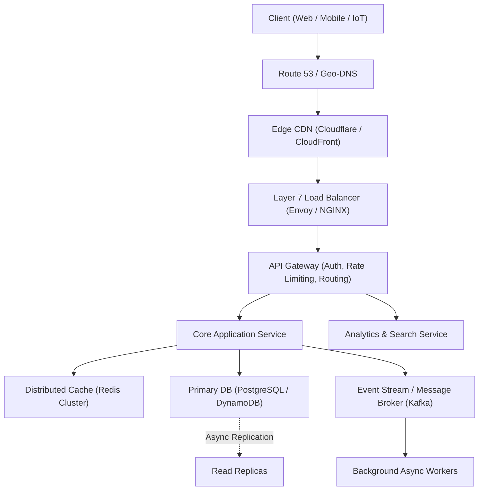

---

### 2. Horizontal vs Vertical Scaling: Architectural Trade-offs and Bottlenecks.

**In Simple Words:**
- **Vertical Scaling (Scale-Up)**: Adding more CPU, RAM, or NVMe disk capacity to a single physical or virtual machine.
- **Horizontal Scaling (Scale-Out)**: Adding more discrete commodity instances into a distributed pool behind a load balancer.

| Parameter | Vertical Scaling (Scale-Up) | Horizontal Scaling (Scale-Out) |
| :--- | :--- | :--- |
| **Complexity** | Minimal (no distributed systems logic) | High (requires load balancing, statelessness, discovery) |
| **Hardware Limit** | Hard physical ceilings (e.g., AWS `u-24tb1.112xlarge`) | Practically infinite linear capacity |
| **Availability** | Single Point of Failure (SPOF) during hardware fault | Highly fault-tolerant (node failures auto-healed) |
| **Network Overhead** | Zero network latency (inter-thread IPC) | Network serialization, latency, and RPC overhead |
| **Cost Curve** | Exponential cost for high-end enterprise hardware | Linear cost using standard commodity compute |

```typescript
// Architectural Rule: Designing Stateless Compute Services for Infinite Horizontal Scale
interface UserSession {
  userId: string;
  roles: string[];
  expiresAt: number;
}

// ❌ Anti-pattern: In-memory session state breaks horizontal scaling
const inMemorySessionStore = new Map<string, UserSession>();

// ✅ Optimal Pattern: External shared distributed session store or stateless JWT
export async function getSession(sessionId: string, redisClient: any): Promise<UserSession | null> {
  const data = await redisClient.get(`session:${sessionId}`);
  return data ? JSON.parse(data) : null;
}
```

---

### 3. The CAP Theorem & PACELC Theorem Deep-Dive.

**In Simple Words:**
**The CAP Theorem** states that a distributed data store can guarantee at most two of three characteristics simultaneously in the presence of a network partition:
1. **Consistency (C)**: Every read receives the most recent write or an error.
2. **Availability (A)**: Every non-failing node returns a non-error response for every request (without guaranteeing latest data).
3. **Partition Tolerance (P)**: The system continues to operate despite arbitrary network drops or delayed packets between nodes.

Because network cables and switches inevitably fail in real datacenters, **Partition Tolerance (P) is mandatory**. Distributed systems must choose between **CP** (Consistency over Availability) and **AP** (Availability over Consistency).

**The PACELC Theorem (Extension):**
If there is a **Partition (P)**, trade off **Availability (A)** vs **Consistency (C)**; **Else (E)**, trade off **Latency (L)** vs **Consistency (C)**.

| System Type | PACELC Classification | Real-World Database Examples | Primary Use Case |
| :--- | :--- | :--- | :--- |
| **CP / EC** | Partition: Consistency; Normal: Consistency | HBase, Spanner, Zookeeper | Bank balances, financial ledger |
| **AP / EL** | Partition: Availability; Normal: Low Latency | Apache Cassandra, Amazon DynamoDB | Social media feeds, IoT telemetry |
| **Tunable** | Configurable Read/Write Quorums | MongoDB, Cassandra ($R + W > N$) | Balance between ACID and scale |

```typescript
// Quorum Math for Strict Consistency (CP) in Distributed Key-Value Stores:
// N = Total Replicas, W = Write Quorum, R = Read Quorum
// Strict Consistency Guarantee: W + R > N (ensures read overlap with latest write)

export function isStrictlyConsistent(replicas: number, writeQuorum: number, readQuorum: number): boolean {
  return writeQuorum + readQuorum > replicas;
}

// Example: 3 Replicas (N=3), Write Quorum=2 (W=2), Read Quorum=2 (R=2)
// W + R = 4 > 3 -> Guarantees at least 1 node in read set holds the latest write!
```

---

### 4. Distributed Consistency Models: Strong, Eventual, Causal, and Read-Your-Writes.

**In Simple Words:**
Consistency models define the contract between a distributed storage system and its applications regarding the order and freshness of observed data across multiple nodes:
- **Strong (Linearizable) Consistency**: Once a write completes, all subsequent reads across all nodes immediately return that value or newer. Requires synchronous replication and consensus (Raft/Paxos).
- **Eventual Consistency**: If no new updates are made to a key, all replicas will eventually converge to the same value. Lowest latency and highest availability.
- **Read-Your-Writes (Monotonic Read) Consistency**: A user is guaranteed to always see their own recent updates immediately, even if other users experience a brief replication delay.
- **Causal Consistency**: Operations that are causally related are observed in the same order by all nodes; concurrent operations without causality can be observed in different order.

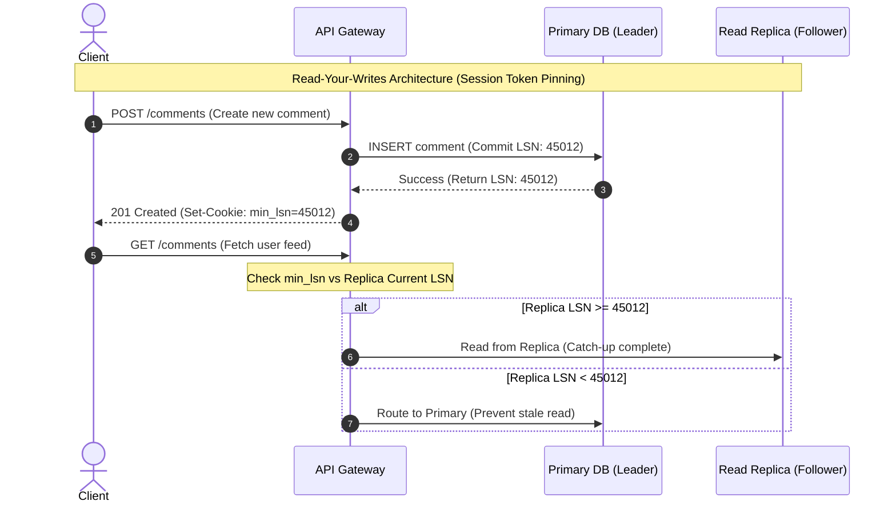

---

### 5. Load Balancing Algorithms and Layer 4 vs Layer 7 Reverse Proxies.

**In Simple Words:**
A **Load Balancer (LB)** distributes incoming network traffic across a cluster of backend servers to ensure high throughput, fault tolerance, and zero-downtime deployments.
- **Layer 4 Load Balancing (Transport Layer - TCP/UDP)**:
  - Operates on IP address and port numbers without inspecting application payload.
  - Lightning fast (millions of packets/sec with kernel bypass like DPDK/eBPF).
  - Cannot inspect HTTP headers, cookies, or URL paths.
- **Layer 7 Load Balancing (Application Layer - HTTP/HTTPS/gRPC)**:
  - Terminates TLS handshakes, parses HTTP request headers, cookies, and JSON payloads.
  - Can route traffic based on URL path (`/api/v1/billing` $
ightarrow$ Billing Cluster, `/api/v1/search` $
ightarrow$ Search Cluster).
  - Can inject security headers, handle gzip/Brotli compression, and enforce JWT rate limiting.

```typescript
// Layer 7 Weighted Round-Robin Load Balancing Algorithm Implementation
interface BackendServer {
  id: string;
  url: string;
  weight: number;
  currentWeight: number;
  healthy: boolean;
}

export class WeightedRoundRobinLB {
  private servers: BackendServer[];

  constructor(servers: BackendServer[]) {
    this.servers = servers.map(s => ({ ...s, currentWeight: 0 }));
  }

  public getNextServer(): BackendServer | null {
    const active = this.servers.filter(s => s.healthy);
    if (active.length === 0) return null;

    let totalWeight = 0;
    let selected: BackendServer | null = null;

    for (const server of active) {
      server.currentWeight += server.weight;
      totalWeight += server.weight;

      if (!selected || server.currentWeight > selected.currentWeight) {
        selected = server;
      }
    }

    if (selected) {
      selected.currentWeight -= totalWeight;
    }

    return selected;
  }
}
```

---

### 6. Consistent Hashing and Virtual Nodes: Mitigating Hot-Spots and Rebalancing.

**In Simple Words:**
In standard modulo hashing (`hash(key) % N`), adding or removing a single server forces almost 100% of keys to be relocated to new servers, causing catastrophic cache stampedes and database overloads.
**Consistent Hashing** maps both servers and data keys onto a circular $2^{32}-1$ hash ring. A key is assigned to the first server encountered moving clockwise. When a node is added or removed, only $K/N$ keys need to be remapped on average ($K$ = total keys, $N$ = total nodes).

**Virtual Nodes (Vnodes):**
Physical servers vary in hardware performance and can create unbalanced clusters. By mapping each physical server to 100–300 **Virtual Nodes** distributed evenly around the ring:
1. Load is distributed evenly across all physical servers.
2. When a physical server fails, its load is split across *all* remaining servers rather than overwhelming its single clockwise neighbor.

```typescript
import crypto from 'crypto';

export class ConsistentHashRing {
  private ring = new Map<number, string>();
  private sortedKeys: number[] = [];
  private replicas: number;

  constructor(virtualNodesPerServer: number = 150) {
    this.replicas = virtualNodesPerServer;
  }

  private hash(val: string): number {
    return crypto.createHash('md5').update(val).digest().readUInt32BE(0);
  }

  public addServer(server: string): void {
    for (let i = 0; i < this.replicas; i++) {
      const vnodeKey = this.hash(`${server}#vnode-${i}`);
      this.ring.set(vnodeKey, server);
      this.sortedKeys.push(vnodeKey);
    }
    this.sortedKeys.sort((a, b) => a - b);
  }

  public getServer(key: string): string | null {
    if (this.sortedKeys.length === 0) return null;
    const keyHash = this.hash(key);

    // Binary search clockwise on ring
    let low = 0, high = this.sortedKeys.length - 1;
    while (low <= high) {
      const mid = Math.floor((low + high) / 2);
      if (this.sortedKeys[mid] >= keyHash) {
        high = mid - 1;
      } else {
        low = mid + 1;
      }
    }

    const targetIdx = low >= this.sortedKeys.length ? 0 : low;
    return this.ring.get(this.sortedKeys[targetIdx]) || null;
  }
}
```

---

### 7. Caching Strategies: Cache-Aside, Write-Through, Write-Behind, and Write-Around.

**In Simple Words:**
Caching reduces latency and offloads database IOPS by storing hot data in ultra-fast RAM (Redis/Memcached). The choice of caching pattern defines how reads and writes interact:

| Pattern | Read Path | Write Path | Pros | Cons |
| :--- | :--- | :--- | :--- | :--- |
| **Cache-Aside** (Lazy Loading) | App checks cache $
ightarrow$ on miss reads DB $
ightarrow$ sets cache | App writes directly to DB $
ightarrow$ evicts/invalidates cache | Resilient to cache failure; only requested data cached | Cache miss penalty ($3 	imes$ network hops); potential stale data |
| **Write-Through** | App reads directly from cache | App writes to Cache $
ightarrow$ Cache synchronously writes to DB | Zero stale data; reads are always fast | Write latency penalty (waits for 2 network hops); unused data cached |
| **Write-Behind** (Write-Back) | App reads from cache | App writes to Cache $
ightarrow$ Cache asynchronously queues write to DB | Ultra-fast writes; batches DB writes | Risk of data loss if cache crashes before flushing to DB |
| **Write-Around** | App checks cache | App writes directly to DB (skips cache) | Cache isn't flooded with writes that are never read | Read miss penalty immediately after write |

```typescript
// Production Cache-Aside Pattern with Probabilistic Early Expiration (XFetch)
export async function cacheAsideGet<T>(
  key: string,
  fetchFromDb: () => Promise<T>,
  redis: any,
  ttlSeconds: number = 3600
): Promise<T> {
  const cached = await redis.get(key);
  if (cached) {
    return JSON.parse(cached);
  }

  const freshData = await fetchFromDb();
  if (freshData !== null && freshData !== undefined) {
    await redis.set(key, JSON.stringify(freshData), 'EX', ttlSeconds);
  }
  return freshData;
}
```

---

### 8. Cache Stampede, Thundering Herd, and Cache Invalidation Strategies.

**In Simple Words:**
- **Cache Stampede (Thundering Herd)**: When a heavily requested hot cache key expires (e.g. homepage top stories or flash sale product), thousands of concurrent requests experience a cache miss simultaneously and hammer the primary database, crashing it.
- **Cache Penetration**: Malicious or buggy clients query keys that exist neither in cache nor in the database (e.g. `id = -9999`), constantly hitting the DB.
  - *Fix*: Cache null objects with short TTL (e.g. 60s) or filter queries using **Bloom Filters**.
- **Cache Breakdown**: A single super-hot key expires.
  - *Fix*: Mutex distributed lock or **Probabilistic Early Recomputation (XFetch)**.

```typescript
// Thundering Herd Protection using Mutex Distributed Lock in Node.js
export async function getWithMutexLock<T>(
  key: string,
  dbFetcher: () => Promise<T>,
  redis: any,
  ttl: number
): Promise<T> {
  let val = await redis.get(key);
  if (val) return JSON.parse(val);

  const lockKey = `lock:${key}`;
  // Try acquiring lock for 5 seconds
  const acquired = await redis.set(lockKey, 'locked', 'NX', 'PX', 5000);

  if (acquired) {
    try {
      const data = await dbFetcher();
      await redis.set(key, JSON.stringify(data), 'EX', ttl);
      return data;
    } finally {
      await redis.del(lockKey);
    }
  } else {
    // Another worker is fetching from DB: sleep and retry
    await new Promise(resolve => setTimeout(resolve, 80));
    return getWithMutexLock(key, dbFetcher, redis, ttl);
  }
}
```

---

### 9. Message Brokers vs Event Streaming: RabbitMQ vs Apache Kafka.

**In Simple Words:**
- **Message Broker (RabbitMQ)**:
  - Smart broker, dumb consumer model.
  - Messages are pushed to consumers via AMQP.
  - Once acknowledged (ACK), messages are deleted from the broker.
  - Ideal for task distribution, background job processing, and granular routing keys.
- **Distributed Event Stream (Apache Kafka)**:
  - Dumb broker, smart consumer model.
  - Append-only partitioned commit log stored on disk.
  - Messages are persisted for a configurable retention period (e.g. 7 days) regardless of consumption.
  - Consumers track their own read pointer (**Offset**). Multiple independent consumer groups can read the stream at different speeds and replay past events.

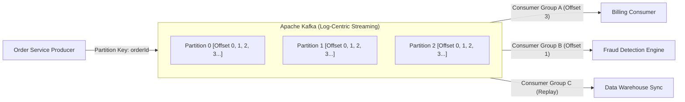

---

### 10. Database Sharding Strategies: Range, Hash, and Directory-Based Partitioning.

**In Simple Words:**
**Sharding** is the horizontal partitioning of a large database across multiple independent physical database instances (shards) when a single database exceeds memory, storage, or connection limits.

| Sharding Strategy | Mechanism | Pros | Cons & Bottlenecks |
| :--- | :--- | :--- | :--- |
| **Hash-Based (Key)** | `shard_id = hash(sharding_key) % N` | Uniform data and traffic distribution | Resharding requires repartitioning data (unless consistent hashing is used) |
| **Range-Based** | Partition based on value range (e.g., A-E, F-J, or Dates) | Efficient range queries (`WHERE date BETWEEN...`) | Hot-spots (e.g. current month receives 99% of all write queries) |
| **Directory-Based** | Lookup service maps entity IDs to specific shard endpoints | Dynamic shard rebalancing with zero downtime | Lookup service is a Single Point of Failure (SPOF) and latency bottleneck |

```sql
-- Example Sharding Key Selection Trade-off for Multi-Tenant SaaS
-- Sharding by tenant_id guarantees all data for a company lives on a single shard:
SELECT o.id, o.amount, c.email 
FROM orders o 
JOIN customers c ON o.customer_id = c.id 
WHERE o.tenant_id = 'tenant_xyz123';
-- ✅ Fast single-shard local JOIN without cross-network distributed transactions!
```

---

## Part 2: Real-World High-Scale Architecture Problems (11 - 25)

### 11. Design a Distributed URL Shortener (TinyURL / Bit.ly).

**In Simple Words:**
Design a scalable service that converts long URLs (e.g. 150 characters) into concise aliases (e.g. `https://tiny.cc/a8X9k2`) and redirects users with sub-15ms latency.

**Scale Estimations:**
- **Traffic**: 100M new URLs created per month (~40 writes/sec), 10B redirects per month (~4,000 reads/sec $
ightarrow$ 100:1 Read-Heavy).
- **Storage**: 100M URLs $	imes$ 500 bytes per record $	imes$ 12 months $	imes$ 5 years = **3 TB total storage** (easily manageable).
- **Base62 Character Set**: `[a-zA-Z0-9]` ($62$ characters).
  - Length 6: $62^6 approx 56.8$ Billion combinations.
  - Length 7: $62^7 approx 3.5$ Trillion unique combinations (safely covers 100 years).

```mermaid
flowchart TD
    Client["User Browser"] -->|"1. GET /a8X9k2"| CDN["Edge CDN / Cloudflare"]
    CDN -->|"Cache Miss"| LB["Load Balancer"]
    LB --> WebApp["URL Redirection Service"]
    WebApp --> Redis["Redis Cluster (LRU Hot Cache)"]
    Redis -.->|"Cache Miss"| DB["NoSQL Storage (DynamoDB / Cassandra)"]
    WebApp -->>|"301 / 302 Redirect"| Client
```

```typescript
// Base62 Converter for Distributed Unique Integer IDs
const BASE62_CHARS = '0123456789abcdefghijklmnopqrstuvwxyzABCDEFGHIJKLMNOPQRSTUVWXYZ';

export function encodeBase62(num: bigint): string {
  if (num === 0n) return '0';
  let str = '';
  let n = num;
  while (n > 0n) {
    const rem = Number(n % 62n);
    str = BASE62_CHARS[rem] + str;
    n = n / 62n;
  }
  return str;
}
```

---

### 12. Design a Distributed Rate Limiter.

**In Simple Words:**
Protect backend microservices from DDoS attacks, brute-force bots, and resource starvation by enforcing request quota policies (e.g. 100 requests per minute per IP or API key).

**Algorithm Comparison:**
1. **Token Bucket (Optimal)**: Tokens are added to a bucket at a constant refill rate. Requests consume 1 token. Handles traffic bursts gracefully.
2. **Leaky Bucket**: Requests enter a queue and leak out at a strictly fixed constant rate. Smooths out traffic spikes.
3. **Sliding Window Counter**: Hybrid combining fixed window memory efficiency with boundary-spike protection.

```lua
-- Production Redis Token Bucket Algorithm executed as an atomic Lua script
-- KEYS[1] = Rate limit key (e.g. "ratelimit:user_123")
-- ARGV[1] = Max capacity, ARGV[2] = Refill rate per sec, ARGV[3] = Current epoch, ARGV[4] = Requested tokens

local key = KEYS[1]
local capacity = tonumber(ARGV[1])
local refill_rate = tonumber(ARGV[2])
local now = tonumber(ARGV[3])
local requested = tonumber(ARGV[4])

local data = redis.call('HMGET', key, 'tokens', 'last_updated')
local tokens = tonumber(data[1])
local last_updated = tonumber(data[2])

if not tokens then
    tokens = capacity
    last_updated = now
else
    local delta = math.max(0, now - last_updated)
    tokens = math.min(capacity, tokens + delta * refill_rate)
    last_updated = now
end

if tokens >= requested then
    tokens = tokens - requested
    redis.call('HMSET', key, 'tokens', tokens, 'last_updated', last_updated)
    redis.call('EXPIRE', key, 3600)
    return 1 -- Request Allowed
else
    return 0 -- Request Denied (HTTP 429 Too Many Requests)
end
```

---

### 13. Design a Real-Time Chat System (WhatsApp / Slack / Discord).

**In Simple Words:**
Support 1-on-1 private messaging, group channels, persistent chat history, and online status with end-to-end delivery guarantees.

**Core Components:**
- **Connection Handshake**: Client connects via HTTP/HTTPS, authenticates, and upgrades connection to bidirectional **WebSocket**.
- **Chat Service Cluster**: Maintains active persistent TCP/WebSocket connections.
- **Redis Presence & Session Registry**: Maps `userId $
ightarrow$ server_id` to know which server holds a user's active socket connection.
- **Message Broker (Kafka / Redis Pub/Sub)**: Routes messages across different chat servers when User A and User B are connected to different physical nodes.

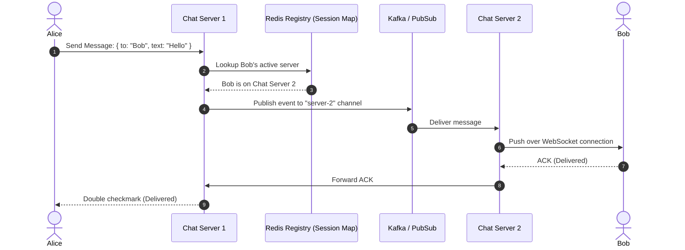

---

### 14. Design Twitter / Social Media Feed System (Fan-Out on Write vs Fan-Out on Read).

**In Simple Words:**
Design an interactive timeline where users can post tweets (tweets/sec: 10K writes) and view a personalized chronological feed of tweets from accounts they follow (feeds/sec: 500K reads).

**The Architectural Dilemma: Fan-Out on Write vs Fan-Out on Read:**
- **Fan-Out on Write (Push Model)**:
  - When user posts a tweet, system looks up all their followers and writes the tweet ID directly into each follower's pre-computed Redis feed cache.
  - *Read Path*: Blazing fast $O(1)$ read from follower's feed cache.
  - *Failure Mode*: Celebrity accounts with 100M followers take minutes to push to 100M caches (wasting immense CPU and RAM).
- **Fan-Out on Read (Pull Model)**:
  - Tweets are stored in a single table. When a user opens their feed, system queries latest tweets from all followed users and merges them dynamically.
  - *Write Path*: Blazing fast $O(1)$ insert.
  - *Read Path*: Extremely expensive multi-way merge ($O(N log K)$).
- **The Hybrid Industry Standard**:
  - Normal users ($< 25,000$ followers): Use **Fan-Out on Write**.
  - Celebrities ($> 25,000$ followers): Do not fan-out. Merge celebrity tweets dynamically into user's feed upon read request.

```typescript
// Hybrid Feed Generation Logic
export async function generateUserFeed(userId: string, redis: any, db: any): Promise<string[]> {
  // 1. Fetch pre-computed timeline containing normal user tweets (Fast O(1))
  const cachedFeed: string[] = await redis.zrevrange(`timeline:${userId}`, 0, 50);

  // 2. Fetch IDs of followed celebrities
  const celebrityFollowees: string[] = await db.getFollowedCelebrities(userId);

  // 3. Fetch latest tweets from celebrities and merge with timeline in-memory
  const celebrityTweets = await db.getLatestCelebrityTweets(celebrityFollowees, 20);

  return mergeChronologically(cachedFeed, celebrityTweets).slice(0, 50);
}
```

---

### 15. Design a Proximity / Ride-Sharing Service (Uber / Lyft).

**In Simple Words:**
Connect drivers with nearby riders in real-time while processing location updates every 4 seconds from millions of active vehicles with sub-100ms spatial matching.

**Spatial Indexing Technologies:**
- **Geohash**: Hierarchical spatial data structure that subdivides Earth into bounding grid boxes and encodes them into Base32 strings. Nearby locations share common string prefixes!
  - Example: Prefix `9q8yy` covers an area of roughly $4.9	ext{ km} 	imes 4.9	ext{ km}$.
- **Google S2 / Uber H3**: Uses hexagonal cells rather than rectangular boxes, eliminating corner distortion and ensuring all neighbors are equidistant.

```mermaid
flowchart TD
    Driver["Driver Phone App"] -->|"GPS Update Every 4s"| LB["Geo-DNS / Envoy LB"]
    LB --> LocationSvc["Location Ingestion Service"]
    LocationSvc --> RedisGeo["Redis Geospatial Engine (GEOADD / GEORADIUS)"]
    
    Rider["Rider App"] -->|"Find Rides Near (Lat, Lon)"| MatchSvc["Ride Dispatcher Engine"]
    MatchSvc --> RedisGeo
    RedisGeo -->>|"Return Top-10 Drivers within 3km"| MatchSvc
    MatchSvc --> DispatchSvc["Optimal Routing & Notification"]
```

---

### 16. Design a Global Video Streaming Platform (YouTube / Netflix).

**In Simple Words:**
Ingest raw video files uploaded by creators, transcode them into multiple resolutions and bitrates, and stream playback smoothly to diverse devices across variable network bandwidths.

**Core Architecture & Streaming Protocols:**
- **HLS (HTTP Live Streaming) / MPEG-DASH**:
  - Videos are split into small chunks (2–6 seconds each).
  - A manifest file (`.m3u8`) lists all available resolutions (480p, 720p, 1080p, 4K) and chunk URLs.
  - Video player dynamically switches bitrates based on real-time client network bandwidth (**Adaptive Bitrate Streaming**).
- **Storage Tiering**:
  - Raw uploads $
ightarrow$ AWS S3 Standard.
  - Transcoded chunks $
ightarrow$ S3 + Global Edge CDN (Cloudflare/Fastly).
  - Cold, unwatched archive videos $
ightarrow$ AWS S3 Glacier Flexible.

```typescript
// Sample M3U8 Master Playlist Concept for Adaptive Bitrate Streaming
const masterPlaylist = `
#EXTM3U
#EXT-X-STREAM-INF:BANDWIDTH=800000,RESOLUTION=640x360
360p/stream.m3u8
#EXT-X-STREAM-INF:BANDWIDTH=1400000,RESOLUTION=842x480
480p/stream.m3u8
#EXT-X-STREAM-INF:BANDWIDTH=2800000,RESOLUTION=1280x720
720p/stream.m3u8
#EXT-X-STREAM-INF:BANDWIDTH=5000000,RESOLUTION=1920x1080
1080p/stream.m3u8
`;
```

---

### 17. Design a Distributed Unique ID Generator (Twitter Snowflake ID).

**In Simple Words:**
Generate unique 64-bit integer IDs across thousands of distributed servers without requiring centralized database auto-increments or slow distributed consensus coordination.

**Snowflake 64-Bit Structure:**
1. **1 bit**: Unused sign bit (always 0).
2. **41 bits**: Timestamp in milliseconds since custom epoch ($2^{41} approx 69$ years of IDs).
3. **5 bits**: Datacenter ID ($2^5 = 32$ datacenters).
4. **5 bits**: Worker / Machine ID ($2^5 = 32$ servers per datacenter).
5. **12 bits**: Sequence number per millisecond ($2^{12} = 4,096$ IDs per millisecond per machine).

```typescript
export class SnowflakeIdGenerator {
  private epoch = 1704067200000n; // Custom epoch: 2024-01-01
  private datacenterId: bigint;
  private workerId: bigint;
  private sequence = 0n;
  private lastTimestamp = -1n;

  constructor(datacenterId: number, workerId: number) {
    this.datacenterId = BigInt(datacenterId & 0x1f);
    this.workerId = BigInt(workerId & 0x1f);
  }

  public nextId(): bigint {
    let now = BigInt(Date.now());
    if (now === this.lastTimestamp) {
      this.sequence = (this.sequence + 1n) & 0xfffn;
      if (this.sequence === 0n) {
        // Millisecond exhausted: wait for next millisecond
        while (now <= this.lastTimestamp) {
          now = BigInt(Date.now());
        }
      }
    } else {
      this.sequence = 0n;
    }

    this.lastTimestamp = now;
    return (
      ((now - this.epoch) << 22n) |
      (this.datacenterId << 17n) |
      (this.workerId << 12n) |
      this.sequence
    );
  }
}
```

---

### 18. Design a Distributed Web Crawler (URL Frontier, Bloom Filters, and Politeness).

**In Simple Words:**
Systematically crawl billions of web pages across the public internet for indexing, processing 100,000 pages per second while adhering to host politeness policies (`robots.txt`).

**Key Architectural Components:**
- **URL Frontier**: Prioritizes crawling order and prevents flooding a single target web server (Politeness queue based on host domain).
- **Bloom Filter**: Memory-efficient probabilistic data structure that prevents re-crawling duplicate URLs with 0% false negatives.
- **Content Signature (SimHash / MinHash)**: Detects near-duplicate web page content to prevent indexing duplicate articles.

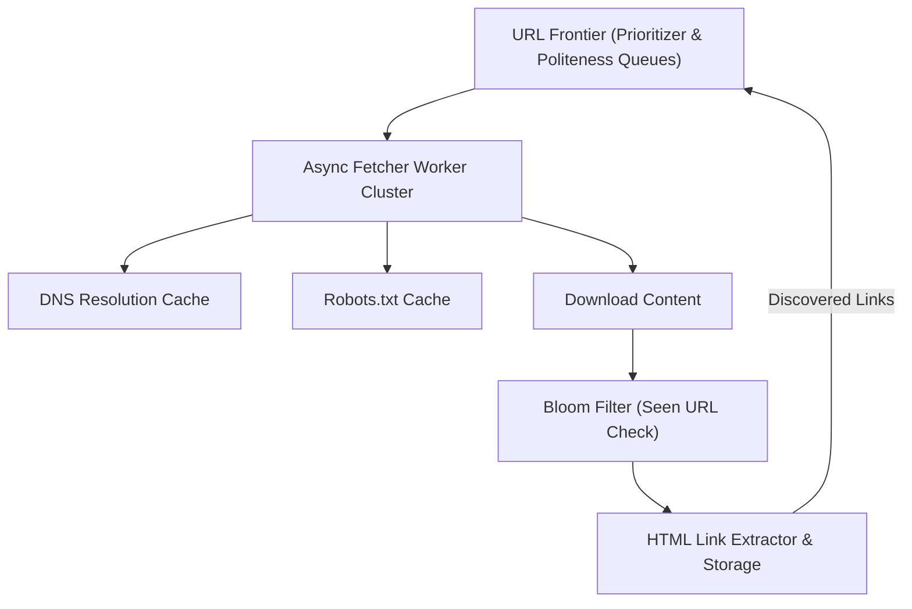

---

### 19. Design an Idempotent Payment System (Stripe / Checkout).

**In Simple Words:**
Ensure that double-clicks, network timeouts, or retried API calls NEVER charge a customer twice or corrupt bank transaction balances.

**Idempotency Key Architecture:**
1. Client generates a UUIDv4 **Idempotency Key** in request header (`Idempotency-Key: c9d721...`).
2. Payment gateway acquires a distributed lock in Redis for that key.
3. If the key exists with a completed status, return the cached previous HTTP response immediately without touching payment processors.
4. Execute financial transaction within a strict database transaction.

```typescript
export async function processPaymentWithIdempotency(
  idempotencyKey: string,
  chargeData: { userId: string; amount: number },
  redis: any,
  db: any
): Promise<{ status: string; transactionId: string }> {
  const cacheKey = `idemp:${idempotencyKey}`;
  
  // 1. Check if already processed
  const cachedResponse = await redis.get(cacheKey);
  if (cachedResponse) {
    return JSON.parse(cachedResponse);
  }

  // 2. Acquire 30-second lock
  const locked = await redis.set(`lock:${cacheKey}`, '1', 'NX', 'EX', 30);
  if (!locked) {
    throw new Error('Concurrent request with identical idempotency key in progress');
  }

  try {
    // 3. Execute financial deduction in database
    const result = await db.executeTransaction(chargeData);
    await redis.set(cacheKey, JSON.stringify(result), 'EX', 86400 * 7); // Cache for 7 days
    return result;
  } finally {
    await redis.del(`lock:${cacheKey}`);
  }
}
```

---

### 20. Design a Cloud File Storage & Synchronization Service (Google Drive / Dropbox).

**In Simple Words:**
Allow users to upload, download, and synchronize files of arbitrary size across desktop and mobile devices with automatic delta sync and data deduplication.

**Core Innovations:**
- **Chunking (Delta Sync)**: Files are divided into 4MB chunks. When a user edits a 500MB document, only the modified 4MB chunks are re-uploaded, saving 99% bandwidth!
- **Content-Addressable Storage**: Each chunk is named after its SHA-256 hash. If multiple users upload the identical file, only one physical copy is stored in object storage (**Global Deduplication**).

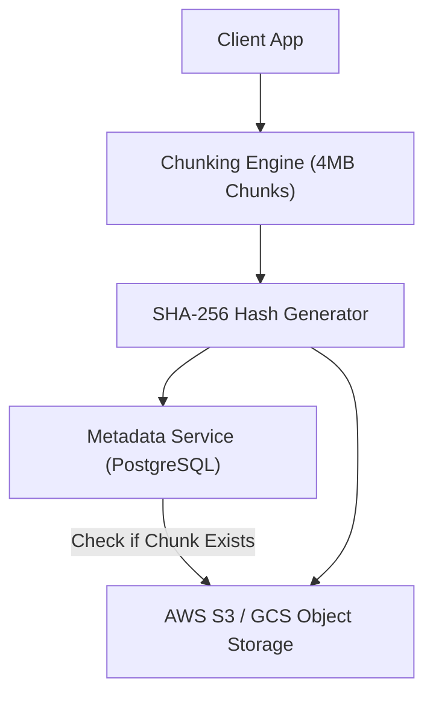

---

### 21. Design a Typeahead / Autocomplete Search System (Trie & Top-K Ranking).

**In Simple Words:**
Provide real-time query suggestions as the user types each keystroke into a search bar within 30ms latency, handling 50,000 keystrokes per second.

**Data Structure: Serialized Prefix Trie with Cached Top-K Suggestions:**
- In a naive Trie, finding matching prefixes requires traversing all child subtrees and sorting results, taking $O(K log K)$ per keystroke.
- **Optimization**: Store the pre-computed **Top-5 most frequent query completions** directly inside every Trie node! Searching a prefix becomes an instantaneous $O(L)$ operation where $L$ is query length (rarely $> 20$ chars).

```typescript
export class AutocompleteTrieNode {
  public children = new Map<string, AutocompleteTrieNode>();
  public topSuggestions: { query: string; score: number }[] = [];

  public insert(query: string, score: number): void {
    let curr: AutocompleteTrieNode = this;
    for (const char of query.toLowerCase()) {
      if (!curr.children.has(char)) {
        curr.children.set(char, new AutocompleteTrieNode());
      }
      curr = curr.children.get(char)!;
      curr.updateTopSuggestions(query, score);
    }
  }

  private updateTopSuggestions(query: string, score: number): void {
    const existing = this.topSuggestions.find(s => s.query === query);
    if (existing) {
      existing.score = score;
    } else {
      this.topSuggestions.push({ query, score });
    }
    this.topSuggestions.sort((a, b) => b.score - a.score);
    if (this.topSuggestions.length > 5) {
      this.topSuggestions.pop();
    }
  }
}
```

---

### 22. Design a Distributed Notification Service (APNs, FCM, SMS, and Email).

**In Simple Words:**
Send billions of push notifications, SMS texts, and transactional emails with high delivery rates, user notification preferences, and deduplication.

**Architectural Highlights:**
- **Notification Template Engine**: Renders dynamic strings and localized language templates.
- **User Preference Filter**: Checks opt-outs, quiet hours, and channel frequency capping.
- **Priority Queues**: Urgent verification OTP SMS bypasses marketing email queues.

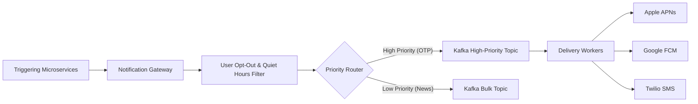

---

### 23. Design an E-Commerce Flash Sale System (High Concurrency & Inventory Reservation).

**In Simple Words:**
Prevent overselling when 500,000 customers try to purchase 1,000 limited-stock gaming consoles within 3 seconds of a flash sale launch.

**The Solution: Atomic In-Memory Inventory Reservation:**
- Relational database row locks (`SELECT ... FOR UPDATE`) will freeze and fail under 100,000 QPS.
- **Pattern**: Preload inventory into **Redis Decr** or Lua script. Only customers who successfully decrement the Redis counter are granted a signed reservation token to proceed to payment checkout!

```lua
-- Atomic Inventory Reservation Script in Redis
local stock_key = KEYS[1]
local user_id = ARGV[1]

local current_stock = tonumber(redis.call('GET', stock_key) or 0)
if current_stock > 0 then
    redis.call('DECR', stock_key)
    redis.call('SADD', stock_key .. ':reservations', user_id)
    return 1 -- Success: Seat reserved for 10 minutes
else
    return 0 -- Sold out: Reject instantly without hitting DB
end
```

---

### 24. Design a Distributed Key-Value Store (Dynamo-Style Vector Clocks & Gossip Protocol).

**In Simple Words:**
Design an Amazon Dynamo-style highly available, partition-tolerant distributed key-value store with eventual consistency and decentralized masterless architecture.

**Key Technical Pillars:**
- **Decentralized Membership**: Nodes monitor cluster health via **Gossip Protocol** (epidemic information dissemination).
- **Partitioning**: Consistent Hashing ring with virtual nodes.
- **Data Versioning**: **Vector Clocks** to detect concurrent write conflicts.
- **Read Repair & Anti-Entropy**: Inconsistencies detected during read operations are repaired asynchronously in the background.

```typescript
// Vector Clock Conflict Detection Logic
export type VectorClock = Record<string, number>;

export function compareVectorClocks(v1: VectorClock, v2: VectorClock): 'EQUAL' | 'BEFORE' | 'AFTER' | 'CONCURRENT' {
  let v1Bigger = false;
  let v2Bigger = false;
  const allNodes = new Set([...Object.keys(v1), ...Object.keys(v2)]);

  for (const node of allNodes) {
    const c1 = v1[node] || 0;
    const c2 = v2[node] || 0;
    if (c1 > c2) v1Bigger = true;
    if (c2 > c1) v2Bigger = true;
  }

  if (v1Bigger && !v2Bigger) return 'AFTER';
  if (!v1Bigger && v2Bigger) return 'BEFORE';
  if (!v1Bigger && !v2Bigger) return 'EQUAL';
  return 'CONCURRENT'; // Conflict! Requires client or LWW resolution
}
```

---

### 25. Design a Web Analytics / Event Tracking Platform (Kafka + ClickHouse / Druid).

**In Simple Words:**
Ingest, aggregate, and query 10 billion daily user interaction events (pageviews, clicks, scroll depth) with real-time dashboard visualization.

**Storage Architecture: Columnar vs Row-Oriented:**
- Row-oriented databases (PostgreSQL/MySQL) are designed for single-row OLTP operations.
- **Columnar Databases (ClickHouse / Apache Druid)** store table data column-by-column on disk. Reading and aggregating billions of rows (`SELECT count(*), avg(duration) GROUP BY country`) only reads the specific requested columns, compressing data by 90% and executing queries in milliseconds!

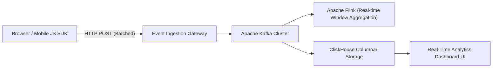

---

## Part 3: Distributed Transactions, Consensus & Reliability (26 - 36)

### 26. Distributed Consensus: Raft vs Paxos.

**In Simple Words:**
Distributed consensus algorithms ensure that a cluster of servers agree on a shared state machine log, even if some nodes crash or experience network partitions.
- **Paxos**: The original consensus algorithm proven by Leslie Lamport. Renowned for mathematical elegance but notoriously difficult to understand and implement in real software.
- **Raft**: Designed specifically to be understandable while providing equivalent safety to Multi-Paxos.
  - Divided into 3 explicit subproblems: **Leader Election**, **Log Replication**, and **Safety**.

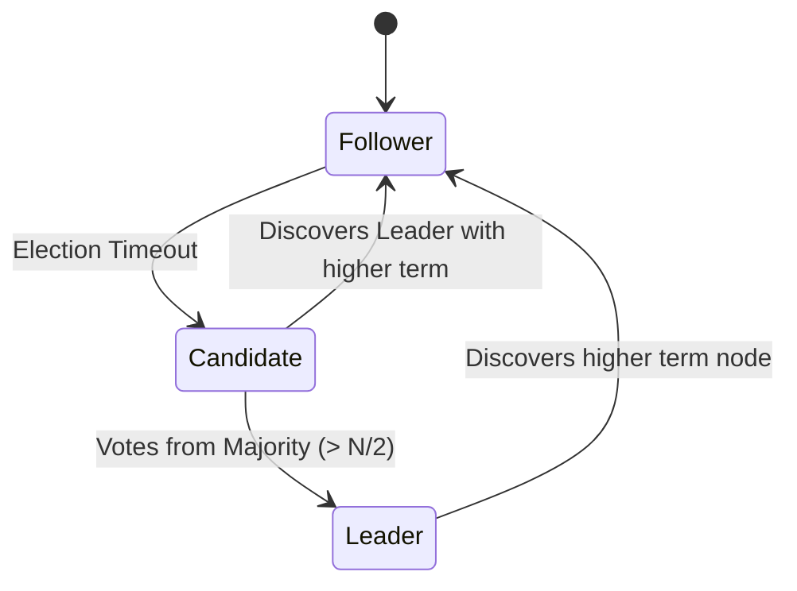

---

### 27. Two-Phase Commit (2PC) vs Three-Phase Commit (3PC).

**In Simple Words:**
Atomic transaction protocols that ensure all participating database nodes either commit or abort a distributed transaction together.
- **Two-Phase Commit (2PC)**:
  - **Phase 1 (Prepare)**: Coordinator asks all participants: "Can you commit?" Participants lock resources and respond YES/NO.
  - **Phase 2 (Commit)**: If all vote YES, Coordinator broadcasts COMMIT. If any vote NO, broadcasts ROLLBACK.
  - *Weakness*: **Blocking protocol**. If Coordinator crashes after Phase 1, participants remain locked indefinitely.
- **Three-Phase Commit (3PC)**:
  - Adds a non-blocking **Pre-Commit** phase and timeouts to avoid indefinite lock starvation. Rarely used in practice due to network partition vulnerabilities.

---

### 28. The Saga Pattern: Orchestration vs Choreography for Microservices.

**In Simple Words:**
In microservice architectures where each service owns its private database, ACID multi-database transactions are anti-patterns. A **Saga** is a sequence of local transactions where each step publishes an event. If any step fails, the Saga executes **Compensating Transactions** backwards to undo previous actions.

| Aspect | Choreography-Based Saga | Orchestration-Based Saga |
| :--- | :--- | :--- |
| **Coordination** | Decentralized; services react to pub/sub events | Centralized orchestrator state machine directs steps |
| **Visibility** | Difficult to track execution status | Crystal clear workflow visibility and auditing |
| **Coupling** | Loosely coupled | Orchestrator holds business workflow logic |
| **Best For** | Simple workflows (2–4 services) | Complex enterprise workflows with branching logic |

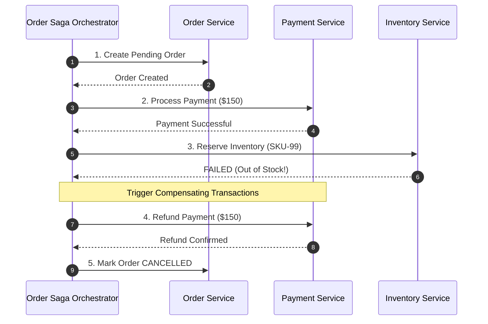

---

### 29. CQRS (Command Query Responsibility Segregation) & Event Sourcing.

**In Simple Words:**
- **CQRS**: Separates the data model for write modifications (**Commands**) from read queries (**Queries**). The Write DB is normalized for high-throughput ACID writes; the Read DB is denormalized for lightning-fast reads.
- **Event Sourcing**: Instead of storing only the *current* state of an entity, every state change is stored as an immutable append-only event log. Current state is reconstructed by replaying events.

```typescript
// Event Sourcing: Reconstructing Account Balance from Immutable Events
export interface BankEvent {
  type: 'DEPOSITED' | 'WITHDRAWN';
  amount: number;
  timestamp: number;
}

export function reconstructBalance(events: BankEvent[]): number {
  return events.reduce((balance, ev) => {
    switch (ev.type) {
      case 'DEPOSITED': return balance + ev.amount;
      case 'WITHDRAWN': return balance - ev.amount;
      default: return balance;
    }
  }, 0);
}
```

---

### 30. Distributed Locking: Redlock Algorithm vs ZooKeeper / etcd.

**In Simple Words:**
Coordinate exclusive access to a shared resource across multiple independent compute instances.
- **Redis Redlock**: Acquires lock across $N$ independent Redis masters (typically 5). Lock is granted if acquired on $ge (N/2 + 1)$ masters within validity time.
- **ZooKeeper / etcd**: Uses consensus-backed ephemeral sequential nodes. If holder crashes, heartbeat loss automatically drops the ephemeral node and triggers a watch event for the next in line.

---

### 31. Gossip Protocols and Cluster Membership Discovery.

**In Simple Words:**
A decentralized peer-to-peer communication protocol where nodes periodically exchange membership and liveness state with a small set of random peers, spreading information exponentially like an epidemic.
- Used by **Apache Cassandra**, **Amazon DynamoDB**, and **HashiCorp Consul**.
- Ensures high resilience: cluster converges to complete knowledge even if $50%$ of nodes fail.

---

### 32. Resolving Concurrent Write Conflicts: Last-Write-Wins (LWW) vs CRDTs.

**In Simple Words:**
When two users update the identical key concurrently across partitioned nodes:
- **Last-Write-Wins (LWW)**: Uses wall-clock NTP timestamp. The update with the highest timestamp overwrites all others. Simple, but clock drift causes silent data loss!
- **Conflict-Free Replicated Data Types (CRDTs)**: Mathematically proven data structures (e.g. G-Counter, PN-Counter, OR-Set) that converge to the identical state regardless of update order.

---

### 33. Circuit Breaker Pattern (Netflix Hystrix / Resilience4j).

**In Simple Words:**
Prevent cascading failures when a downstream microservice is down. Instead of exhausting worker threads on blocking timeouts, the Circuit Breaker trips to **OPEN** state and fails fast.
- **CLOSED**: Requests flow normally. Failures increment failure counter.
- **OPEN**: Error threshold exceeded. Requests fail immediately with fallback without network hop.
- **HALF-OPEN**: After sleep window, allows trial requests. If successful, resets to CLOSED.

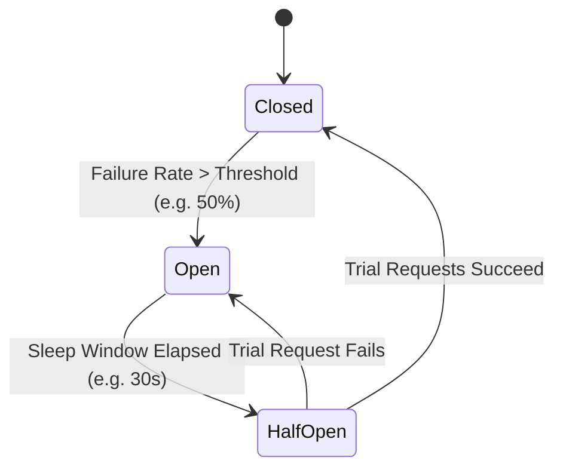

---

### 34. Dead Letter Queues (DLQ) and Exponential Backoff with Full Jitter.

**In Simple Words:**
When retrying failed network calls or message processing, retrying immediately causes thundering herd traffic spikes.
- **Exponential Backoff**: Multiplies sleep interval by $2^n$ on each failure ($1s, 2s, 4s, 8s, 16s...$).
- **Full Jitter**: Adds random uniform delay ($sleep = 	ext{random}(0, min(	ext{cap}, 	ext{base} 	imes 2^{	ext{attempt}}))$) to desynchronize retrying clients.
- **Dead Letter Queue (DLQ)**: After maximum attempts (e.g. 5 retries), unprocessable messages are routed to a DLQ for inspection rather than blocking the main pipeline.

```typescript
export function calculateBackoffWithJitter(attempt: number, baseMs = 100, maxMs = 5000): number {
  const exponential = Math.min(maxMs, baseMs * Math.pow(2, attempt));
  return Math.floor(Math.random() * exponential);
}
```

---

### 35. Database Replication Lag, Split-Brain & Leader Election.

**In Simple Words:**
- **Replication Lag**: Time elapsed between a write committing to the Leader and replicating to Followers. Causes users to see stale data if they read from followers immediately after write.
- **Split-Brain**: When a network partition divides a cluster into two isolated subnets, and both subnets elect their own Leader and accept conflicting writes.
  - *Fix*: Strict **Majority Quorum** ($N/2 + 1$). A partition can only elect a leader if it contains more than half the total cluster nodes.

---

### 36. Zero-Downtime Database Migrations (Expand and Contract Pattern).

**In Simple Words:**
How to rename columns or alter schemas on live production databases with billions of rows without table locks or service downtime.
1. **Expand**: Add new nullable column `new_column`.
2. **Dual-Write**: Deploy application code that reads from `old_column` and writes to both `old_column` and `new_column`.
3. **Backfill**: Asynchronously copy legacy data from `old_column` to `new_column` in small batches.
4. **Switch Read**: Switch application reads to `new_column`.
5. **Contract**: Stop writing to `old_column` and drop it during a low-traffic window.

---

## Part 4: API Design, Security & Edge Networking (37 - 43)

### 37. REST vs GraphQL vs gRPC: Serialization, Latency & Streaming Trade-offs.

**In Simple Words:**
- **REST**: Standard over HTTP/1.1 or HTTP/2 using JSON. Great for public consumer APIs and caching at CDN edge.
- **GraphQL**: Client specifies exact fields needed, eliminating over-fetching and under-fetching. Complex backend caching.
- **gRPC**: Uses Protocol Buffers (binary serialization) over HTTP/2 multiplexing. Ideal for internal microservice-to-microservice communication (7–10x faster than REST/JSON).

---

### 38. The API Gateway Pattern: Authentication, Rate Limiting & Aggregation.

**In Simple Words:**
A single reverse-proxy entry point for all client requests that handles cross-cutting concerns: SSL termination, JWT authentication, rate limiting, request tracing, and payload aggregation.

---

### 39. WebSockets vs Server-Sent Events (SSE) vs Long Polling.

**In Simple Words:**
- **WebSockets**: Full-duplex bidirectional TCP communication. Best for gaming, collaborative editing, and chat.
- **Server-Sent Events (SSE)**: Unidirectional server-to-client streaming over standard HTTP. Built-in reconnection. Best for live stock tickers, LLM streaming output, and notifications.
- **Long Polling**: Legacy fallback where client holds an HTTP request open until the server responds.

---

### 40. Content Delivery Networks (CDNs): Edge Caching & Anycast Routing.

**In Simple Words:**
Geographically distributed network of proxy servers that cache static assets and dynamic responses close to end users.
- **Anycast BGP**: Routes client DNS queries to the topologically nearest physical datacenter.
- **Cache-Control Headers**: `s-maxage`, `stale-while-revalidate`, and instant tag purging.

---

### 41. Distributed Tracing & W3C TraceContext (OpenTelemetry).

**In Simple Words:**
Track a single end-user request as it traverses across dozens of microservices.
- **Trace ID**: Unique identifier for the entire request journey.
- **Span ID**: Identifies individual unit of work in a specific service.
- **Baggage**: Context propagated across HTTP/gRPC boundaries via W3C `traceparent` headers.

---

### 42. DDoS Attack Mitigation: SYN Flood, Slowloris & Anycast Absorption.

**In Simple Words:**
- **SYN Flood (Layer 4)**: Floods TCP SYN packets without sending final ACK to exhaust connection memory table. *Fix: SYN Cookies*.
- **Slowloris (Layer 7)**: Sends HTTP headers at agonizingly slow rates to keep server thread pool occupied. *Fix: Min request rate enforcement*.
- **Anycast Absorption**: Distributes massive attack volume across hundreds of edge locations worldwide.

---

### 43. TLS 1.3 Handshake & Zero Round-Trip Time (0-RTT) Resumption.

**In Simple Words:**
TLS 1.3 reduces the handshake from two round-trips (2-RTT in TLS 1.2) to a single round-trip (1-RTT). **0-RTT Resumption** allows returning clients to send encrypted application data in the very first flight.

---

## Part 5: Back-of-the-Envelope Estimation & Production Calculations (44 - 50)

### 44. Latency Numbers Every Software Engineer Should Know.

**In Simple Words:**
Approximate physical hardware latencies that dictate architectural trade-offs:

| Operation | Approximate Latency | Scaled to Human Perspective |
| :--- | :--- | :--- |
| **L1 Cache Reference** | 0.5 ns | 1 heart beat |
| **L2 Cache Reference** | 7 ns | 14 heart beats |
| **RAM Main Memory Reference** | 100 ns | 3.3 minutes |
| **NVMe SSD Random Read** | 10,000 ns (10 µs) | 5.5 hours |
| **Standard Datacenter Network RTT** | 500,000 ns (0.5 ms) | 11.5 days |
| **Disk Seek (Mechanical HDD)** | 10,000,000 ns (10 ms) | 8 months |
| **Transatlantic Cable Packet (NYC to London)** | 100,000,000 ns (100 ms) | 6.5 years |

---

### 45. Back-of-the-Envelope: Daily Active Users (DAU) to QPS and Bandwidth.

**In Simple Words:**
How to calculate Queries Per Second (QPS) and network egress during an interview:

```typescript
// Back-of-the-envelope calculation helper
export function estimateQps(dailyActiveUsers: number, requestsPerUserPerDay: number) {
  const secondsPerDay = 86400; // ~10^5 seconds for easy mental math
  const totalDailyRequests = dailyActiveUsers * requestsPerUserPerDay;
  const averageQps = Math.round(totalDailyRequests / secondsPerDay);
  const peakQps = averageQps * 2; // Peak factor standard 2x-3x

  return { averageQps, peakQps };
}

// Example: 100 Million DAU, each making 20 requests/day
// Total Requests = 2 Billion/day
// Average QPS = 2,000,000,000 / 86,400 ≈ 23,150 QPS
// Peak QPS ≈ 46,300 QPS
```

---

### 46. Storage Capacity and Disk IOPS Sizing for 5-Year Projections.

**In Simple Words:**
Sizing raw storage and IOPS requirements for long-term data retention:

```typescript
export function estimateStorage(writesPerDay: number, bytesPerWrite: number, years = 5) {
  const daysPerYear = 365;
  const rawBytesPerYear = writesPerDay * bytesPerWrite * daysPerYear;
  const total5YearRaw = rawBytesPerYear * years;
  
  // Factor in 3x Replication Factor (Standard in Cassandra/HDFS/Kafka)
  const totalWithReplication = total5YearRaw * 3;
  const inTerabytes = (totalWithReplication / 1e12).toFixed(2);

  return { totalWithReplicationTb: inTerabytes };
}
// Example: 50M writes/day, 1KB per record
// 5-Year Storage with 3x replication = 50M * 1KB * 365 * 5 * 3 ≈ 273.75 TB
```

---

### 47. Estimating Memory Requirements for Multi-Tier Caching (80/20 Rule).

**In Simple Words:**
Applying the **Pareto Principle (80/20 Rule)**: $80%$ of total read traffic is generated by $20%$ of hot data.
- If daily read volume is $100	ext{ GB}$, your Redis cluster only needs to hold $20	ext{ GB}$ in RAM to achieve an $80%$ cache hit ratio!

---

### 48. High Availability Sizing: 99.9% vs 99.99% ("Four Nines") Downtime Budgets.

**In Simple Words:**
Service Level Agreements (SLAs) determine permissible annual and monthly downtime:

| Availability Level | Downtime Per Year | Downtime Per Month | Typical Architecture |
| :--- | :--- | :--- | :--- |
| **99% ("Two Nines")** | 3.65 days | 7.3 hours | Single instance with automated restart |
| **99.9% ("Three Nines")** | 8.76 hours | 43.8 minutes | Multi-AZ with load balancer and read replicas |
| **99.99% ("Four Nines")** | 52.6 minutes | 4.38 minutes | Multi-Region Active-Active with automated failover |
| **99.999% ("Five Nines")** | 5.26 minutes | 26.3 seconds | Telco-grade redundant hardware, live patching |

---

### 49. Network Egress and Cloud CDN Cost Optimization Sizing.

**In Simple Words:**
Cloud providers (AWS, GCP) charge heavily for outbound internet data transfer ($0.08–$0.09 per GB).
- Routing static media (images, videos, JS chunks) through a CDN with high cache hit ratios ($> 95%$) cuts egress costs by up to $80%$ due to cheaper CDN bandwidth contracts.

---

### 50. How to Summarize and Conclude a System Design Interview.

**In Simple Words:**
In the final 3-5 minutes of an interview, don't wait for the interviewer to prompt you. Proactively summarize your architecture:
1. **Recap Requirements**: Confirm how the design satisfies initial functional and non-functional goals (e.g. 50K peak QPS, p99 < 50ms).
2. **Review Trade-offs**: Explicitly state why you chose NoSQL over SQL, or Eventual Consistency over Strong Consistency.
3. **Identify Remaining Bottlenecks**: Single points of failure (SPOF), cross-region replication lag, or database hot partitions.
4. **Operationalization**: Mention distributed tracing (OpenTelemetry), health checks, auto-scaling policies, and disaster recovery plans.
